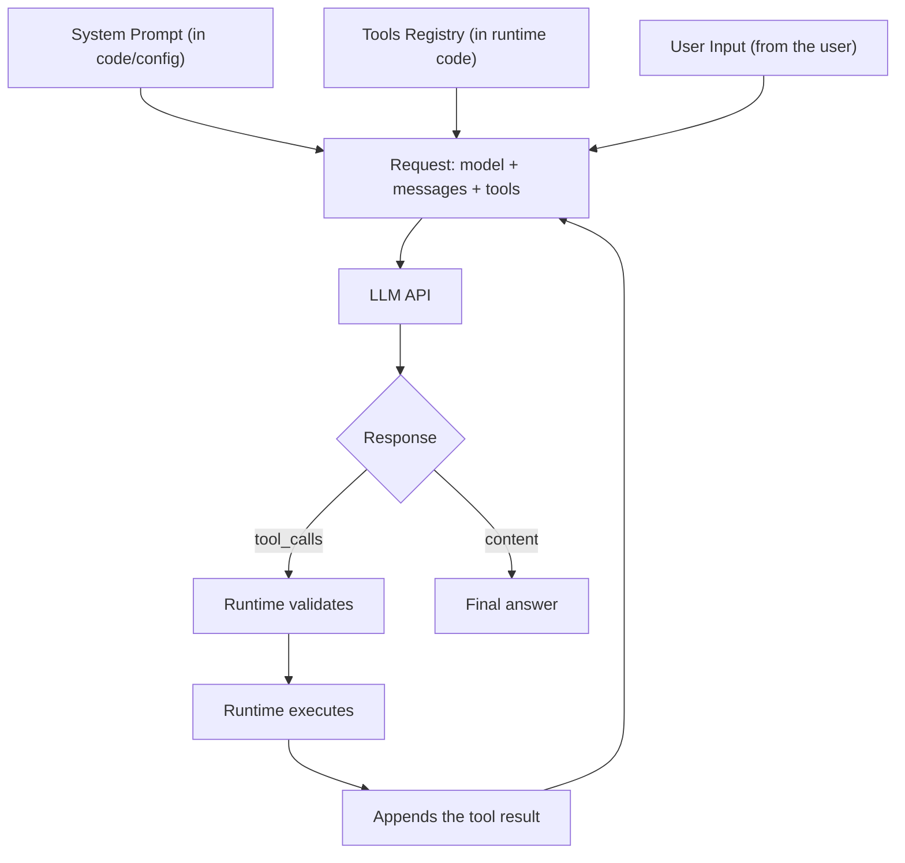

# 03. Tools and Function Calling — The Agent's "Hands"

> **A note on terminology:** this chapter uses "Function Calling" (the name of the mechanism in the API) and "Tool Call" (a specific tool invocation). They are the same thing: the mechanism by which an LLM returns a structured request to call a Go function. In agent code we usually say "tool", because it is a more general concept (a tool may be not only a Go function but also an API call, a shell command, etc.).

## Why does this matter?

Tools turn an LLM from a talker into a worker. Without tools an agent can only reply with text; it cannot interact with the real world.

Function Calling is the mechanism that gives the model access to real actions: calling Go functions, running commands, reading data.

### A real-world case

**Situation:** you built a chatbot for DevOps. The user writes: "Check the status of server web-01"

**Problem:** the bot cannot actually check the server. It only promises: "I will check the status of server web-01..." — but that's just text.

**Solution:** Function Calling lets the model call real Go functions. The model generates structured JSON with the function name and arguments; your code executes the function and returns the result back to the model.

> **Junior employee model.** An agent's list of tools is the "job description of a new employee". What you didn't give them, they cannot do; what you gave them, they can — and very quickly. A minimal set of roles, explicit `ReadOnly` / `Parallel` flags and a risk category for each tool is the same idea as for a human: "access only to what the job requires". See [Preface → The mental model](../00-preface/README.md#mental-model-an-agent-is-a-new-employee) and [Ch. 17: Security and Governance](../17-security-and-governance/README.md).

## The theory in plain words

### How does function calling work?

1. **You describe the function** in JSON Schema format
2. **The LLM sees the description** and decides: "I need to call this function"
3. **The LLM generates JSON** with the function name and arguments
4. **Your code parses the JSON** and executes the real function
5. **The result is returned** to the LLM for further processing

## Function Calling — How the Mechanism Works

**Function Calling** is the mechanism by which the LLM returns not text but structured JSON with a function name and arguments.

### The full cycle: from definition to execution

Let's walk through the **full cycle** using a `ping` tool as an example:

For the examples in this chapter we use neutral types layered over the native tool-calling API (OpenAI-compatible). This is exactly what goes into the HTTP request and comes back in the response — without binding to a specific SDK:

```go
// Tool description — goes into the "tools" field of the request.
type ToolDef struct {
    Name        string
    Description string
    Parameters  json.RawMessage // JSON Schema of the arguments
}

// A message in the history. Role: "system" | "user" | "assistant" | "tool".
type Message struct {
    Role       string
    Content    string
    ToolCallID string    // for role="tool": links the result to the call
    ToolCalls  []ToolCall // for role="assistant": generated calls
}

// A single tool call generated by the model.
type ToolCall struct {
    ID        string
    Name      string
    Arguments string // JSON string
}
```

#### Step 1: Defining the tool (tool schema)

```go
tools := []ToolDef{
    {
        Name:        "ping",
        Description: "Ping a host to check connectivity",
        Parameters: json.RawMessage(`{
            "type": "object",
            "properties": {
                "host": {
                    "type": "string",
                    "description": "Hostname or IP address to ping"
                }
            },
            "required": ["host"]
        }`),
    },
}
```

**What happens:** we describe the tool in JSON Schema format. This description is sent to the model along with the request.

#### Step 2: The request to the model

```go
messages := []Message{
    {Role: "system", Content: "You are a network admin. Use tools to check connectivity."},
    {Role: "user", Content: "Check if google.com is reachable"},
}

client, err := NewClient(...) // provider from the config (ch. 04)

req := Request{
    Model:       "glm-5.3",
    Messages:    messages,
    Tools:       tools,  // The model sees the tool descriptions!
    Temperature: 0.2, // quality: less variance in tool selection
}

resp, err := client.Complete(ctx, req) // the error is handled by the loop (ch. 04)
msg := resp.Choices[0].Message
```

`client.Complete` is a method of the neutral client; the full canonical types are in [chapter 04](../04-autonomy-and-loops/README.md).

**What happens:** the model sees:
- System prompt (the role and instructions)
- User input (the user's request)
- **Tools schema** (the descriptions of the available tools)

#### Step 3: The model's response (tool call)

The model **does not return text** like "I'll run a ping". It returns a **structured tool call**:

```go
// msg.ToolCalls contains:
[]ToolCall{
    {
        ID:        "call_abc123",
        Name:      "ping",
        Arguments: `{"host": "google.com"}`,
    },
}
```

**What happens:** the model **generated a tool_call** for the `ping` tool plus JSON with the arguments. There is no magic here: the model saw `Description: "Ping a host to check connectivity"` and matched it against the user's request.

**How does the model choose between several tools?**

Let's extend the example with a few more tools:

```go
tools := []ToolDef{
    {
        Name:        "ping",
        Description: "Ping a host to check network connectivity. Use this when user asks about network reachability or connectivity.",
    },
    {
        Name:        "check_http",
        Description: "Check HTTP status code of a website. Use this when user asks about website availability or HTTP errors.",
    },
    {
        Name:        "traceroute",
        Description: "Trace the network path to a host. Use this when user asks about network routing or path analysis.",
    },
}

userInput := "Check if google.com is reachable"
```

**The selection process:**

1. The model sees **all three tools** and their `Description`:
    - `ping`: "check network connectivity... Use this when user asks about network reachability"
    - `check_http`: "Check HTTP status... Use this when user asks about website availability"
    - `traceroute`: "Trace network path... Use this when user asks about routing"

2. The model matches the request "Check if google.com is reachable" against the descriptions:
    - [x] `ping` — the description contains "connectivity" and "reachability" → **it picks this one**
    - [ ] `check_http` — about HTTP status, not about network reachability
    - [ ] `traceroute` — about routing, not about reachability checks

3. The model returns a tool call for `ping`:
    ```json
    {"name": "ping", "arguments": "{\"host\": \"google.com\"}"}
    ```

**An example with a different request:**

```go
userInput := "Check whether the google.com site is responding"

// The model sees the same 3 tools
// It matches:
// - ping: about network reachability → not quite it
// - check_http: "Use this when user asks about website availability" → PICKS THIS ONE
// - traceroute: about routing → doesn't fit

// The model returns:
// {"name": "check_http", "arguments": "{\"url\": \"https://google.com\"}"}
```

**The point:** the model picks a tool based on the **semantic match** between the user's request and the `Description`. The more precise and specific the `Description`, the better the model picks the right tool.

#### What the LLM does vs. what the runtime does

**LLM (the model):**
- Sees the tool descriptions in `tools[]`
- Generates JSON with the tool name and arguments
- Returns a structured response in the `tool_calls` field

**Runtime (your code):**
- Parses `tool_calls` from the model's response
- Validates the tool name (does it exist?)
- Validates the argument JSON (is it well-formed?)
- Executes the real Go function
- Appends the result to the history (`messages[]`)
- Sends the updated history back to the model

**Important:** the LLM does not execute code. It only generates JSON with a request to execute. Your runtime executes the real code.

#### Step 4: Validation (runtime)

```go
// Check that the tool exists
if msg.ToolCalls[0].Name != "ping" {
    return fmt.Errorf("unknown tool: %s", msg.ToolCalls[0].Name)
}

// Validate the argument JSON
var args struct {
    Host string `json:"host"`
}
if err := json.Unmarshal([]byte(msg.ToolCalls[0].Arguments), &args); err != nil {
    return fmt.Errorf("invalid JSON: %v", err)
}

// Check required fields
if args.Host == "" {
    return fmt.Errorf("host is required")
}
```

**What happens:** the runtime validates the call before executing it. This is **critical** for security.

#### Step 5: Executing the tool

```go
func executePing(host string) string {
    cmd := exec.Command("ping", "-c", "1", host)
    output, err := cmd.CombinedOutput()
    if err != nil {
        return fmt.Sprintf("Error: %s", err)
    }
    return string(output)
}

result := executePing(args.Host)  // "PING google.com: 64 bytes from ..."
```

**What happens:** the runtime executes the **real function** (in this case the system `ping` command).

#### Step 6: Returning the result to the model

```go
// Append the result to the history as a message with role "tool"
messages = append(messages, Message{
    Role:       "tool",
    Content:    result,  // "PING google.com: 64 bytes from ..."
    ToolCallID: msg.ToolCalls[0].ID,  // Link it to the call
})

// Send the updated history to the model again
resp2, err := client.Complete(ctx, Request{
    Model:    "glm-5.3",
    Messages: messages,  // Now includes the tool result!
    Tools:    tools,
}) // the error is handled by the loop (ch. 04)
```

**What happens:** the model sees the result of the tool execution and can:
- Compose the final answer for the user
- Call another tool, if needed
- Ask a clarifying question

#### Step 7: The final answer

```go
finalMsg := resp2.Choices[0].Message
if len(finalMsg.ToolCalls) == 0 {
    // This is the final text answer
    fmt.Println(finalMsg.Content)  // "google.com is reachable, response time 10ms"
}
```

**What happens:** the model saw the `ping` result and composed a clear answer for the user.

## The End-to-end Protocol: a Full Request and Two Runs

Now let's walk through the **full protocol** from the point of view of an agent developer: where everything is stored, how the request is assembled, and how the runtime processes the responses.

### Where is what stored in the agent's code?



**The storage layout:**

1. **System Prompt** — stored in the agent's code (a constant or config):
    - Instructions (Role, Goal, Constraints)
    - Few-shot examples (if used)
    - SOP (the operating procedure)

2. **Tools Schema** — stored in the **runtime registry** (not in the prompt!):
    - Tool definitions (JSON Schema)
    - Tool handler functions
    - Validation and execution

3. **User Input** — comes from the user:
    - The current request
    - The conversation history (stored in `messages[]`)

4. **Tool Results** — generated by the runtime:
    - After the tool executes
    - Appended to `messages[]` with `Role = "tool"`

### The full protocol: JSON requests and responses (2 runs)

**Run 1: a request with several tools**

```json
{
  "model": "glm-5.3",
  "messages": [
    {
      "role": "system",
      "content": "You are a DevOps engineer. Use tools to check services.\n\nUsage examples:\nUser: \"Check the status of nginx\"\nAssistant: returns a tool_call check_status(\"nginx\")\n\nUser: \"Restart the server\"\nAssistant: returns a tool_call restart_service(\"web-01\")"
    },
    {
      "role": "user",
      "content": "Check the status of nginx"
    }
  ],
  "tools": [
    {
      "type": "function",
      "function": {
        "name": "check_status",
        "description": "Check if a service is running. Use this when user asks about service status.",
        "parameters": {
          "type": "object",
          "properties": {
            "service": {
              "type": "string",
              "description": "Service name"
            }
          },
          "required": ["service"]
        }
      }
    },
    {
      "type": "function",
      "function": {
        "name": "restart_service",
        "description": "Restart a systemd service. Use this when user explicitly asks to restart a service.",
        "parameters": {
          "type": "object",
          "properties": {
            "service_name": {
              "type": "string",
              "description": "Name of the service to restart"
            }
          },
          "required": ["service_name"]
        }
      }
    }
  ],
  "tool_choice": "auto"
}
```

**Where everything lives:**
- **System Prompt** (instructions + few-shot examples) → `messages[0].content`
- **User Input** → `messages[1].content`
- **Tools Schema** (2 tools with full JSON Schema) → the separate `tools[]` field

**Response #1 (tool call):**

```json
{
  "id": "chatcmpl-abc123",
  "choices": [{
    "message": {
      "role": "assistant",
      "content": null,
      "tool_calls": [
        {
          "id": "call_xyz789",
          "type": "function",
          "function": {
            "name": "check_status",
            "arguments": "{\"service\": \"nginx\"}"
          }
        }
      ]
    }
  }]
}
```

**The runtime processes the tool call:**
1. Validates: `tool_calls[0].function.name` exists in the registry
2. Parses: `json.Unmarshal(tool_calls[0].function.arguments)` → `{"service": "nginx"}`
3. Executes: `check_status("nginx")` → result: `"Service nginx is ONLINE"`
4. Appends the tool result to `messages[]`

**Run 2: Request with the tool result**

```json
{
  "model": "glm-5.3",
  "messages": [
    {
      "role": "system",
      "content": "You are a DevOps engineer. Use tools to check services.\n\nUsage examples:\nUser: \"Check the status of nginx\"\nAssistant: returns tool_call check_status(\"nginx\")\n\nUser: \"Restart the server\"\nAssistant: returns tool_call restart_service(\"web-01\")"
    },
    {
      "role": "user",
      "content": "Check the status of nginx"
    },
    {
      "role": "assistant",
      "content": null,
      "tool_calls": [
        {
          "id": "call_xyz789",
          "type": "function",
          "function": {
            "name": "check_status",
            "arguments": "{\"service\": \"nginx\"}"
          }
        }
      ]
    },
    {
      "role": "tool",
      "content": "Service nginx is ONLINE",
      "tool_call_id": "call_xyz789"
    }
  ],
  "tools": [
    {
      "type": "function",
      "function": {
        "name": "check_status",
        "description": "Check if a service is running. Use this when user asks about service status.",
        "parameters": {
          "type": "object",
          "properties": {
            "service": {
              "type": "string",
              "description": "Service name"
            }
          },
          "required": ["service"]
        }
      }
    },
    {
      "type": "function",
      "function": {
        "name": "restart_service",
        "description": "Restart a systemd service. Use this when user explicitly asks to restart a service.",
        "parameters": {
          "type": "object",
          "properties": {
            "service_name": {
              "type": "string",
              "description": "Service name to restart"
            }
          },
          "required": ["service_name"]
        }
      }
    }
  ]
}
```

**Where everything lives:**
- **System Prompt** → `messages[0].content` (same as before)
- **User Input** → `messages[1].content` (same as before)
- **Tool Call** → `messages[2]` (added by the runtime after the first response)
- **Tool Result** → `messages[3].content` (added by the runtime after execution)
- **Tools Schema** → the `tools[]` field (same as before)

**Response #2 (the final answer):**

```json
{
  "id": "chatcmpl-def456",
  "choices": [{
    "message": {
      "role": "assistant",
      "content": "nginx is running fine, the service is ONLINE",
      "tool_calls": null
    }
  }]
}
```

### Evolution of the messages[] array (JSON)

**Before the first request:**
```json
[
  {"role": "system", "content": "You are a DevOps engineer..."},
  {"role": "user", "content": "Check the status of nginx"}
]
```

**After the first request (the runtime adds the tool call):**
```json
[
  {"role": "system", "content": "You are a DevOps engineer..."},
  {"role": "user", "content": "Check the status of nginx"},
  {
    "role": "assistant",
    "content": null,
    "tool_calls": [{
      "id": "call_xyz789",
      "type": "function",
      "function": {
        "name": "check_status",
        "arguments": "{\"service\": \"nginx\"}"
      }
    }]
  }
]
```

**After the tool executes (the runtime adds the tool result):**
```json
[
  {"role": "system", "content": "You are a DevOps engineer..."},
  {"role": "user", "content": "Check the status of nginx"},
  {
    "role": "assistant",
    "content": null,
    "tool_calls": [{
      "id": "call_xyz789",
      "type": "function",
      "function": {
        "name": "check_status",
        "arguments": "{\"service\": \"nginx\"}"
      }
    }]
  },
  {
    "role": "tool",
    "content": "Service nginx is ONLINE",
    "tool_call_id": "call_xyz789"
  }
]
```

**After the second request (the model sees the tool result and formulates an answer):**
- The model sees the full context (system + user + tool call + tool result)
- It generates the final answer: `"nginx is running fine, the service is ONLINE"`

**Note:** For a Go implementation, see the examples in [Lab 02: Tools](https://github.com/kshvakov/ai-agent-course/tree/main/labs/lab02-tools) and [Lab 04: Autonomy](https://github.com/kshvakov/ai-agent-course/tree/main/labs/lab04-autonomy).

> **Note:** labs 02 and 04 are revised to the neutral client; the canonical material remains in this chapter.

### Key takeaways for the developer

1. **The System Prompt and the Tools Schema are different things:**
    - The system prompt is the text in `Messages[0].Content` (it may contain few-shot examples)
    - The tools schema is a separate `Tools` field in the request (JSON Schema)

2. **Few-shot examples live inside the system prompt:**
    - This is text showing the model the response format or how to pick tools
    - It is distinct from the tools schema (which describes the structure of the tools)

3. **The runtime drives the loop:**
    - Validates the `tool_calls`
    - Executes the tools
    - Appends the results to `messages`
    - Sends the next request

4. **Tools are not "inside the prompt":**
    - In the API they are passed as a separate `Tools` field
    - The model sees them alongside the prompt, but they are different parts of the request

For how to write instructions and examples, see **[Chapter 02: Prompting](../02-prompt-engineering/README.md)**

Practice: **[Lab 02: Tools](https://github.com/kshvakov/ai-agent-course/tree/main/labs/lab02-tools)**, **[Lab 04: Autonomy](https://github.com/kshvakov/ai-agent-course/tree/main/labs/lab04-autonomy)**

### What actually happens?

**In short:**

1. **The model sees the descriptions of ALL tools** — it doesn't "know" about the tools out of the box; it sees their `Description` in the JSON Schema. The model picks a tool by matching the user's request against the descriptions.

2. **The selection mechanism is semantics-based** — the model looks for a match between:
    - The user's request ("Check availability")
    - The tool description ("Use this when user asks about network reachability")
    - The context of previous results (if any)

3. **The model returns structured JSON** — not text like "I'll call ping", but a concrete tool call with the tool name and arguments

4. **The runtime does all the work** — parsing, validation, execution, returning the result

5. **The model sees the result** — it receives the result as a new message in the history and continues working

**Example of choosing between similar tools:**

```go
tools := []ToolDef{
    {
        Name:        "check_service_status",
        Description: "Check if a systemd service is running. Use this for Linux services like nginx, mysql, etc.",
    },
    {
        Name:        "check_http_status",
        Description: "Check HTTP response code of a web service. Use this for checking if a website or API is responding.",
    },
}

// Request 1: "Check the status of nginx"
// The model picks: check_service_status (nginx is a systemd service)

// Request 2: "Check whether the site example.com responds"
// The model picks: check_http_status (a website is an HTTP service)
```

**Note:** If tool descriptions are too similar or unclear, the model may pick the wrong tool. That's why `Description` must be **specific and distinguishable**. The full tool definition with the argument schema is in "Step 1" above; the full walkthrough of the JSON protocol is in the "The end-to-end protocol" section.

**The main point:** `Description` is the most important field! The LLM relies on it when deciding which tool to call.

## The Cost of Tools in Context

The `tools` block is not a one-time setting: it is sent **with every request** of the loop and paid for in tokens every time. As a rule of thumb, 4 compact tools already cost ~742 tokens — and that's just the schema, before the system prompt and history.

Practical consequences:

- **`Description` is the most important field, and also the most expensive line.** Every word in it is paid for on every run. Write densely: what the tool does, when to pick it, what it returns. Strike out anything that doesn't help the model choose.
- **Check the budget before adding each tool.** A new tool must justify its tokens: if the model calls it once per hundred tasks, it probably doesn't belong in the permanent set (see the section "Many tools ≠ you need a catalog of them" in [Chapter 06: RAG](../06-rag/README.md)).
- **The number and size of descriptions is design question #1.** More than 20 tools with long descriptions is a signal to rethink the design: perhaps you don't need tool wrappers but skills and `exec` with progressive disclosure (see [Chapter 09: Agent Architecture](../09-agent-architecture/README.md) and [Chapter 06: RAG](../06-rag/README.md)).

> **How the real SDK does it.** Descriptions are not written by hand: a tool is declared via a typed constructor, and the JSON Schema is generated from the Go input struct — the schema and the code simply cannot drift apart. The execution result is an object with two versions of the content: the full one for the UI and audit, and a filtered one for the model.

## Tool Examples Across Domains

Tools from different domains are built the same way — only the `Description` and the argument schema change. A summary of typical examples:

| Domain | Tool | Description gist | Note |
|-------|------------|---------------|-------------|
| DevOps | `check_service_status` | Check if a systemd service is running | read-only |
| DevOps | `restart_service` | Restart a systemd service | downtime — requires confirmation |
| DevOps | `read_logs` | Read the last N lines of service logs | read-only |
| Support | `search_kb` | Search knowledge base for solutions | read-only |
| Support | `draft_reply` | Draft a reply to the ticket | draft, not sending |
| Data | `sql_select` | Execute a SELECT query on the database | SELECT-only enforced in code, not in words |
| Data | `describe_table` | Get table schema and column information | read-only |
| Security | `query_siem` | Query security events | read-only |
| Security | `isolate_host` | Isolate a host from the network | destructive — requires confirmation |

Two examples where the wording of `Description` decides everything:

```go
// DevOps: a destructive operation — the description explains the consequences
{
    Name:        "restart_service",
    Description: "Restart a systemd service. This interrupts the service and may cause downtime for users; the tool returns the new service status.",
    Parameters:  `{"service_name": "string"}`,
}

// Security: a dangerous tool — the description says what it does and why it requires confirmation
{
    Name:        "isolate_host",
    Description: "Cut a host off from the network to contain an active security incident. This severs all connections on the host; execution requires confirmation through the agent's Confirm mechanism.",
    Parameters:  `{"host": "string"}`,
}
```

Note that confirmation for `isolate_host` is enforced by the **runtime code** (the Confirm callback and the mandatory `confirmed_by` argument), not by a plea in the Description. For a detailed treatment see [Chapter 05: Safety and HITL](../05-safety-and-hitl/README.md); the full collection of tools by domain is in [Chapter 15: Case Studies](../15-case-studies/README.md).

## Handling Tool Errors

If a tool returns an error, the agent must see it and handle it.

**Example:**

```go
// The agent calls ping("nonexistent-host")
result := ping("nonexistent-host")
// result = "Error: Name or service not known"

// Append the error to the history
messages = append(messages, Message{
    Role:       "tool",
    Content:    result,  // The model will see the error!
    ToolCallID: call.ID,
})

// The model receives the error and can:
// 1. Try a different host
// 2. Report the problem to the user
// 3. Escalate the issue
```

**Remember:** an error is a result too! Don't hide errors from the model.

## Validating Tool Calls

Before executing a tool, you need to validate its arguments.

**Validation example:**

```go
func executeTool(name string, args json.RawMessage) (string, error) {
    switch name {
    case "restart_service":
        var params struct {
            ServiceName string `json:"service_name"`
        }
        if err := json.Unmarshal(args, &params); err != nil {
            return "", fmt.Errorf("invalid args: %v", err)
        }
        
        // Validation
        if params.ServiceName == "" {
            return "", fmt.Errorf("service_name is required")
        }
        
        // Security check: allowlist, not denylist.
        // We explicitly list what may be restarted; everything else is rejected.
        var allowedServices = map[string]bool{
            "nginx":    true,
            "redis":    true,
            "worker":   true,
        }
        if !allowedServices[params.ServiceName] {
            return "", fmt.Errorf("service %q is not in the restart allowlist; restart is permitted only for explicitly allowed services", params.ServiceName)
        }
        
        return restartService(params.ServiceName), nil
    }
    return "", fmt.Errorf("unknown tool: %s", name)
}
```

## Repairing Tool-Call Arguments (When the JSON/schema is Invalid)

In production this happens regularly: the model sometimes returns:

- syntactically invalid JSON (a missing `}`, broken quotes, etc.),
- valid JSON that **fails** your JSON Schema (wrong fields/types).

Fix the first category deterministically — **with a resilient parser such as `jsonrepair`** — before giving up on the model. Typical breakages (trailing commas, single quotes, unclosed brackets, wrapping in a ```json fence) are fixed by the parser without an LLM call:

```go
args := call.Arguments
if !json.Valid([]byte(args)) {
    repaired, err := jsonrepair.Repair(args) // deterministic repair
    if err != nil {
        // couldn't repair — return a clear error message as the result for the model
        return "Error: invalid arguments JSON, re-send as valid JSON matching the schema", nil
    }
    args = repaired
}
// then the usual validation: json.Unmarshal + schema check
```

If the JSON is syntactically sound but fails the schema, you can return the error to the model once, with the schema text, and ask it to retry the call. The key rule: repair **does not change the intent**, it fixes the format.

> **How the real SDK does it.** Sometimes the model "leaks": it emits a tool call as plain text in `content` instead of the `tool_calls` field. Mature SDKs include recovery parsers that recognize such leaked calls in the text and reconstruct them into full-fledged tool calls. This is a fallback path for model glitches, not the normal mode of operation — don't design around it.

## Tool Descriptions in .md Files

In production agents, tool descriptions are stored **in separate .md files**, not in Go code:
```
internal/agent/tool/
├── read/
│   ├── read.go          // implementation
│   └── read.md          // description for the LLM
├── edit/
│   ├── edit.go
│   └── edit.md
└── exec/
    ├── exec.go
    └── exec.md
```

The description is loaded via `go:embed`:

```go
import _ "embed"

//go:embed read.md
var description string

type ReadTool struct{}

func (t *ReadTool) Name() string        { return "read" }
func (t *ReadTool) Description() string { return description }
```

Advantages:
- **Markdown is easier to edit** — you don't need to touch Go code to improve the description
- **Descriptions get reviewed separately from code** — a product manager can improve a description without knowing Go
- **Single Source of Truth** — `Tool.Description()` is the only source of the description

### Anti-pattern: duplicate description

A common mistake: the tool description is duplicated in the system prompt **and** in the API tool definitions. The model receives contradictory instructions:

```
// In system.md (system prompt):
"ALWAYS use ask tool to ask questions. Never write questions as plain text."

// In ask.Description() (tool definition):
"Use ONLY when you need the user to pick from options. For free-text, just ask in your message."
```

The model receives **mutually exclusive** instructions. For raw providers (Qwen, DeepSeek) the description may end up in **three** places: system prompt + tool definition + `<tools>` injection.

**Rule:** the system prompt contains **behavior rules and workflow**, but **not tool descriptions**. Descriptions go only through the Tool API.

## Fallbacks Instead of Routing

### When you do NOT need different models

This is the core of the section, so let's start with it:

- **Prototype / MVP:** one model is simpler. Optimize later.
- **Few calls:** if the agent makes 1-2 calls a day, the savings won't justify the complexity.
- **Critical consistency:** some tasks require the same model to "remember" its reasoning between iterations. Switching models can break the chain of reasoning.

For the main agent loop, pick **one** model (GLM-5.3 or Fable 5.1) and don't overcomplicate things.

### Why stage-based routing is over-engineering

The idea of "a cheap model for tool selection, a powerful one for analyzing results" sounds reasonable, but in practice it breaks the agent:

1. **It kills the prompt cache.** Each model has its own prompt cache. Switching models within a single run resets the cacheable prefix (system prompt + tools + history) — and that prefix is exactly what gives you the main savings in long loops. The savings on the "cheap iteration" turn into paying for the full prefix again.
2. **It makes testing harder.** Agent behavior starts to depend on which model handled which iteration. Reproducing a bug becomes much harder.
3. **A stage cannot be predicted.** You don't know in advance whether the model will call a tool or answer with text — the "router" is just guessing anyway.

### The right shape: primary + explicit fallbacks

Instead of stage-based routing — one primary model and an **explicit list of fallbacks**. On a transient error (timeout, 429/5xx) or context overflow, the request is retried against the fallback model:

```go
type ModelConfig struct {
    Primary  string   // the main model of the loop
    Fallbacks []string // fallbacks, in order
}

cfg := ModelConfig{
    Primary:   "glm-5.3",
    Fallbacks: []string{"fable-5.1"}, // a different model, same tool-calling protocol
}
```

Rules:

- each fallback triggers **at most once per run** — otherwise the agent will get stuck looping on repeated errors;
- fallbacks are about availability (transient errors, context overflow), not about "saving on a simple iteration";
- all models in the chain must support the same tools protocol, so `messages[]` can be carried over without conversion.

### Where the cheap model belongs

A cheap model (GLM-5.3 Flash) belongs not in the main loop but at **auxiliary nodes outside it** — places with no long cacheable prefix where the task really is simple:

- classification of incoming requests,
- structured output for field extraction.

Condense is the exception: summarization runs on the same model with the same cacheable prefix, so the head is read from a warm cache ([ch. 20](../20-cost-latency-engineering/README.md), [ch. 13](../13-context-engineering/README.md)).

The main loop — GLM-5.3 or Fable 5.1; auxiliary nodes — GLM-5.3 Flash.

For more on cost and optimization, see [Chapter 20: Cost & Latency Engineering](../20-cost-latency-engineering/README.md).

## Common Mistakes

### Mistake 1: The model doesn't generate a tool_call

**Symptom:** The agent receives a text response from the model instead of `tool_calls`. The model answers with text instead of calling a tool.

**Cause:**
- The model wasn't trained on function calling
- Poor tool description (unclear `Description`)
- `Temperature` too high — worse instruction following during tool selection

**Fix:**
```go
// GOOD: Use a model with tools support
// Check via Lab 00: Capability Check

// GOOD: Improve the Description
Description: "Check the status of a server by hostname. Use this when user asks about server status or availability."

// GOOD: Low Temperature — quality, less variance in tool selection
Temperature: 0.2,
```

### Mistake 2: Broken JSON in arguments

**Symptom:** `json.Unmarshal` returns an error. The JSON in the arguments is invalid.

**Cause:** The model generates invalid JSON (missing brackets, wrong format).

**Fix:**
```go
// GOOD: Validate the JSON before parsing
if !json.Valid([]byte(call.Arguments)) {
    return "Error: Invalid JSON", nil
}

// GOOD: Low Temperature — fewer errors in JSON generation
Temperature: 0.2,
```

### Mistake 3: Tool hallucinations

**Symptom:** The agent calls a tool that doesn't exist. The model generates a tool_call with a name that isn't in the list.

**Cause:** The model doesn't see a clear list of available tools, or the list is too large.

**Fix:**
```go
// GOOD: Validate the tool name before executing
allowedFunctions := map[string]bool{
    "get_server_status": true,
    "ping":              true,
}
if !allowedFunctions[call.Name] {
    return "Error: Unknown function", nil
}
```

**Note:** If you have a large tool space (hundreds or thousands), reconsider the design first: skills + exec instead of a catalog of wrappers (see [Chapter 06: RAG](../06-rag/README.md)). **Tool retrieval** — dynamically selecting relevant tools before planning — is a last resort for when tools are genuinely diverse and numerous.

### Mistake 4: Poor tool description

**Symptom:** The model picks the wrong tool, or doesn't pick one at all.

**Cause:** The `Description` is too generic or lacks keywords from the user's request.

**Fix:**
```text
// BAD:
Description: "Ping a host"

// GOOD:
Description: "Ping a host to check network connectivity. Use this when user asks about network reachability or connectivity."
```

### Mistake 5: Duplicated tool description

**Symptom:** The model behaves unpredictably — sometimes it uses the tool, sometimes it writes the question as text. Different providers show different behavior.

**Cause:** The tool description is duplicated in the system prompt and in the tool definition. The descriptions contradict each other.

**Fix:**
```go
// BAD: description in two places
systemPrompt := "Use read tool to read files. Always read before editing."
readTool := Tool{Description: "Read a file from the filesystem. Returns file content."}

// GOOD: description only in the tool definition
systemPrompt := "Before editing, always read the file first." // a rule, not a description
readTool := Tool{Description: "Read a file. Returns content with line numbers."}
```

## Exercises

### Exercise 1: Create a tool

Create a `check_disk_usage` tool that checks disk usage:

```go
tools := []ToolDef{
    {
        Name:        "check_disk_usage",
        Description: "...",  // Your code here
        Parameters:  json.RawMessage(`{
            // Your code here
        }`),
    },
}
```

**Expected result:**
- `Description` contains the keywords: "disk", "usage", "space"
- The JSON Schema is correct
- Required fields are listed in `required`

### Exercise 2: Argument validation

Implement an argument validation function for a tool:

```go
func validateToolCall(call ToolCall) error {
    // Check the tool name
    // Check the JSON validity
    // Check the required fields
}
```

**Expected result:**
- The function returns an error if the tool name is unknown
- The function returns an error if the JSON is invalid
- The function returns an error if required fields are missing

## Acceptance Criteria / Checklist

**Passed:**
- [x] `Description` is concrete and clear (contains keywords)
- [x] The JSON Schema is correct
- [x] Required fields are listed in `required`
- [x] Argument validation is implemented
- [x] Errors are handled and returned to the agent
- [x] Critical tools require confirmation
- [x] The model successfully generates a tool_call

**Failed:**
- [ ] The model doesn't generate a tool_call (poor description or unsuitable model)
- [ ] JSON in arguments is broken (no validation)
- [ ] The model calls a non-existent tool (no name validation)
- [ ] `Description` is too generic (the model can't pick the right tool)
- [ ] The tool description is duplicated in the system prompt and the tool definition

## Relation to Other Chapters

- **LLM physics:** Why the model chooses a tool call instead of text — see [Chapter 01: LLM Fundamentals](../01-llm-fundamentals/README.md)
- **Prompting:** How to describe tools so the model uses them correctly — see [Chapter 02: Prompt Engineering](../02-prompt-engineering/README.md)
- **The loop:** How tool results are returned to the model — see [Chapter 04: Autonomy](../04-autonomy-and-loops/README.md)
- **MCP:** The standard protocol for connecting tools to agents — [Model Context Protocol](https://modelcontextprotocol.io/). Details in [Chapter 18: Tool Protocols](../18-tool-protocols-and-servers/README.md)

## Full Example: a Compact Working Loop

The full walkthrough of the JSON protocol (requests, responses, the evolution of `messages[]`) was already given above in the "End-to-end protocol" section — here is just a compact working loop on the neutral types from the beginning of the chapter:

```go
// Agent loop with a single tool. client is a neutral client (ch. 04):
// Complete is a call to your LLM provider
// (OpenAI-compatible tool-calling endpoint).
func runAgent(ctx context.Context, client Client) error {
    tools := []ToolDef{{
        Name:        "check_status",
        Description: "Check the status of a server by hostname. Use this when user asks about server status.",
        Parameters:  json.RawMessage(`{"type":"object","properties":{"hostname":{"type":"string","description":"Server hostname"}},"required":["hostname"]}`),
    }}

    messages := []Message{
        {Role: "system", Content: "You are a DevOps engineer. Use tools to check services."},
        {Role: "user", Content: "Check the status of server web-01"},
    }

    for i := 0; i < 10; i++ {
        resp, err := client.Complete(ctx, Request{
            Model:       "glm-5.3",
            Messages:    messages,
            Tools:       tools,
            Temperature: 0.2, // quality: less variance in tool selection
        })
        if err != nil {
            return fmt.Errorf("LLM call failed: %w", err)
        }

        msg := resp.Choices[0].Message
        messages = append(messages, msg)

        if len(msg.ToolCalls) == 0 { // final answer
            fmt.Println("Agent:", msg.Content)
            return nil
        }

        for _, call := range msg.ToolCalls { // runtime: validate and execute
            result := executeTool(call) // an error is a result too, for the model
            messages = append(messages, Message{
                Role:       "tool",
                Content:    result,
                ToolCallID: call.ID,
            })
        }
    }
    return fmt.Errorf("iteration limit reached")
}

func executeTool(call ToolCall) string {
    if call.Name != "check_status" {
        return fmt.Sprintf("Error: unknown tool %s", call.Name)
    }
    var args struct {
        Hostname string `json:"hostname"`
    }
    if err := json.Unmarshal([]byte(call.Arguments), &args); err != nil {
        return fmt.Sprintf("Error: invalid arguments: %v", err)
    }
    return fmt.Sprintf("Server %s is ONLINE", args.Hostname) // in real life — an API or a command
}
```

**Running it:** `go run main.go` — the key and endpoint of your LLM provider are set via environment variables.

## What's Next?

Once you've covered tools, move on to:
- **[04. Autonomy and Loops](../04-autonomy-and-loops/README.md)** — how the agent works in a loop
