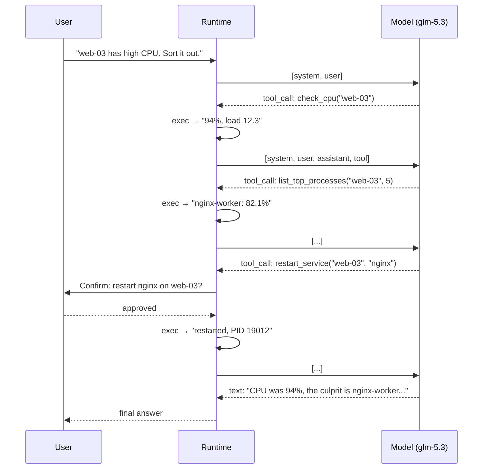

# 04. Autonomy and Loops — ReAct Loop

## Why does this matter?

In this chapter we implement the **ReAct (Reason + Act)** pattern — the heart of an autonomous agent.

Without an autonomous loop, an agent works like a chatbot: one request → one response. With an autonomous loop, the agent can perform 10 actions in a row to solve a single task, making its own decisions based on the results of previous actions.

### A real-world case

**Situation:** The user writes: "I've run out of disk space on the server. Deal with it."

**Without an autonomous loop:**
- Agent: "I'll check disk usage" → calls `check_disk` → gets "95%"
- Agent: [Stops, waits for the user's next command]

**With an autonomous loop:**
- Agent: "I'll check disk usage" → calls `check_disk` → gets "95%"
- Agent: "The disk is full. I'll clean up the logs" → calls `clean_logs` → gets "Freed 20GB"
- Agent: "Let me check again" → calls `check_disk` → gets "40%"
- Agent: "Done! Freed 20GB."

**The difference:** The agent decides what to do next on its own, based on the results of its previous actions.

> **The junior employee model.** The iteration limit of the loop is "time until you escalate to your senior." If a new employee bangs their head against the same problem 20 times in a row without success, they must call the team lead — not "try one more time." An agent works the same way: once the limit is reached, hand control back to a human instead of trying "just a bit more." See [Preface → Mental model](../00-preface/README.md#mental-model-an-agent-is-a-new-employee) and [Ch. 17: Security and Governance](../17-security-and-governance/README.md).

## The theory in plain words

### The ReAct loop (the loop of autonomy)

**ReAct** stands for **Reason + Act**. It is a pattern in which the agent:
1. **Reasons:** Analyzes the situation and decides what to do
2. **Acts:** Performs an action (calls a tool)
3. **Observes:** Sees the result of the action
4. **Repeats:** Reasons again based on the result

There is no magic here — it is simply a loop where the model sees the results of previous actions in its context and generates the next step.

An autonomous agent works in a loop:

```
While (task not solved):
  1. Send the history to the LLM
  2. Get a response
  3. IF it is text → Show it to the user and wait for new input
  4. IF it is a tool call →
       a. Execute the tool
       b. Add the result to the history
       c. GOTO 1 (without asking the user anything!)
```

**The essence:** Step 4.c is what creates the feeling of "magic": the agent looks at the result and decides what to do next. But it is not real magic: the model sees the tool result in its context (`messages[]`) and generates the next step based on that context.

### Freedom inside the run, boundaries on the outside

Before looking at the code, let's pin down the main rule of autonomy:

- **Inside the run, the model is free.** Which tool to call, what to check, when to finish — the model decides based on context. The runtime does not hint at the "correct next step."
- **The boundaries sit on the outside.** The run deadline, the iteration limit, the tool allowlist, host permissions — these are invariants enforced by **code**, not by the prompt. The model cannot bypass them because they are not its to control.

### Closing the loop

After executing a tool we **do not ask the user** what to do next. We send the result back to the LLM. The model sees the result of its own actions and decides what to do next.

### Magic vs. reality: how the loop works

**Magic (the usual explanation):**
> The agent decided on its own to call `clean_logs()` after checking the disk

**Reality (what actually happens):**

**Iteration 1: The first request**

```go
client, err := NewClient(...) // provider from config; the Client interface is below in this chapter

// messages before the first iteration (neutral types from ch. 03)
messages := []Message{
    {Role: "system", Content: "You are an autonomous DevOps agent."},
    {Role: "user", Content: "Out of disk space."},
}

// Send to the model
resp1, err := client.Complete(ctx, Request{
    Model:       "glm-5.3",
    Messages:    messages,
    Tools:       tools,
    Temperature: 0.2, // quality: less variance in tool selection
}) // the error is handled by the loop below

msg1 := resp1.Choices[0].Message
// msg1.ToolCalls = [{ID: "call_1", Name: "check_disk_usage", Arguments: "{}"}]

// Append the assistant's response to the history
messages = append(messages, msg1)
// messages now contains:
// [system, user, assistant(tool_call: check_disk_usage)]
```

**Iteration 2: Executing the tool and returning the result**

```go
// Execute the tool
result1 := checkDiskUsage()  // "95% usage"

// Append the result as a message with the "tool" role
messages = append(messages, Message{
    Role:       "tool",
    Content:    result1,  // "95% usage"
    ToolCallID: "call_1",
})
// messages now contains:
// [system, user, assistant(tool_call), tool("95% usage")]

// Send the UPDATED history to the model again
resp2, err := client.Complete(ctx, Request{
    Model:    "glm-5.3",
    Messages: messages,  // The model sees the check_disk_usage result!
    Tools:    tools,
}) // the error is handled by the loop below

msg2 := resp2.Choices[0].Message
// msg2.ToolCalls = [{ID: "call_2", Name: "clean_logs", Arguments: "{}"}]

messages = append(messages, msg2)
// messages now contains:
// [system, user, assistant(tool_call_1), tool("95%"), assistant(tool_call_2)]
```

**Iteration 3: The second tool**

```go
// Execute the second tool
result2 := cleanLogs()  // "Freed 20GB"

messages = append(messages, Message{
    Role:       "tool",
    Content:    result2,  // "Freed 20GB"
    ToolCallID: "call_2",
})
// messages now contains:
// [system, user, assistant(tool_call_1), tool("95%"), assistant(tool_call_2), tool("Freed 20GB")]

// Send again
resp3, err := client.Complete(ctx, Request{
    Model:    "glm-5.3",
    Messages: messages,  // The model sees both results!
    Tools:    tools,
}) // the error is handled by the loop below

msg3 := resp3.Choices[0].Message
// msg3.ToolCalls = []  // Empty! The model decided to respond with text
// msg3.Content = "I've cleaned the logs, there is enough space now."

// This is the final answer — exit the loop
```

**What is actually happening:**

1. **The model sees the whole history** — it does not "remember" the past, it sees it in `messages[]`
2. **The model sees the tool result** — the result is appended as a new message with the `tool` role
3. **The model decides based on context** — seeing "95% usage", the model understands it needs to free up space
4. **The runtime drives the loop** — the code checks `len(msg.ToolCalls)` and decides whether to continue the loop

**The essence:** The model did not "decide on its own" — it saw the result of `check_disk_usage` in its context and generated the next tool call based on that context.

> **Prompt cache.** The system prompt is identical across all iterations — it is the cacheable prefix ([Ch. 02](../02-prompt-engineering/README.md#the-system-prompt-is-a-cacheable-prefix)). The `tools` block, however, is sent — and **billed — on every request**, so bloated tool descriptions get more expensive with each iteration. Change the system prompt between iterations and you break the cache, paying the full rate for the entire prefix.

### Visualization: who does what?

**The model (LLM):** sees in its context the system prompt, the user's messages, the tool schemas, and the results of past calls. It generates **only JSON** tool calls — it does not execute code.

**The runtime (your Go code):** receives the tool call, checks it against the allowlist, executes the real function, appends the result to `messages[]`, and sends the history back to the model. It also holds the boundaries: limits, deadline, permissions.

**The essence:** The LLM does not "remember" the past. It sees it in `messages[]`, which the runtime assembles. Each next step is just one more request with a slightly grown history.

## Implementing the Loop

A minimal working loop using the neutral types from [Chapter 03](../03-tools-and-function-calling/README.md):

```go
const maxIterations = 10

client, err := NewClient(...) // provider from config; the Client interface is below in this chapter

for i := 0; i < maxIterations; i++ {
    // 1. Send the request
    resp, err := client.Complete(ctx, Request{
        Model:       "glm-5.3",
        Messages:    messages,
        Tools:       tools,
        Temperature: 0.2, // quality: less variance in tool selection
    })
    if err != nil {
        return fmt.Errorf("iteration %d: %w", i, err)
    }

    msg := resp.Choices[0].Message
    messages = append(messages, msg) // Save the response

    // 2. A response without tool_calls — the model has wrapped up the run
    if len(msg.ToolCalls) == 0 {
        fmt.Println("Agent:", msg.Content)
        break
    }

    // 3. Execute the tools
    for _, call := range msg.ToolCalls {
        result := executeTool(call.Name, call.Arguments)

        // 4. Append the result to the history
        messages = append(messages, Message{
            Role:       "tool",
            Content:    result,
            ToolCallID: call.ID,
        })
    }
    // The loop continues automatically!
    // No magic: we send the updated history (with the tool result)
    // back to the model, and the model sees the result and decides what to do next
}
```

Note how the history grows: every iteration with tool calls adds **two** messages (assistant + tool). Input tokens grow from iteration to iteration — the entire previous history is sent again. This is exactly why long runs require condensing the history, and why the token budget is a run-level boundary, not a "hint to the model" (more on that below).

### Handling errors inside the loop

**Important:** Don't forget to handle errors and add them to the history! If a tool fails, the LLM must learn about it and try something else.

**Proper error handling:**

```go
for _, call := range msg.ToolCalls {
    result, err := executeTool(call.Name, call.Arguments)

    if err != nil {
        // An error is a result too! Add it to the history
        result = fmt.Sprintf("Error: %v", err)
    }

    // Append the result (or the error) to the history
    messages = append(messages, Message{
        Role:       "tool",
        Content:    result, // The model will see the error!
        ToolCallID: call.ID,
    })
}
```
**What happens:**

1. The tool returns an error: `Error: connection refused`
2. The error is added to the history as the tool result
3. The model sees the error in its context
4. The model can:
    - Try a different tool
    - Tell the user about the problem
    - Escalate the issue

**Example:**

```
Iteration 1:
Action: check_database_status("prod")
Observation: Error: connection refused

Iteration 2 (the model sees the error):
Thought: "The database is unreachable. Let me check network connectivity"
Action: ping_host("db-prod.example.com")
Observation: "Host is unreachable"

Iteration 3:
Thought: "The network is down. I'll tell the user about the problem"
Action: [Final answer] "The database is unreachable. Check network connectivity."
```

**Anti-pattern:** Don't hide errors from the model!

```go
// BAD: Hiding the error
if err != nil {
    log.Printf("Error: %v", err) // Only to the log
    continue                     // Skip the tool
}

// GOOD: Show the error to the model
if err != nil {
    result := fmt.Sprintf("Error: %v", err)
    messages = append(messages, Message{
        Role: "tool", Content: result, ToolCallID: call.ID,
    })
}
```

## The Right Shape for a Runtime: Config + Run

The raw `for` loop above is good for understanding, but in production it quickly accumulates `if`s: add a confirmation here, parallel calls there, interleaving over there, condensation here... The right shape is **a flat run configuration + a single Run on top of it**. Every control point of the loop becomes a field of one struct:

```go
// Tool — a tool of the run: definition (ch. 03) plus permissions.
type Tool struct {
    Def      ToolDef // name, description, parameters
    ReadOnly bool    // only reads state — a candidate for parallel execution
    Parallel bool    // explicitly allowed to run in parallel
    Confirm  bool    // requires human confirmation (ch. 05)
    Category Category // risk scale: the mechanics of confirmations (ch. 05)
}

// Category — the tool's risk scale (ch. 05): it is defined by the mechanics,
// not by the model's self-assessment.
type Category int

const (
    CategoryReadOnly     Category = iota // read, list, search — auto-execute
    CategoryMutating                     // write, edit, restart — Confirm
    CategoryDestructive                  // drop, delete — dry run + Confirm + confirmed_by
)

// Limits — the run boundaries. All three are terminal.
type Limits struct {
    MaxIterations int           // iteration limit
    Deadline      time.Duration // run deadline (~1 hour in production)
    TokenBudget   int           // token budget per run
}
```

And here is the neutral client itself, shared by all chapters of the course:

```go
// Client — a neutral provider interface: two methods are enough.
type Client interface {
    Complete(ctx context.Context, req Request) (*Response, error)
    Stream(ctx context.Context, req Request) (Stream, error)
}

// Stream — an iterator over the deltas of a streaming response (used in ch. 20).
type Stream interface {
    Recv() (Delta, error) // Delta{Text string}; at the end — io.EOF
    Close() error
}

// Request — a single request to the model.
type Request struct {
    Model       string
    Messages    []Message
    Tools       []ToolDef
    Temperature float64 // generation quality: 0.0–0.3 for agent loops (ch. 01)
}

// Response — the shape of the real wire protocol: the model's answer in Choices[0].Message.
type Response struct {
    Choices []Choice
    Usage   Usage
}

// Usage — token usage as counted by the provider. The primary source
// of numbers for the budget (ch. 13): PromptTokens is ground truth, your own estimates are the fallback.
type Usage struct {
    PromptTokens     int
    CompletionTokens int
    CacheReadTokens  int // prompt cache hit: > 0 means the prefix came from cache
}

type Choice struct {
    Message      Message
    FinishReason string
}
```

In all examples in this course, the model's answer is read as `resp.Choices[0].Message`, and token counts come from `resp.Usage.PromptTokens` (ch. 13).
```go
// AgentConfig — a flat configuration of a single agent run.
// This is not a specific SDK signature but a pattern: all the loop control points
// are fields of one struct, and the loop itself is a single Run on top of it.
type AgentConfig struct {
    Resolve  func(ctx context.Context) (Client, error) // client: primary model + fallback chain
    Memory   Memory                             // persistent history: messages[] lives here (ch. 11)
    Tools    []Tool                             // run allowlist of tools + their permissions
    Prompt   string                             // system prompt: immutable for the whole run (cacheable prefix)

    Inject   func() []Message                   // external messages injected before the next iteration
    Stop     func(history []Message) bool       // meaningful stop predicate
    Confirm  func(ctx context.Context, call ToolCall) Decision // confirmation of dangerous actions (ch. 05)
    Condense func(ctx context.Context, m Memory) error     // history condensation, ≤ 1 per Run

    Recovery RecoveryPolicy // error classification: transient → retry, boundaries → terminal
    Limits   Limits         // iterations, deadline, budget
    Loop     *loopDetector  // loop detection: N → block, 2N → terminal

    On       func(Event)    // loop events: stream deltas, tool progress
}

// Decision — the verdict of the Confirm callback (ch. 05): not just yes/no,
// but who confirmed — the runtime injects ConfirmedBy into the target tool call.
type Decision struct {
    Approved    bool
    ConfirmedBy string // person ID from the authenticated session (ch. 24)
    Reason      string // filled on refusal; goes to the model as the call result
}
```

And one loop on top of it. Note the order inside an iteration: **Inject → request → tool calls → execution → append → Stop/Limits**:

```go
// RunResult is always returned — on success and on terminal error alike:
// how many iterations were made, how many tokens spent, which tools were called.
type RunResult struct {
    Output     string
    Err        error // terminal error if the run was stopped by a boundary
    Iterations int
    Usage      Usage
    ToolsUsed  []ToolCall
}

func Run(ctx context.Context, cfg AgentConfig) RunResult {
    res := RunResult{}

    // The run deadline — a terminal boundary from the outside
    ctx, cancel := context.WithTimeout(ctx, cfg.Limits.Deadline)
    defer cancel()

    for iter := 0; iter < cfg.Limits.MaxIterations; iter++ {
        // 1. Inject: external messages enter the tail of the history (see "A message mid-run")
        if cfg.Inject != nil {
            if extra := cfg.Inject(); len(extra) > 0 {
                cfg.Memory.Append(extra...) // persisted BEFORE the ack — invariant of ch. 11
            }
        }

        // 2. Request: system prompt + tools + history.
        //    The prefix is unchanged — the prompt cache works; the tools block is paid every time.
        resp, err := cfg.Resolve(ctx).Complete(ctx, Request{
            Model:       "glm-5.3",
            Messages:    cfg.Memory.History(),
            Tools:       toolDefs(cfg.Tools),
            Temperature: 0.2, // quality, not "determinism"
        })
        if err != nil {
            res.Err = err
            return res // classification happens in Recovery: transient was already retried by the client
        }

        msg := resp.Choices[0].Message
        cfg.Memory.Append(msg)
        res.Iterations = iter + 1
        res.Usage.PromptTokens += resp.Usage.PromptTokens
        res.Usage.CompletionTokens += resp.Usage.CompletionTokens
        res.Usage.CacheReadTokens += resp.Usage.CacheReadTokens

        // The budget is the second terminal boundary: we count paid tokens;
        // a cache prefix is cheaper than generation (see "Token budget" below).
        // A lower-bound simplification: a cache read is paid at a discount (ch. 19)
        if res.Usage.PromptTokens-res.Usage.CacheReadTokens+res.Usage.CompletionTokens > cfg.Limits.TokenBudget {
            res.Err = ErrBudgetExhausted
            return res
        }

        // 3. The run is complete: a response without tool_calls — the model has delivered the result
        if len(msg.ToolCalls) == 0 {
            res.Output = msg.Content
            return res
        }

        // 4. Execute the tools (in parallel — read-only only, see below)
        for _, call := range msg.ToolCalls {
            tool, ok := lookup(cfg.Tools, call.Name)
            if !ok {
                // Allowlist: an unknown tool is an error for the model, not a panic
                cfg.Memory.Append(Message{Role: "tool", ToolCallID: call.ID,
                    Content: "Error: unknown tool " + call.Name})
                continue
            }
            if tool.Confirm {
                if cfg.Confirm == nil {
                    // Confirm is not configured — a safe refusal, not a panic (ch. 05)
                    cfg.Memory.Append(Message{Role: "tool", ToolCallID: call.ID,
                        Content: "Error: tool requires confirmation but no Confirm callback configured"})
                    continue
                }
                dec := cfg.Confirm(ctx, call) // ch. 05: UX confirmation, not a security boundary
                if !dec.Approved {
                    // The refusal Reason goes to the model — it sees why it was declined
                    cfg.Memory.Append(Message{Role: "tool", ToolCallID: call.ID,
                        Content: "Error: declined: " + dec.Reason})
                    continue
                }
                call.Arguments = setConfirmedBy(call.Arguments, dec.ConfirmedBy)
            }
            emit(cfg.On, ToolStartEvent{Call: call})
            out := execute(ctx, tool, call)

            // 5. Loop detection by signature (name + input + output).
            //    N → block: an error "change approach" goes into the history
            //    instead of the result, and the run continues; only 2N is terminal.
            if cfg.Loop != nil {
                if err := cfg.Loop.Record(call.Name, call.Arguments, out); err != nil {
                    if errors.Is(err, ErrLoopTerminal) {
                        emit(cfg.On, ToolEndEvent{Call: call, Err: err})
                        res.Err = err
                        return res
                    }
                    out = err.Error()
                }
            }

            emit(cfg.On, ToolEndEvent{Call: call, Res: &Result{Content: out}})
            res.ToolsUsed = append(res.ToolsUsed, call)
            cfg.Memory.Append(Message{Role: "tool", ToolCallID: call.ID, Content: out})
        }

        // 6. Stop predicate: the code sees the goal is reached — the run wraps up early
        if cfg.Stop != nil && cfg.Stop(cfg.Memory.History()) {
            return res
        }
    }

    // The iteration limit is exhausted — TERMINAL.
    // Not "one more attempt": the run stops, and the human gets a message.
    res.Err = ErrLoopLimit
    return res
}
```

This is a **teaching form**, mirroring the real SDK: in production you won't carry these `if`s by hand — you assemble a Config and call Run.

The helpers from the loop above are trivial and shown for completeness (`executeBatch` below uses the same signatures):

```go
// lookup — search in the run allowlist; an unknown tool is not a panic
func lookup(tools []Tool, name string) (Tool, bool) {
    for _, t := range tools {
        if t.Def.Name == name {
            return t, true
        }
    }
    return Tool{}, false
}

// execute — runs a single call; errors go to the model as a string in the
// result, not as a panic (invariant of ch. 03)
func execute(ctx context.Context, tool Tool, call ToolCall) string {
    // ...
}

// emit delivers an event if a subscriber is attached
func emit(on func(Event), ev Event) {
    if on != nil {
        on(ev)
    }
}

// setConfirmedBy records the confirmation into the arguments of the target call:
// the fact of "who approved" lives in the call data, not only in the logs (ch. 05)
func setConfirmedBy(argsJSON, confirmedBy string) string {
    var args map[string]any
    if json.Unmarshal([]byte(argsJSON), &args) != nil {
        return argsJSON // invalid JSON — return as is; the allowlist will catch it
    }
    args["confirmed_by"] = confirmedBy
    out, _ := json.Marshal(args)
    return string(out)
}
```

> **How the real SDK does it.** The Claude Agent SDK and its analogues start exactly the same way: a flat Config (client resolver, memory, tools, prompt, stop predicate, confirm, condense, fallback models, limits, event handler) and a single Run call. Loop events are sealed types: stream delta, final response, tool start/progress/end, condensation error. RunResult is returned even on error: iterations, usage, tools called. The per-run deadline is on the order of an hour. Loop detection: N identical calls in a row → block, 2N → terminal error.

## Parallel Tool Calls

The model may return **several tool calls in a single iteration**. For example, the user asks "Check the status of nginx and postgresql" — the model returns two calls in one response.

### Who decides what can be parallelized

The right to run in parallel is **a property of the tool, not a runtime guess**. The flags live in the tool description (see `Tool` above), and the rules are strict:

- **only** tools with `ReadOnly && Parallel` are parallelized — two `check_status` calls, a batch of metric reads;
- **mutating** tools and **confirm tools** are never executed in parallel — strictly sequentially, one at a time (races and double side effects are not allowed);
- the **concurrency limit** is a runtime-level concern (a semaphore), not a prompt concern: the model may return 10 calls, and the runtime will execute no more than K at a time.

```go
// executeBatch executes the calls of a single iteration, respecting tool permissions.
// It is called INSIDE Run after the Confirm step and before the loop detector:
// here we only dispatch read-only calls in parallel; confirm tools run
// sequentially (their gate was passed above, in the canonical Run).
func executeBatch(ctx context.Context, calls []ToolCall, tools []Tool, limit int) []Message {
    results := make([]Message, len(calls))
    var wg sync.WaitGroup
    sem := make(chan struct{}, limit) // runtime-level concurrency limit

    for i, call := range calls {
        t, ok := lookup(tools, call.Name)
        if !ok {
            results[i] = Message{Role: "tool", ToolCallID: call.ID,
                Content: "Error: unknown tool " + call.Name}
            continue
        }

        // Mutating and confirm tools — strictly sequentially
        if !t.ReadOnly || !t.Parallel {
            results[i] = Message{Role: "tool", ToolCallID: call.ID,
                Content: execute(ctx, t, call)}
            continue
        }

        // Read-only with the Parallel flag — can go into a goroutine
        wg.Add(1)
        go func(idx int, c ToolCall, tool Tool) {
            defer wg.Done()
            sem <- struct{}{}
            defer func() { <-sem }()
            results[idx] = Message{Role: "tool", ToolCallID: c.ID,
                Content: execute(ctx, tool, c)}
        }(i, call, t)
    }
    wg.Wait()
    return results // the order of results matches the order of calls
}
```

**When parallel, when sequential:**

| Situation | Strategy |
|----------|-----------|
| Two `check_status` calls for different services | In parallel — both are `ReadOnly` + `Parallel` |
| The model returned 10 read-only calls | In parallel, but no more than `limit` at a time |
| `restart_service` (mutating, confirm) | Always sequential, via Confirm ([ch. 05](../05-safety-and-hitl/README.md)) |
| Dependent calls (`parse_json` on the result of `read_file`) | Sequential — the model returns them in dependency order |

## Fallbacks

The question "which model to use on different iterations" is covered in detail in [Chapter 03 → Fallbacks instead of routing](../03-tools-and-function-calling/README.md#fallbacks-instead-of-routing). Briefly, for the loop: **one primary model for the whole run** (GLM-5.3 or Fable 5.1) — "cheap on tool calls, powerful on answers" routing breaks the cacheable prefix and makes behavior irreproducible. Switching models mid-run happens only through an explicit fallback chain on transient errors, at most one switch per model per Run. This is baked into the `Resolve` of the configuration: the client itself retries against the backup model, and the loop knows nothing about it.

## End-to-end Example: One Agent Run

Let's walk through a concrete run in full. The user writes: **"web-03 has high CPU. Sort it out."**

Tools: `check_cpu` (read-only), `list_top_processes` (read-only), `restart_service` (mutating, requires confirmation — [ch. 05](../05-safety-and-hitl/README.md)).



The run's trajectory:

| It. | What the model decided (Reason) | Action (Act) | Result (Observe) |
|:--:|:--|:--|:--|
| 1 | "I'll check the CPU" | `check_cpu("web-03")` | `"CPU: 94%, load average: 12.3"` |
| 2 | "The CPU is indeed high. I'll find the culprit" | `list_top_processes("web-03", 5)` | `"nginx-worker 82.1%, postgres 3.2%, ..."` |
| 3 | "nginx-worker ate the CPU. The tool is mutating — I'll request confirmation" | `restart_service("web-03", "nginx")` → Confirm | approved → `"restarted, PID: 19012"` |
| 4 | "I'll check if it helped" | `check_cpu("web-03")` | `"CPU: 31%, load average: 2.1"` |
| 5 | "The task is done" | — text without tool_calls (FinishReason = stop) | final answer to the user |

What matters to see here:

- **The history grows in pairs:** each iteration with tool calls adds two messages to `messages[]` — assistant + tool. The final iteration adds one.
- **The prefix is stable:** the system prompt and the tools block are identical in all five requests — the prompt cache works ([ch. 02](../02-prompt-engineering/README.md#the-system-prompt-is-a-cacheable-prefix)), but the tools block is paid in every request.
- **A dangerous action goes through Confirm:** `restart_service` does not execute silently — the runtime pauses for confirmation ([ch. 05](../05-safety-and-hitl/README.md)). A user's refusal would have come back into the history as `Error: declined by user`, and the model would have changed its plan.
- **Stopping is driven by the model's response:** the fifth iteration contains no tool calls — that is the run-completion signal. No special "surrender tool" (see below).
- **Every call is recorded in the loop detector:** the signature (name + input + output). If `check_cpu` had returned the same thing five times, the block would have kicked in.

## Loop Stopping Strategies

The iteration limit (`MaxIterations`) is **protection against stuck loops**, not a stopping strategy. Two mechanisms stop a run, and both are already in the Config.

### Mechanism 1: The model finishes on its own (the default)

The model stops calling tools and returns text — a response without tool_calls, FinishReason = stop. This is the main path. For it to work, the system prompt contains the instruction:

```
When the task is complete, respond with a summary. Do not call tools unnecessarily.
```

### Mechanism 2: The config stop predicate

The code knows what "done" looks like: the required file is created, the PR is open, the alert is closed. The stop predicate checks the history after each iteration and wraps up the run early — without spending one more request on a "final answer".

### Why a "surrender tool" (task_complete) is an anti-pattern

Old tutorials recommended a special `task_complete` tool that the model calls to finish. It's unnecessary:

- **an extra run:** an iteration calling `task_complete` is another full request to the model (with the entire accumulated history) that you pay for;
- **an extra round:** after the call, the tool result still has to be sent back to the model to get the final text;
- **an extra risk:** the model may "give up" too early or keep working after "giving up".

A response without tool_calls already signals completion — a separate tool adds nothing. If you need a structured result (success/failure + summary), ask in the system prompt for the final answer in a specified JSON format — that adds no iterations.

### Stuck-loop detection

If the last N actions are identical, the agent is stuck:

```go
func detectStuck(messages []Message, windowSize int) bool {
    var recentCalls []string
    for i := len(messages) - 1; i >= 0 && len(recentCalls) < windowSize; i-- {
        msg := messages[i]
        if msg.Role == "assistant" && len(msg.ToolCalls) > 0 {
            call := msg.ToolCalls[0].Name + ":" + msg.ToolCalls[0].Arguments
            recentCalls = append(recentCalls, call)
        }
    }

    if len(recentCalls) < windowSize {
        return false
    }
    // Are all the calls identical?
    for _, c := range recentCalls[1:] {
        if c != recentCalls[0] {
            return false
        }
    }
    return true
}
```

### SHA256 loop detection (from a real agent)

The `detectStuck` function above compares only the name and arguments. In practice a more robust approach is used: **a hash of the triple (name + input + output)**. This catches situations where the tool returns the same result:
```go
type loopDetector struct {
    window  int      // size of the sliding window (e.g., 10)
    history []string // signatures of recent calls
}

const (
    loopBlock    = 3 // N:  identical calls in a row — block the call
    loopTerminal = 6 // 2N: the model isn't changing its approach — terminal run error
)

func (d *loopDetector) Record(toolName, input, output string) error {
    sig := sha256sum(toolName + "|" + input + "|" + output)
    d.history = append(d.history, sig)

    // Sliding window
    if len(d.history) > d.window {
        d.history = d.history[len(d.history)-d.window:]
    }

    // Count repeats of the current signature in the window
    count := 0
    for _, s := range d.history {
        if s == sig {
            count++
        }
    }

    switch {
    case count >= loopTerminal:
        // 2N: the model ignored the block and keeps repeating the same thing.
        // TERMINAL: the run stops, a message goes to the human.
        return ErrLoopTerminal
    case count >= loopBlock:
        // N: the call is blocked, and the error goes into history as a tool result.
        // The model can change its approach — this is not terminal yet.
        return fmt.Errorf("loop detected: %s called %d times with the same result; change approach",
            toolName, count)
    }
    return nil
}

func sha256sum(s string) string {
    h := sha256.Sum256([]byte(s))
    return hex.EncodeToString(h[:8]) // the first 8 bytes are enough
}
```

The two levels of reaction are an SDK-level invariant:

- **N identical signatures** → the call is **blocked**: an "change approach" error goes into history, and the run continues. The model has been given a chance to recover.
- **2N** → **terminal run error**: the model ignored the block, the runtime stops, and a message goes to the human.

The key difference from `detectStuck`: the **result** of the tool call is taken into account. If the `read` tool is called with the same file and returns the same content 3 times, that's a loop. But if the result is different each time (e.g., checking the status of a service that is being fixed), that's normal behavior.

## Run Boundaries

"Freedom inside, boundaries on the outside" only works if the boundaries are real. Three boundaries — the iteration limit, the token budget, and the deadline — are **terminal**: when one of them is exhausted, the run stops and a message goes to the human. No "one more attempt".

### Error classification

| Error class | Examples | What the runtime does |
|---|---|---|
| **Transient** | network timeout, 429, 5xx | Retry with exponential backoff **inside the client**; the loop knows nothing about it |
| **Run boundary** | iteration limit, deadline, token budget, 2N loop | **Terminal**: the run stops, and the human gets a message with a RunResult |

Mixing these classes is a typical mistake: retrying on an exhausted iteration limit simply prolongs a pointless run at your expense.

### Token budget

The budget is a run boundary, not a request to the model. The check was already shown in the canonical `Run` above (after usage accumulation); here is its mechanics:

```go
// Budget over paid tokens: the cache prefix (CacheReadTokens) is cheaper
// than generation, so it is subtracted from PromptTokens (ch. 13, 20).
// Lower-bound simplification: cache reads are paid at a discount — a precise
// accounting uses a coefficient from the pricing config (ch. 19)
if res.Usage.PromptTokens-res.Usage.CacheReadTokens+res.Usage.CompletionTokens > cfg.Limits.TokenBudget {
    res.Err = ErrBudgetExhausted
    return res // terminal: the run is stopped, a message goes to the human
}
```

**Anti-pattern** (found in old tutorials): inserting a user message into history — "Token budget exhausted, provide your best answer" — and making one more request without tools. Why this is bad:

- it is **another full request** — the entire accumulated prefix is paid for again;
- it **teaches the model a lesson**: the limit turns from a boundary into a hint on "how to beg for more";
- when the budget is genuinely exhausted, the model may answer with anything — there are no guarantees.

Instead, the human gets a message: the run took N iterations, X tokens were spent, and here is the last state. For details on budgets, see [Chapter 20: Cost & Latency Engineering](../20-cost-latency-engineering/README.md).

### Run deadline

A run is finite in time. In production, a single run gets a timeout on the order of **an hour**: `context.WithTimeout` in `Run` cuts off even a "smooth" loop with not a single error but hundreds of iterations.

Exhausting the deadline is a terminal error: `RunResult` is returned with `ErrDeadline`, and the human gets a message (how many iterations completed, which tools ran). The deadline is a boundary on the outside: within the run, the model is free to decide anything, but the run's time is not extended by "one more attempt".

Deadlines in combination with checkpoints and resumption — [Chapter 11: State Management](../11-state-management/README.md#step-4-deadlines).

## Mid-run Message (Interleaving)

The user does not have to wait for the end of the run. A message like **"don't restart nginx, show me the logs first"** can enter a run in progress: the runtime inserts it **at the end of history before the next iteration** of the loop, and the model sees it as a regular user message — correcting course without waiting for the run to finish.

```go
// At the start of each iteration of Run:
if extra := cfg.Inject(); len(extra) > 0 {
    cfg.Memory.Append(extra...) // the message goes to the end of history
    cfg.Memory.Flush()          // persist BEFORE ack — an invariant (ch. 11)
    ackSender.Ack(extra)        // only now do we acknowledge receipt
}
```

The invariant: **the ack is sent only after the message has been written to persistent memory** ([Chapter 11](../11-state-management/README.md#step-5-persisting-state)). Otherwise, on a run restart the message will be lost while the user believes the agent took it into account.

## Streaming Repetition Detection

SHA256 catches loops at the tool call level. But the model can also degrade at the **text** level: generating the same phrase or pattern endlessly — token by token, without a single tool call.

The solution is a repetition detector attached to **stream events**: every delta (stream chunk) the runtime receives via `On(Event)` is passed through `Feed`, and when it triggers, generation is cancelled on the fly:

```go
type repetitionDetector struct {
    buf       []byte
    bufSize   int // 256
    triggered bool
}

func (d *repetitionDetector) Feed(delta string) bool {
    d.buf = append(d.buf, delta...)
    if len(d.buf) < d.bufSize {
        return false
    }
    // Check: is a pattern of length 1..20 repeating?
    window := d.buf[len(d.buf)-d.bufSize:]
    for patLen := 1; patLen <= 20; patLen++ {
        pattern := window[:patLen]
        covers := true
        for i := patLen; i < len(window); i += patLen {
            end := i + patLen
            if end > len(window) {
                end = len(window)
            }
            if !bytes.Equal(window[i:end], pattern[:end-i]) {
                covers = false
                break
            }
        }
        if covers {
            d.triggered = true
            return true // the pattern covers the whole buffer — degradation
        }
    }
    return false
}
```

Integration with the agent loop: if `Feed` returns `true` on the next delta, call `streamCancel()` and treat the response as empty (a transient retry inside the client). The detector is simply one more consumer of stream events, alongside the UI output.

## Tool Call Recovery

The model sometimes "forgets" the Function Calling format and outputs a tool call as text. Instead of a structured `tool_calls` in the response, JSON appears right in `content`:

```
I need to check the disk. I'll call check_disk:
{"name": "check_disk", "arguments": {"host": "web-03"}}
```

The solution: parse the text and recover the tool calls:

```go
func recoverToolCalls(content string, knownTools []string) []ToolCall {
    // Look for JSON objects in the text
    for _, match := range findJSONObjects(content) {
        var tc struct {
            Name      string          `json:"name"`
            Arguments json.RawMessage `json:"arguments"`
        }
        if err := json.Unmarshal([]byte(match), &tc); err != nil {
            continue
        }
        // Verify the tool name exists (allowlist!)
        if contains(knownTools, tc.Name) {
            return []ToolCall{{
                Name:      tc.Name,
                Arguments: string(tc.Arguments),
            }}
        }
    }
    return nil
}
```

After recovery, update history: replace the last assistant message with the version containing the tool calls. Without this, the model will keep outputting JSON as text.

## Error Recovery State Machine

In practice, errors come in different types. Each type requires its own recovery strategy:

| Error type | Strategy | Limit |
|------------|-----------|-------|
| Transient (rate limit, timeout) | Retry with exponential backoff — inside the client | 3 attempts |
| Context overflow | Condense (LLM summarization) | once per run |
| Empty response | Retry (transient) | 2 attempts |

```go
type recoveryState struct {
    apiRetries       int // max 3
    condenseCount    int // max 1
    transientRetries int // max 2
}

func (r *recoveryState) Handle(err error) Action {
    if isContextOverflow(err) && r.condenseCount == 0 {
        r.condenseCount++
        return ActionCondense
    }
    if isRetriable(err) && r.apiRetries < 3 {
        r.apiRetries++
        return ActionRetry
    }
    if isEmptyResponse(err) && r.transientRetries < 2 {
        r.transientRetries++
        return ActionRetry
    }
    return ActionFail
}
```

Anti-pattern: all strategies in one `if-else` inside the agent loop. This makes recovery untestable. Extract recovery into a separate component with clear states and limits.

> **How the real SDK does it.** Condense is called at most once per run; retrying transient errors lives in the client (a resolver + fallback chain), not in the loop body. A "condense error" is a separate sealed type in the event stream: the run either continues with the uncondensed history or stops, but the `On` handler always knows that condense failed.

## Common Mistakes

### Mistake 1: Getting stuck in a loop

**Symptom:** The agent repeats the same action endlessly.

**Cause:** No iteration limit and no detection of repeated actions.

**Solution:**
```go
// GOOD: Iteration limit + stuck detection
for i := 0; i < maxIterations; i++ {
    // ...
    
    // Detect repeated actions
    if lastNActionsAreSame(history, 3) {
        break
    }
}

// GOOD: Improve the prompt
systemPrompt := `... If action doesn't help, try a different approach.`
```

### Mistake 2: Tool result not added to history

**Symptom:** The agent doesn't see the tool result and keeps performing the same action.

**Cause:** The tool execution result is not appended to `messages[]`.

**Solution:**
```go
// BAD: The result is not appended
result := executeTool(toolCall)
// History not updated!

// GOOD: ALWAYS append the result!
messages = append(messages, Message{
    Role:       "tool",
    Content:    result,
    ToolCallID: call.ID, // Important for pairing!
})
```

### Mistake 3: The agent doesn't stop

**Symptom:** The agent keeps calling tools even when the task is solved.

**Cause:** The system prompt doesn't instruct the agent to stop when the task is solved.

**Solution:**
```go
// GOOD: Add to the system prompt
systemPrompt := `... If task is solved, answer user with text. Don't call tools unnecessarily.`
```

### Mistake 4: Model routing inside a run

**Symptom:** The "cheap model for tool calls, powerful one for the final answer" setup behaves unpredictably in cost; bugs are not reproducible.

**Cause:** Switching models within a single run resets the cacheable prefix and makes behavior depend on which model handled which iteration.

**Solution:**
```go
// BAD: routing by iterations
if lastHadToolCalls {
    model = "glm-5.3-flash" // resets the prompt cache, breaks reproducibility
} else {
    model = "glm-5.3"
}

// GOOD: one primary model + explicit fallbacks on transient errors
cfg := ModelConfig{
    Primary:   "glm-5.3",           // the whole run uses one model
    Fallbacks: []string{"fable-5.1"}, // availability only, not "savings"
}
```

The cheap GLM-5.3 Flash is for auxiliary nodes outside the loop (classification, structured output); condense is the exception: the same model and the same cacheable prefix ([ch. 20](../20-cost-latency-engineering/README.md)). More: [Chapter 03 → Fallbacks Instead of Routing](../03-tools-and-function-calling/README.md#fallbacks-instead-of-routing).

### Mistake 5: No tool-level loop detection

**Symptom:** The agent calls `read("config.yaml")` 10 times in a row. Text-level repetition detection doesn't fire because the model's responses between tool calls are different.

**Cause:** Loop detection works only at the text level, not at the tool call level.

**Solution:**
```go
// BAD: text level only
if isRepeatingText(resp.Choices[0].Message.Content) {
    break // doesn't catch tool call loops
}
```

GOOD — a SHA256 signature of `(toolName, arguments, result)` and two levels of reaction in `loopDetector.Record`: N → block with an "change approach" error into history, 2N → terminal `ErrLoopTerminal`. The full mechanics are in the canonical `Run` above (step 5 of the loop) and in the "Tool Call Loop Detector" section.

## Exercises

### Exercise 1: Add loop detection

Implement a check that the last 3 actions are identical:

```go
func isStuck(history []Message) bool {
    // Check that the last 3 actions are identical
    // ...
}
```

**Expected result:**
- The function returns `true` if the last 3 actions are identical
- The function returns `false` otherwise

### Exercise 2: Add logging

Log each iteration of the loop:

```go
fmt.Printf("[Iteration %d] Agent decided: %s\n", i, action)
fmt.Printf("[Iteration %d] Tool result: %s\n", i, result)
```

**Expected result:**
- Each iteration is logged with its number and action
- Tool results are logged

## Acceptance Criteria / Checklist

**Done:**
- [x] The agent runs the loop autonomously
- [x] Tool results are added to history
- [x] The agent stops when the task is solved (FinishReason / a stop predicate)
- [x] Loop protection is in place (iteration limit + SHA256 detection: N → block, 2N → terminal)
- [x] Tool errors are handled and added to history
- [x] Deadline and budget are terminal run boundaries, not "one more attempt"
- [x] Mutating and confirm tools are not executed in parallel

**Not done:**
- [ ] The agent does not continue the loop after a tool execution
- [ ] Tool results are invisible to the agent (not added to history)
- [ ] The agent gets stuck in a loop (no protection)
- [ ] The agent doesn't stop when the task is solved
- [ ] No tool-level loop detection (text level only)
- [ ] Exhausted limits are handled with a retry instead of a terminal stop

## Relation to Other Chapters

- **Tools:** How tools are called and return results — see [Chapter 03: Tools](../03-tools-and-function-calling/README.md)
- **Prompt cache:** Why the system prompt is immutable and the tools block is paid for in every request — see [Chapter 02](../02-prompt-engineering/README.md#the-system-prompt-is-a-cacheable-prefix)
- **Memory:** How the message history (`messages[]`) grows and is managed — see [Chapter 09: Agent Anatomy](../09-agent-architecture/README.md)
- **Safety:** How to pause the loop for confirmation — see [Chapter 05: Safety](../05-safety-and-hitl/README.md)
- **Persistence:** Deadlines, checkpoints, and ack after persisting a message — see [Chapter 11: State Management](../11-state-management/README.md)

## What's Next?

After studying autonomy, move on to:
- **[05. Safety and Human-in-the-Loop](../05-safety-and-hitl/README.md)** — how to protect the agent from dangerous actions
