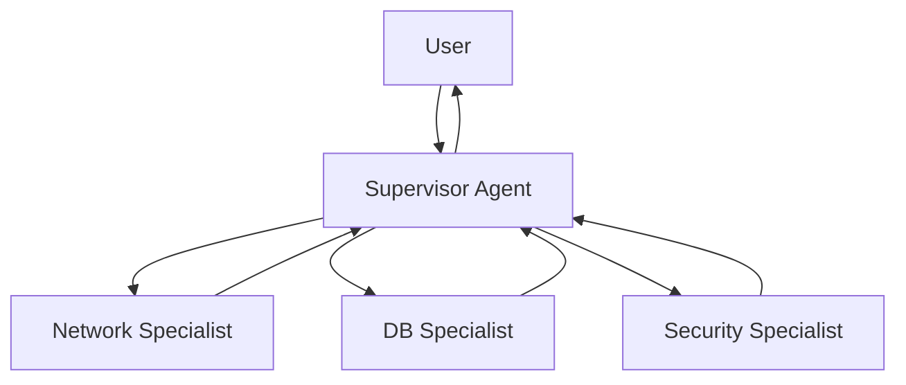

# 07. Multi-Agent Systems

## Why does this matter?

When an agent accumulates a lot of tools (20+), the first impulse is to "hire a team": a Supervisor and narrow specialists. This is almost always the wrong answer. The right one is **skills and progressive disclosure** ([ch. 09](../09-agent-architecture/README.md)): the model sees one line per skill and pulls in the details itself, only when they are needed; long descriptions do not ride along in every request. The cheap solution to the same "too much of everything in the context" problem is RAG ([ch. 06](../06-rag/README.md)).

Multi-agent setups solve a different problem — **context isolation and independent verification**:

1. **Review with a clean memory.** A model reviewing its own work agrees with itself: in its history it sees *why* it made a decision and checks its own justification, not the result. A subagent reviewer receives only the artifact (a diff, a report) and the criteria — no parent history.
2. **Moving noisy reading out.** Searching logs, analyzing a codebase — dozens of `read`/`search` calls with large results. A subagent pumps them through its own short history and returns one page of conclusions to the parent, without bloating the parent's memory.

Splitting into "narrow specialists" is not the default answer to "many tools"; it is an exception that needs justification (when — see the Supervisor pattern below).

### A real-world case

**Situation:** You have built a DevOps agent with 15 tools: network checks, database work, service management, logs, metrics, security, and so on.

**Problem:** The agent gets confused among the tools. When the user asks "Check whether the DB is reachable and find out its version", the agent may call the wrong tool or skip a step.

**The first step is not multi-agent.** Remove the noise from the context: skills for groups of tools (ch. 09), progressive disclosure for descriptions. In most cases that is enough, and you end up with a single agent loop.

**When Supervisor/Worker is actually justified:** the domains are genuinely different (network, DB, security), reading in each domain is noisy (dozens of calls with large results), and context isolation yields real savings. Then the Supervisor delegates: the Network Expert for the reachability check, the DB Expert for the version — not because "a team must have roles", but because each specialist pumps the noise through its own short history.

> **Junior employee model.** Delegating to a subagent = delegating to a human: along with the task goes **only the necessary** context, what comes back is a report, not "my entire toolkit". A subagent is a pure function `task → result`: the parent's memory is not inherited. See [Preface → Mental Model](../00-preface/README.md#mental-model-an-agent-is-a-new-employee) and [Ch. 17: Security and Governance](../17-security-and-governance/README.md).

## The theory in plain words

### How does Multi-Agent work?

1. **The Supervisor receives a task** from the user
2. **The Supervisor analyzes the task** and decides which specialists are needed
3. **The Supervisor invokes the specialists** via tool calls
4. **The specialists do their work** in isolated contexts
5. **The results return to the Supervisor**, which assembles the answer

**The essence:** context isolation — each specialist sees only its own task, not the Supervisor's entire history. This saves tokens and keeps attention focused.

## The Supervisor Pattern (Boss–Subordinate)

> This is an exception pattern, not the default. It is justified when the domains are genuinely different and reading in each of them is noisy — then context isolation pays off. If the motivation is "the agent has many tools", the right answer is skills ([ch. 09](../09-agent-architecture/README.md)), not a Supervisor.

**Architecture:**

- **Supervisor:** the main brain. It has no tools of its own, but it knows who can do what.
- **Workers:** specialized agents with a narrow set of tools.

**Context isolation:** a Worker does not see the Supervisor's entire conversation, only its own task. This saves tokens and keeps attention focused.



## The DevOps Example — Magic vs Reality

**The magic:**
> The Supervisor "thinks" and "delegates" tasks to specialists

**The reality:**

### How Multi-Agent works in practice

**Step 1: The Supervisor receives the task**

```go
// The Supervisor has tools for invoking Workers (neutral types — ch. 03)
supervisorTools := []ToolDef{
    {
        Name:        "ask_network_expert",
        Description: "Ask the network specialist about connectivity, pings, ports",
        Parameters: json.RawMessage(`{
            "type": "object",
            "properties": {
                "question": {"type": "string"}
            },
            "required": ["question"]
        }`),
    },
    {
        Name:        "ask_database_expert",
        Description: "Ask the DB specialist about SQL, schemas, data",
        Parameters: json.RawMessage(`{
            "type": "object",
            "properties": {
                "question": {"type": "string"}
            },
            "required": ["question"]
        }`),
    },
}

supervisorMessages := []Message{
    {Role: "system", Content: "You are a Supervisor. Delegate tasks to specialists."},
    {Role: "user", Content: "Проверь, доступен ли сервер БД, и если да — узнай версию"},
}
```

**Step 2: The Supervisor generates tool calls for the Workers**

```go
client, err := NewClient(...) // provider from the config (ch. 04)

supervisorResp, err := client.Complete(ctx, Request{
    Model:    "glm-5.3",
    Messages: supervisorMessages,
    Tools:    supervisorTools,
}) // the error is handled by the loop (ch. 04)

supervisorMsg := supervisorResp.Choices[0].Message
// supervisorMsg.ToolCalls = [
//     {ID: "call_1", Name: "ask_network_expert", Arguments: "{\"question\": \"Проверь доступность db-host.example.com\"}"},
//     {ID: "call_2", Name: "ask_database_expert", Arguments: "{\"question\": \"Какая версия PostgreSQL на db-host?\"}"},
// ]
```

**Why did the Supervisor call both tools?**
- The Supervisor sees the task "check reachability" → associates it with the Network Expert
- The Supervisor sees "find out the version" → associates it with the DB Expert
- The Supervisor understands the sequence: network first, then the DB

**Step 3: The Runtime (your code) invokes the Worker for the Network Expert**

> **Note:** The Runtime is the agent code that you write in Go. See [Chapter 00: Preface](../00-preface/README.md#runtime) for the definition.

```go
// The Runtime intercepts the "ask_network_expert" tool call
func askNetworkExpert(question string) string {
    client, err := NewClient(...) // provider from the config (ch. 04)

    // Create a NEW context for the Worker (isolation!)
    workerMessages := []Message{
        {Role: "system", Content: "You are a Network Specialist. Use ping tool to check connectivity."},
        {Role: "user", Content: question},  // Only the question, none of the Supervisor's history!
    }
    
    // The Worker has its own tools
    workerTools := []ToolDef{
        {
            Name:        "ping",
            Description: "Ping a host to check connectivity",
            Parameters: json.RawMessage(`{
                "type": "object",
                "properties": {"host": {"type": "string"}},
                "required": ["host"]
            }`),
        },
    }
    
    // Run the Worker as a separate agent
    workerResp, err := client.Complete(ctx, Request{
        Model:    "glm-5.3-flash", // a cheaper model for the Worker: the task is narrow
        Messages: workerMessages,  // Isolated context!
        Tools:    workerTools,
    })
    if err != nil {
        return fmt.Sprintf("Error: %v", err) // an error is a result too, for the Supervisor
    }
    
    workerMsg := workerResp.Choices[0].Message
    // workerMsg.ToolCalls = [{ID: "call_1", Name: "ping", Arguments: `{"host": "db-host.example.com"}`}]
    
    // Run the ping
    pingResult := ping("db-host.example.com")  // "Host is reachable"
    
    // The Worker sees the result and formulates an answer
    workerMessages = append(workerMessages, workerMsg)
    workerMessages = append(workerMessages, Message{
        Role:       "tool",
        Content:    pingResult,
        ToolCallID: "call_1",
    })
    
    workerResp2, err := client.Complete(ctx, Request{
        Model:    "glm-5.3-flash",
        Messages: workerMessages,
        Tools:    workerTools,
    })
    if err != nil {
        return fmt.Sprintf("Error: %v", err) // an error is a result too, for the Supervisor
    }
    
    // Return the Worker's final answer to the Supervisor
    return workerResp2.Choices[0].Message.Content  // "Host db-host.example.com is reachable"
}
```

**The essence of isolation:**
- The Worker does **not see** the Supervisor's entire history
- The Worker sees only its own question and its own context
- This saves tokens and keeps the Worker's attention focused

**Step 4: The Runtime (your code) invokes the Worker for the DB Expert**

The DB Expert is built identically to the Network Expert — the same loop "question → tool call → result → answer". Do not duplicate the implementation: one function `runWorker(cfg WorkerConfig, question string) string`, only the configuration changes.

| Parameter | Network Expert | DB Expert |
|----------|----------------|-----------|
| System prompt | "You are a Network Specialist. Use ping tool to check connectivity." | "You are a DB Specialist. Use SQL tools." |
| Tools | `ping` (host) | `sql_query` (query, SELECT only) |
| Model | glm-5.3-flash | glm-5.3-flash |
| Returns | "Host db-host.example.com is reachable" | "PostgreSQL 15.2" |

**Step 5: The Workers' results are returned to the Supervisor**

```go
// The Runtime appends the results as tool messages
supervisorMessages = append(supervisorMessages, supervisorMsg)
supervisorMessages = append(supervisorMessages, Message{
    Role:       "tool",
    Content:    askNetworkExpert("Проверь доступность db-host.example.com"),  // "Host is reachable"
    ToolCallID: supervisorMsg.ToolCalls[0].ID,
})
supervisorMessages = append(supervisorMessages, Message{
    Role:       "tool",
    Content:    askDatabaseExpert("Какая версия PostgreSQL на db-host?"),  // "PostgreSQL 15.2"
    ToolCallID: supervisorMsg.ToolCalls[1].ID,
})
```

**Step 6: The Supervisor assembles the results and answers**

```go
// Send the Workers' results to the Supervisor
supervisorResp2, err := client.Complete(ctx, Request{
    Model:    "glm-5.3",
    Messages: supervisorMessages,  // The Supervisor sees both Workers' results!
    Tools:    supervisorTools,
}) // the error is handled by the loop (ch. 04)

finalMsg := supervisorResp2.Choices[0].Message
// finalMsg.Content = "Сервер БД доступен (ping успешен). Версия PostgreSQL: 15.2"
```

**What actually happens:**

1. **The Supervisor invokes Workers as ordinary tools** — this is not "delegation", it is a tool call
2. **Workers are separate agents** — each with its own context and tools
3. **Context isolation** — a Worker does not see the Supervisor's history, only its own question
4. **The Runtime controls everything** — it intercepts the Supervisor's tool calls, launches the Workers, collects the results

**The essence:** Multi-Agent is not "commanding", but a mechanism for invoking specialized agents via tool calls with context isolation.

## Other Multi-Agent Patterns

Supervisor/Worker is a pattern for genuinely different domains; by default it is a single agent loop + skills ([ch. 09](../09-agent-architecture/README.md)). Other patterns are also used in practice.

### Pattern: Router agent

A Router Agent receives a request and directs it to one suitable specialist. Unlike a Supervisor, a Router does **not coordinate** several agents — it picks one.

```
┌──────┐     ┌────────┐     ┌────────────────┐
│ User │────→│ Router │────→│ Network Agent  │
└──────┘     │        │     └────────────────┘
             │        │────→│ DB Agent       │
             │        │     └────────────────┘
             │        │────→│ Security Agent │
             └────────┘     └────────────────┘
```

**Implementation:**

```go
// The Router decides which agent to send the request to
func routeRequest(ctx context.Context, query string) (string, error) {
    client, err := NewClient(...) // provider from the config (ch. 04)

    resp, err := client.Complete(ctx, Request{
        Model: "glm-5.3-flash", // a cheap model — it's a classification task
        Messages: []Message{
            {
                Role: "system",
                Content: `Classify the request and route to the correct specialist.
Available specialists:
- "network": connectivity, DNS, ports, network troubleshooting
- "database": SQL, schemas, queries, DB performance
- "security": access, vulnerabilities, incidents
Return ONLY the specialist name.`,
            },
            {Role: "user", Content: query},
        },
        Temperature: 0.2, // quality: a stable routing choice
    })
    if err != nil {
        return "", err
    }
    return strings.TrimSpace(resp.Choices[0].Message.Content), nil
}

// Usage
specialist, _ := routeRequest(ctx, "Не могу подключиться к PostgreSQL")
// specialist = "database"
result := runSpecialist(specialist, query) // Run the right agent
```

**When a Router beats a Supervisor:**
- The request belongs to a single domain (no coordination needed)
- Minimal latency matters (one LLM call for routing instead of several)
- You have 10+ specialists — a Router is easier to scale

### Pattern: Handoffs (context transfer)

A handoff is when one agent **hands control** to another, including part of the context. Unlike Supervisor/Worker, there is no "boss" here — the agents are peers.

**Hot handoff** — the next agent receives the full context:

```go
type Handoff struct {
    FromAgent string    // Who is handing off
    ToAgent   string    // Who receives it
    Context   []Message // What is handed over
    Reason    string    // Why
}

func performHandoff(h Handoff) (string, error) {
    // Build the context for the receiving agent
    handoffMessages := []Message{
        {
            Role: "system",
            Content: fmt.Sprintf(
                "You are a %s specialist. You received a handoff from %s.\nReason: %s\nContinue the conversation.",
                h.ToAgent, h.FromAgent, h.Reason,
            ),
        },
    }
    // Append the handed-over context
    handoffMessages = append(handoffMessages, h.Context...)

    resp, err := client.Complete(ctx, Request{
        Model:    "glm-5.3",
        Messages: handoffMessages,
        Tools:    getToolsForAgent(h.ToAgent),
    })
    if err != nil {
        return "", err
    }
    return resp.Choices[0].Message.Content, nil
}
```

**Cold handoff** — the next agent receives only a summary:

```go
// Instead of the full context, pass a condensed description
summary := summarizeConversation(messages)
handoff := Handoff{
    FromAgent: "l1_support",
    ToAgent:   "l2_engineer",
    Context: []Message{
        {Role: "user", Content: summary},
    },
    Reason: "Issue requires deeper investigation",
}
```

**When to use handoffs:**
- Escalation (L1 Support → L2 Engineer)
- A domain switch (a network problem turned out to be a DB problem)
- Long tasks with several stages

### Pattern: Subagents (agent hierarchy)

A subagent is an agent that a parent launches for a subtask. It is not a "role on a team" but a **pure function**: the input is a self-contained task, the output is a report, and the parent's memory is not inherited.

There are only two justified reasons for a subagent (a detailed discussion in [ch. 09](../09-agent-architecture/README.md)):

- **Review with a clean memory** — a model reviewing itself agrees with itself; a subagent reviewer sees only the artifact and the criteria, without the author's justifications.
- **Moving noisy reading out** — dozens of `read`/`search` calls with large results stay in the subagent's short history; the parent receives a page of conclusions.
```go
// Subagent: a minimal Config — a narrow prompt, read-only tools, its own limits.
// The Run/RunResult/AgentConfig structures — ch. 04.
func runSubagent(ctx context.Context, task string) (string, error) {
    cfg := AgentConfig{
        SystemPrompt: "You are a focused agent. Complete the specific task given to you.",
        Tools:        readOnlyTools, // only read/list/search — no mutating tools
        Limits:       Limits{MaxIterations: 15},
    }
    res := Run(ctx, cfg)
    if res.Err != nil {
        return "", res.Err
    }
    return res.Output, nil // a report as text; the parent's history is not inherited
}
```

### When a subagent is justified (and when it is not)

| Situation | Subagent? | Why |
|----------|-----------|--------|
| Reviewing your own work (a diff, a report, a plan) | ✅ | Clean memory: the reviewer does not see *why* the author made a decision |
| Analyzing a codebase, searching logs, reading documentation | ✅ | Noisy reading does not bloat the parent's history |
| A subtask boils down to 2–3 tool calls | ❌ | A regular tool call in the main loop |
| "Splitting roles" within one task (planner, critic, writer, researcher...) | ❌ | Anti-pattern: several agents sharing one task do not work better than one, while coordination, latency and cost grow |
| Too many tools in one domain | ❌ | That is a job for skills and progressive disclosure — [ch. 09](../09-agent-architecture/README.md) |

A subagent has **no mutating external tools**: no `exec` with writes, no creating MRs, no deploys, no database changes. All writes are done by the parent after receiving the report — this keeps the audit of actions in a single history.

### Depth control

A subagent must not spawn subagents. Depth is limited explicitly — the standard maximum is one level of nesting:

```go
const maxDepth = 1

func spawnSubagent(ctx context.Context, task string) (string, error) {
    depth := getDepth(ctx)
    if depth >= maxDepth {
        return "", fmt.Errorf("max subagent depth %d reached", maxDepth)
    }
    ctx = withDepth(ctx, depth+1)

    return runSubagent(ctx, task)
}
```

Depth is passed via `context.Value` — no global state. Each additional level multiplies the cost and makes debugging harder.

### Pattern: Custom DAG workflows

For tasks with complex dependencies — a DAG (directed acyclic graph). Agents run in dependency order, and independent ones run in parallel.

```go
type WorkflowStep struct {
    AgentID      string   // Which agent executes the step
    DependsOn    []string // Which steps it depends on
    Task         string   // The task
}

type Workflow struct {
    Steps []WorkflowStep
}

// Example: incident analysis
workflow := Workflow{
    Steps: []WorkflowStep{
        {AgentID: "log_analyzer", DependsOn: nil, Task: "Проанализируй логи за последний час"},
        {AgentID: "metrics_checker", DependsOn: nil, Task: "Проверь метрики CPU и memory"},
        {AgentID: "correlator", DependsOn: []string{"log_analyzer", "metrics_checker"}, Task: "Сопоставь результаты"},
        {AgentID: "reporter", DependsOn: []string{"correlator"}, Task: "Составь отчёт об инциденте"},
    },
}

// log_analyzer and metrics_checker run in parallel (no dependencies)
// correlator waits for both results
// reporter waits for correlator
```

For more on workflow patterns, see [Chapter 10: Planning and Workflows](../10-planning-and-workflows/README.md).

### The 10-file rule

A heuristic from real-world practice: **if a task requires reading more than 10 files, decompose it into subagents**.

A single agent with 10+ files in context loses focus. Instead, use the map-reduce pattern:

1. **List** — collect the list of files
2. **Group** — group them by module/directory
3. **Map** — run a subagent for each group
4. **Reduce** — collect the results

```go
func analyzeProject(ctx context.Context, path string) (string, error) {
    files := listFiles(path)
    if len(files) <= 10 {
        return analyzeDirect(ctx, files) // one agent can handle it
    }

    groups := groupByDirectory(files)
    var results []string
    for _, group := range groups {
        result, err := spawnSubagent(ctx,
            fmt.Sprintf("Analyze files in %s: %v", group.Dir, group.Files))
        if err != nil {
            continue
        }
        results = append(results, result)
    }

    return spawnSubagent(ctx,
        "Combine analysis results:\n" + strings.Join(results, "\n---\n"))
}
```

### Subagent context isolation

A subagent is a **pure function**: `task → result`. It has no access to the parent's conversation. This is a deliberate restriction:

- The parent **must pass in** everything needed: exact file paths, search criteria, the expected result format
- The subagent **does not go through routing** — it does not need task classification; it has already received a specific assignment
- The subagent **does not inherit the parent's memory**: it has its own clean history that starts with its `task` — so its output is not polluted by the parent's train of thought, and the parent does not pay in tokens for search noise

```go
// BAD: a vague task
result, _ := spawnSubagent(ctx, "Изучи проект и найди проблемы")

// GOOD: a concrete task with context and a completion criterion.
// The subagent is read-only: it confirms the diagnosis and finds the spots; the parent fixes them.
result, _ := spawnSubagent(ctx,
    "Проверь JWT-валидацию в internal/auth/middleware.go:45: "+
    "проверка expiry использует time.Now() вместо time.Now().UTC(). "+
    "Подтверди проблему и найди все другие места с той же ошибкой. "+
    "Верни список: файл:строка + обоснование")
```

### A clean-memory subagent for review

Why reviewing via a separate subagent works better than "check your own result" in the same loop: a model reviewing its own work **agrees with itself** — in the history it sees *why* it made a decision and checks its own justification rather than the result. A reviewer subagent does not have that context.

- **Input:** a self-sufficient assignment — the artifact (diff, report, plan) + review criteria ("look for leaks, races, forgotten error handling")
- **Output:** a verdict + findings — a list of problems with locations; the reviewer does not "fix" anything
- **Tools:** read-only only (read/search/list) — the parent fixes the code after receiving the findings

```
Parent: wrote a diff → SpawnSubagent(reviewCfg, diff + criteria)
  Subagent (clean memory, read-only): reads the diff → findings
Parent: reads the findings and fixes the code itself
```

> **How the real SDK does it.** There is no special "subagent" entity: it is the same agent loop started as a second Run with a minimal Config and a clean history. The sub-run is correlated with the parent run via a shared `run_id` in telemetry, so traces show the whole chain (ch. 19).

### The A2A (Agent-to-Agent) protocol

In the patterns above, agents communicate through the runtime (your code). [A2A](https://a2a-protocol.org/) is a **standardized protocol** for agent-to-agent communication. A Google initiative, developed since 2025 under the Linux Foundation.

**Key concepts:**

- **Agent Card** — a JSON description of an agent: what it can do, which tasks it accepts.
- **Task** — a unit of work with a lifecycle: `submitted → working → completed/failed`.
- **Message/Artifact** — data exchange between agents.

```go
// Agent Card — a description of an agent for other agents
type AgentCard struct {
    Name         string   `json:"name"`
    Description  string   `json:"description"`
    URL          string   `json:"url"`           // Agent endpoint
    Capabilities []string `json:"capabilities"`  // What it can do
    InputSchema  json.RawMessage `json:"input_schema"` // What data it accepts
}

// Task — a unit of work
type A2ATask struct {
    ID      string `json:"id"`
    Status  string `json:"status"` // "submitted", "working", "completed", "failed"
    Input   string `json:"input"`
    Output  string `json:"output,omitempty"`
}

// A client agent sends a task to another agent
func sendA2ATask(agentURL string, task A2ATask) (*A2ATask, error) {
    body, _ := json.Marshal(task)
    resp, err := http.Post(agentURL+"/tasks", "application/json", bytes.NewReader(body))
    if err != nil {
        return nil, err
    }
    defer resp.Body.Close()

    var result A2ATask
    json.NewDecoder(resp.Body).Decode(&result)
    return &result, nil
}
```

**When A2A is needed:**
- Agents run on **different servers** (a microservice architecture)
- Agents are written in **different languages** (Go + Python)
- You need a **standard interface** for integration with external agents

**When A2A is overkill:**
- All agents in one process — use tool calls (Supervisor/Worker)
- A prototype — start with plain functions

For more on A2A, see [Chapter 18: Tool Protocols](../18-tool-protocols-and-servers/README.md#a2a-agent-to-agent-protocol).

### Scaling multi-agent systems

Worker pools and load balancing (round-robin, by load, by specialization) are a general engineering topic, not specific to agents: a task channel per Worker type plus a shared results channel is an ordinary Go worker pool. There are no differences from any other worker pool here. As the system grows, the main question quickly stops being "how to distribute tasks" and becomes "how to trace all of this" — see [Chapter 19: Observability and Tracing](../19-observability-and-tracing/README.md).

### Decision table: which pattern to use when

| Pattern | When to use | Complexity |
|---------|-------------------|-----------|
| Single loop + skills | Many tools in one domain (the default, see [ch. 09](../09-agent-architecture/README.md)) | Low |
| Supervisor/Worker | Truly different domains, context isolation needed | Medium |
| Router | A request belongs to a single domain | Low |
| Handoffs | Escalation, a domain switch | Medium |
| Subagents | Review with clean memory; moving noisy reading out | High |
| DAG Workflow | Tasks with complex dependencies | High |
| A2A | Distributed agents on different servers | High |

## Common Mistakes

### Mistake 1: No context isolation

**Symptom:** The Worker sees the Supervisor's entire history, which leads to context overflow and confusion.

**Cause:** The Worker receives the Supervisor's full message history instead of an isolated context.

**Fix:**
```go
// BAD: the Worker sees the Supervisor's entire history
workerMessages := supervisorMessages  // The whole history!

// GOOD: the Worker receives only its own question
workerMessages := []Message{
    {Role: "system", Content: "You are a Network Specialist."},
    {Role: "user", Content: question},  // Only the question!
}
```

### Mistake 2: The supervisor does not know whom to call

**Symptom:** The Supervisor does not call the right specialists, or calls the wrong ones.

**Cause:** The tool descriptions for calling Workers are not clear enough.

**Fix:**
```go
// GOOD: A clear description of when to call each specialist
{
    Name: "ask_network_expert",
    Description: "Ask the network specialist about connectivity, pings, ports, network troubleshooting. Use this when user asks about network issues, connectivity, or network-related problems.",
},
{
    Name: "ask_database_expert",
    Description: "Ask the DB specialist about SQL, schemas, data, database queries. Use this when user asks about database, SQL, or data-related questions.",
},
```

### Mistake 3: The worker does not return a result

**Symptom:** The Supervisor does not receive an answer from the Worker, or receives an empty one.

**Cause:** The Worker does not finish its work, or the result is not returned to the Supervisor.

**Fix:**
```go
// GOOD: the Worker finishes its work and returns the result
func askNetworkExpert(question string) string {
    // ... the Worker performs the task ...
    
    // Return the Worker's final answer
    return workerResp2.Choices[0].Message.Content  // "Host is reachable"
}

// The Supervisor receives the result
supervisorMessages = append(supervisorMessages, Message{
    Role:       "tool",
    Content:    askNetworkExpert("..."),  // The Worker's result
    ToolCallID: supervisorMsg.ToolCalls[0].ID,
})
```

### Mistake 4: A subagent gets stuck in a loop

**Symptom:** The subagent runs for a long time, consumes tokens, but does not return a result. The logs show repeated tool calls.

**Cause:** A vague task. The subagent does not know when the task is solved and keeps exploring.

**Fix:**
```go
// BAD: a vague task
spawnSubagent(ctx, "Изучи проект и расскажи, как он устроен")

// GOOD: a concrete task with a completion criterion
spawnSubagent(ctx,
    "Найди все файлы с gRPC-сервисами в internal/. "+
    "Для каждого: имя файла, имя сервиса, список методов. "+
    "Верни результат в формате: service_name: [method1, method2]")
```

A real case from Atlas: while running subagents to analyze a project, one of them got stuck in a loop of repeatedly reading files. The fix: a restart with clearer instructions and adding an iteration limit to the subagent's Config.

## Exercises

### Exercise 1: Implement context isolation

Implement a function that creates an isolated context for a Worker:

```go
func createWorkerContext(question string, workerRole string) []Message {
    // Create an isolated context for the Worker
    // Only the System Prompt and the user's question
}
```

**Expected result:**
- The Worker receives only the System Prompt and its own question
- The Worker does not see the Supervisor's history

### Exercise 2: Implement a supervisor with two specialists

Create a Supervisor with two specialists (Network Expert and DB Expert):

```go
supervisorTools := []ToolDef{
    // Your code here
}
```

**Expected result:**
- The Supervisor can call both specialists
- The tool descriptions are clear and understandable
- The Supervisor correctly picks the specialist for the task

## Acceptance Criteria / Checklist

**Passed:**
- [x] The Supervisor correctly delegates tasks to specialists
- [x] Workers operate in an isolated context
- [x] Worker results are returned to the Supervisor
- [x] The Supervisor collects the results and formulates the final answer
- [x] Tool descriptions for calling Workers are clear
- [x] You understand when a subagent is justified (review with clean memory, noisy reading) and when it is not
- [x] You know the 10-file rule

**Not passed:**
- [ ] The Worker sees the Supervisor's entire history (no isolation)
- [ ] The Supervisor does not know whom to call (poor descriptions)
- [ ] The Worker does not return a result to the Supervisor
- [ ] The Supervisor does not collect results from Workers
- [ ] Subagents with no depth limit
- [ ] Vague tasks for subagents

## Production Notes

When using multi-agent systems in production:

- **Correlation by `run_id`:** Use a single `run_id` for the whole Supervisor → Worker → Tool chain. This lets you trace the full path of a request in the logs.
- **Chain tracing:** Trace every step of the chain (Supervisor → Worker → Tool) for debugging. For more, see [Chapter 19: Observability and Tracing](../19-observability-and-tracing/README.md).
- **Context isolation:** Each Worker must have its own isolated context (described above). This is critical for preventing context overflow.

## Relation to Other Chapters

- **Tools:** How the Supervisor calls Workers via tool calls — see [Chapter 03: Tools](../03-tools-and-function-calling/README.md)
- **Autonomy:** How the Supervisor manages the working loop — see [Chapter 04: Autonomy](../04-autonomy-and-loops/README.md)
- **Architecture:** The agent components (Runtime, Memory, Planning) that multi-agent systems are built from — see [Chapter 09: Anatomy of an Agent](../09-agent-architecture/README.md)

## What's Next?

After multi-agent systems, move on to:
- **[08. Evals and Reliability](../08-evals-and-reliability/README.md)** — how to test agents

