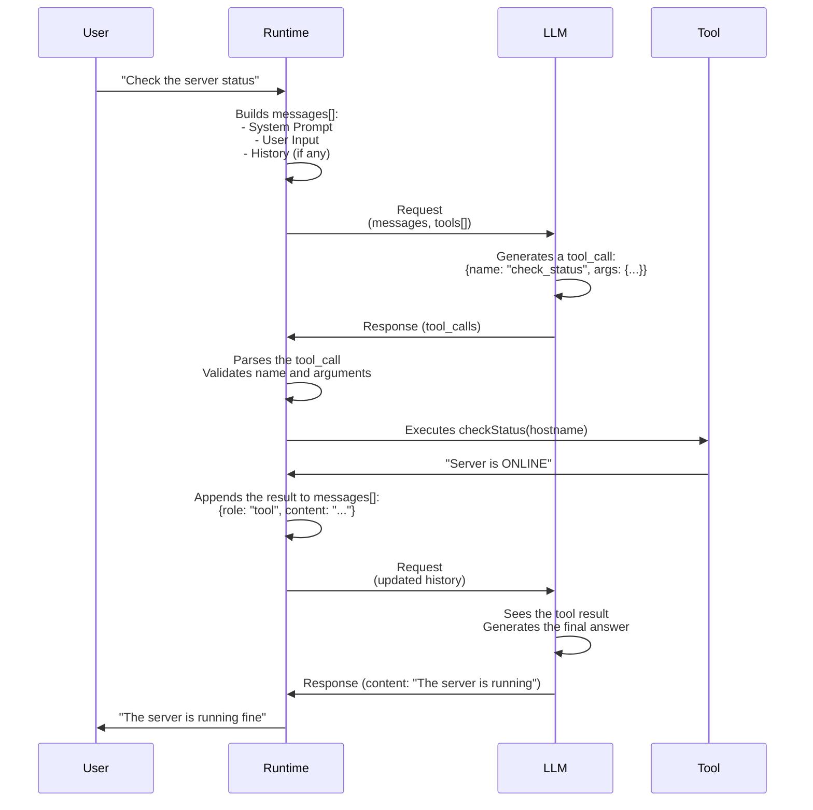

# 09. Agent Anatomy — Components and Their Interaction

## Why does this matter?

An agent is a **simple** system. At its core is the loop "the LLM responds → calls tools → gets the result → keeps responding," plus a linear message history and a stable system prompt. No "meta-architectures," state graphs, or multi-level memory are needed in the basic case (see [Preface: the mental model](../00-preface/README.md)).

But for this loop to work **reliably in production**, it's important to understand what it is actually made of: where messages are stored, what the system prompt is and why it must not change on every step, how to defend against infinite loops, how to isolate a subagent. Without this anatomy it's easy to start "fixing" a problem in the wrong place and to adopt fashionable patterns that make the agent more complex without solving anything.

In this chapter we'll cover the **minimal set of components** and how they connect, so that you can:
- Manage context and dialogue history properly (linear history + a single `condense`).
- Implement the agent's autonomous loop with predictable limiters.
- Optimize token usage through the prompt cache rather than through "clever" strategies.
- Build an extensible system through tools, not through overcomplicated abstractions in the core.

### A real-world case

**Situation:** You built a DevOps agent. After 20 messages the agent "forgets" the beginning of the conversation and loses track of the task context.

**Problem:** The dialogue history overflows the model's context window. Old messages get "pushed out," and the agent loses important information.

**Solution:** If you understand how memory works, you can, on overflow, condense the old part of the history into a brief summary via the LLM — without breaking `tool_call ↔ tool_result` pairs and without touching the stable system prefix. Details in [Ch. 13: Context Engineering](../13-context-engineering/README.md). Reordering messages "by importance" is **not needed**: it's an anti-pattern that kills the prompt cache (see [Ch. 12: Agent Memory](../12-agent-memory/README.md)).

## The theory in plain words

A simplified formula:

$$ Agent = LLM + Memory + Tools + Planning $$

## Memory

The agent must "remember" the conversation context and the history of its actions.

### Short-term memory

This is the message history (the `messages` array). It is bounded by the context window.

**Message structure:**

```go
type Message struct {
    Role       string     // "system", "user", "assistant", "tool"
    Content    string
    ToolCalls  []ToolCall // tool calls (assistant role only)
    ToolCallID string     // call ID (role="tool" only)
}

type ToolCall struct {
    ID        string
    Name      string
    Arguments string // JSON string with the arguments
}
```

**Example history:**

```go
messages := []Message{
    {Role: "system", Content: "You are a DevOps engineer"},
    {Role: "user", Content: "Check the server status"},
    {Role: "assistant", Content: "", ToolCalls: [...]},  // Tool call
    {Role: "tool", Content: "Server is ONLINE", ToolCallID: "call_123"},
    {Role: "assistant", Content: "The server is running fine"},
}
```

**Problem:** If the history gets too long, it no longer fits in the context window.

**Example of the problem:**

```go
// Model context window:    128,000 tokens
// System Prompt:               500 tokens
// Dialogue history:        127,000 tokens  // 30 iterations with large tool_results
// New request:               1,000 tokens
// TOTAL: 128,500 tokens > 128,000 [ERROR: context overflow]
```

Current models have windows from ~128k up to ~1M tokens in some models (the exact figure is in the provider's documentation). The problem hasn't gone away — it has merely shifted: in a long agent session with large tool_results (logs, dumps, web pages), overflow sets in around iteration 20–50.

**Two rules that make this memory workable** (details in [Ch. 12](../12-agent-memory/README.md) and [Ch. 13](../13-context-engineering/README.md)):

1. **The history is immutable.** Messages are only appended to the end; nothing is reordered, nothing is struck out "by importance," old messages are never edited. Any mutation of the prefix kills the provider's prompt cache, which means input costs 5–10× more and latency grows.
2. **The system prompt is stable within a single Run.** Any "dynamic" update of the system prompt between iterations (live state, facts, plan progress) is an anti-pattern. Dynamic content lives in `tool_result` and in the last `user` message, not in the system prefix.

On context overflow there is exactly one reaction — `condense`: call the LLM, ask it to briefly summarize the old part of the history, and replace it with a single `user` message "Context of the previous work: ...". The limit is 1 condense per Run; the token count comes from `usage.PromptTokens` in the provider's response, not from your own counters. Details in [Ch. 13](../13-context-engineering/README.md).

### Long-term memory

This is a vector database (RAG). You can store gigabytes of documents in it and search for what you need by meaning (Semantic Search).

**How it works:**

1. Documents are split into chunks
2. Each chunk is converted into a vector (embedding)
3. When the agent makes a request, similar vectors are found
4. Relevant chunks are added to the context

**Use cases:**

- **DevOps:** Storing procedures, runbooks, service documentation
- **Support:** A knowledge base with solutions to typical problems
- **Data:** Database schemas, API documentation
- **Security:** Incident playbooks, security policies

See [Chapter 06: RAG](../06-rag/README.md)

## Planning

**Planning** is the agent's ability to break a complex task into steps and execute them in the right order. Let's set the frame right away: in this book's basic architecture there is **no separate "planner module."** The plan is born in the same agent loop as everything else and lives as ordinary text in the message history. No meta-architectures in the basic case (see [Preface: the mental model](../00-preface/README.md)).

### On-the-fly planning: ReAct

In the simplest case the agent doesn't build an explicit plan — it reasons step by step: `Thought → Action → Observation`. This is the **ReAct** pattern, and in essence it's just the agent loop from [Ch. 04](../04-autonomy-and-loops/README.md) in which the model, between tool calls, explains to itself what it is doing and why.

**Example (DevOps):**

```
Thought: The user complains about slowness. I need to check the CPU.
Action: get_cpu_metrics()
Observation: CPU 99%, process: ffmpeg
Thought: ffmpeg is eating all the resources. Let me see what this process is.
Action: get_process_info(pid=123)
Observation: Video conversion, started by the user
Thought: A legitimate process, but it's blocking the system. I'll suggest limiting its priority.
Action: [final answer to the user]
```

ReAct is flexible and sufficient for most tasks. But on long tasks (5+ steps) the model can "get lost": skip a step, forget verification, repeat something already done.

### The plan is an artifact too

The key idea of explicit planning: **the plan is not a structure in code and not a separate service, but an artifact the model sees in its own history and updates as it works**. Two working options:

- **Plan → Execute.** The model's first response is a list of steps. The agent then executes them one by one; the plan sits in the history as an ordinary message.
- **Plan-and-Revise.** When a step fails or new data comes to light, the model issues an updated plan — again as an ordinary message appended to the history. This costs one message and requires no "planner" in the runtime.

An example plan (DevOps, incident "the service returns 502"):

```
1. Check the service's HTTP status (check_http)
2. If not 200 — read the last 50 lines of logs (read_logs)
3. Find the cause in the logs (config error / connection refused / OOM)
4. Apply the fix: rollback / restart — depending on the cause found
5. Verify: check_http again
```

**How the plan lives in the context without breaking the cache.** The plan and "plan progress" are messages at the end of the history (`assistant` text or a `tool_result`), not part of the system prompt. A prompt function that rebuilds the system prompt on every iteration to "insert the current plan" is an anti-pattern: it kills the prompt cache for the entire history (see [Ch. 13](../13-context-engineering/README.md)).

### A good plan vs a bad one

- Steps are atomic: not "figure it out and fix it," but "check the status" → "read the logs" → "apply the fix."
- The order makes sense: diagnosis first, action second.
- The plan ends with explicit verification of the result.
- Every step has a success criterion ("CPU dropped to 50%", not "it got better").

### For general knowledge: ToT and self-consistency

- **Tree-of-Thoughts (ToT):** the model generates several alternative solution paths, evaluates them, and picks the best one. Justified when a task has several fundamentally different approaches.
- **Self-consistency:** the model generates N independent plans and assembles the final one from the most frequently occurring elements. An expensive technique (N full generations), rarely seen in production.

Both families of techniques — with examples and their limits — are covered in [Ch. 10: Planning and Workflow Patterns](../10-planning-and-workflows/README.md).

### Hierarchical planning is not the default

"A supervisor splits the task into subplans and hands them to subagents" is already a multi-agent architecture, [Ch. 07: Multi-Agent](../07-multi-agent/README.md). It is justified in narrow cases (covered in the [Subagents](#subagents) section below), but by default a single agent loop plus an explicit plan in the history solves the same class of tasks more simply, more cheaply, and more predictably. Don't start a project with multi-agent.

### Reflexion (self-correction)

Agents often make mistakes. Reflexion adds a criticism step: after a failed action, the model explains to itself **why** it failed and what to change.

The cycle: `Act → Observe → Fail → Reflect → Plan Again`

**Example:**

```
Action: read_file("/etc/nginx/nginx.conf")
Observation: Permission denied
Reflection: "The file can't be read — I don't have the rights. First I'll check the permissions."
Action: check_permissions("/etc/nginx/nginx.conf")
Observation: File is readable by root only
Action: read_file_sudo("/etc/nginx/nginx.conf")
```

Reflection is also just text in the history. The model sees its mistake, its conclusion from it, and the next move; no special mechanisms in the runtime are needed.

## Runtime

The runtime is the code that ties the LLM to the tools: it sends the history to the model, parses the response, executes the tools, appends the results to the end of the history, and decides when to stop.

**Neutral message structures** (not tied to any particular SDK; `Message` and `ToolCall` were defined above — here we add `ToolDef`, a tool description for the `tools[]` block):

```go
type ToolDef struct {
    Name        string
    Description string
    Parameters  json.RawMessage // JSON Schema
}
```

### The tool interface

```go
type Tool interface {
    Name() string
    Description() string
    Parameters() json.RawMessage
    Execute(ctx context.Context, args json.RawMessage) (*Result, error)
}

// Result — the outcome of a tool execution.
type Result struct {
    Content         string // the full result: for UI, logs, and audit
    FilteredContent string // what the model will actually see in the tool_result
}
```

The two fields of `Result` are the main lever for saving context. Example: `read_logs` returned 500 lines. `Content` holds all 500 — the UI will show them in full and audit will keep them. But the model's `tool_result` receives `FilteredContent` — 30 lines, selected and trimmed. The model shouldn't pay in tokens for noise.

> **Sidebar: flags on the tool.** In real SDKs a tool can carry metadata: `ReadOnly` (no side effects — can run in parallel and without confirmation), `Parallel` (parallel execution is explicitly allowed), `Confirm` (a dangerous action — ask a human first, [Ch. 05](../05-safety-and-hitl/README.md)). These are just struct fields next to `ToolDef`; the runtime reads them before calling `Execute`. Covered in [Ch. 04](../04-autonomy-and-loops/README.md).

### Tool registry — in brief

So that the runtime doesn't need to know about specific tools, they are kept in a registry: a map "name → Tool" plus a method that returns `[]ToolDef` for the `tools[]` block of the request.

```go
type ToolRegistry struct{ tools map[string]Tool }

func (r *ToolRegistry) Register(t Tool)              { r.tools[t.Name()] = t }
func (r *ToolRegistry) Get(name string) (Tool, bool) { t, ok := r.tools[name]; return t, ok }
func (r *ToolRegistry) ToolDefs() []ToolDef          // serialized into the request's tools[]
```

A new tool = implement the interface and register it. The runtime stays unchanged; validation, logging, and metrics are added at the registry level. For the full implementation (argument validation, schema generation, parallel execution), see [Ch. 03: Tools and Function Calling](../03-tools-and-function-calling/README.md); framework options are in [Ch. 14](../14-ecosystem-and-frameworks/README.md).

**Remember the cost of the `tools[]` block.** It is sent with **every** request and paid for every time — even if no tool is called in that iteration. A benchmark: 4 compact tools ≈ 742 tokens for the schemas alone ([Ch. 03](../03-tools-and-function-calling/README.md)). The number of tools and the length of their descriptions is design question #1; if the tools have multiplied, some of them should become a skill (section below) or a single universal command.

### Data flow diagram in the agent



**Key takeaways:**
- The LLM doesn't execute code, it only generates JSON. The actual code is executed by the runtime.
- The runtime controls the whole loop; the history (`messages[]`) is assembled by the runtime and sent in full with every request.
- Tool results are appended to the end of the history before the next request.

### The minimal agent loop

Everything together — a compact loop on the neutral structures (the full version with limits, confirm, and condense is in [Ch. 04](../04-autonomy-and-loops/README.md)):

```go
func runOnce(ctx context.Context, client Client, registry *ToolRegistry, messages []Message) error {
    for i := 0; i < maxIterations; i++ {
        resp, err := client.Complete(ctx, Request{Messages: messages, Tools: registry.ToolDefs()})
        if err != nil {
            return err // transient errors are retried by the client itself (Ch. 04)
        }

        msg := resp.Choices[0].Message
        messages = append(messages, msg) // the assistant response goes to the end of the history

        if len(msg.ToolCalls) == 0 {
            fmt.Println(msg.Content) // the final answer — we're done
            return nil
        }

        for _, tc := range msg.ToolCalls {
            tool, ok := registry.Get(tc.Name)
            if !ok {
                messages = append(messages, Message{
                    Role:       "tool",
                    ToolCallID: tc.ID,
                    Content:    "Error: unknown tool " + tc.Name,
                })
                continue
            }
            res, err := tool.Execute(ctx, json.RawMessage(tc.Arguments))
            var content string
            if err != nil {
                // An error is a result too, for the model (Ch. 03); dereference
                // res only on the success path: Execute returned (nil, err)
                content = "Error: " + err.Error()
            } else {
                content = res.FilteredContent
            }
            messages = append(messages, Message{
                Role:       "tool",
                ToolCallID: tc.ID,
                Content:    content,
            })
        }
    }
    // Iteration limit — a terminal error: we stopped and reported to a human
    return fmt.Errorf("iteration limit exceeded (%d)", maxIterations)
}
```

### Config: flat behavior injection

In practice a single `Agent` type serves different modes not through inheritance and if-branches, but through **behavior injection via Config**: all the control points of the loop are fields of one flat structure (client/model, system prompt, tools with permissions, limits, stop predicate, confirm, condense, event handler), and the loop itself is a single `Run` on top of it. The canonical listing of `AgentConfig` and `Run` is in [Ch. 04: Autonomy and Loops](../04-autonomy-and-loops/README.md#the-right-shape-for-a-runtime-config-run); we don't duplicate it here.

The same `Agent` works as:
- **Main agent** — a full Config: a prompt with the whole role, tools, condense on overflow.
- **Subagent** — a minimal Config: a narrow prompt for the subtask, a short list of read-only tools.
- **Triage agent** — a narrow prompt + a truncated list of Tools.
- **ChatOnly** — Tools = nil, plain dialogue.

**Why are Prompt and Tools fields rather than `func(state)` functions?** Because the `system` message and the `tools[]` block sit at the very beginning of the request and form the **prefix** that the provider caches. If each iteration returns different prompt text or a different tool list, the cache misses on every step, input gets 5–10× more expensive, and latency grows. Dynamic content goes into `tool_result` and `user` messages at the end of the history, not into the system prefix. If the behavior changes radically (a new role, a different set of tools), that's a **new Run**, not a modification of the current one.

With this design, a subagent needs no "Working Memory" at all — it has its own short history for its own `task`. If the main agent wants to pass it context, it passes it as text in the `task`, not through a shared structure.

### RunResult: a result is returned even on error

`Run` always returns a result structure — including when the run was stopped by a terminal error (iteration limit, deadline, budget):

```go
type RunResult struct {
    Output     string     // the final answer (if any)
    Err        error      // the terminal error, nil on success
    Iterations int        // how many iterations were made
    Usage      Usage      // tokens across all iterations
    ToolsUsed  []ToolCall // which tools were called
}
```

Even if the Run failed on the 14th iteration, the calling code knows how many tokens were spent, which tools were called, and where things stopped. This is needed for logs, billing, and debugging — which is why the error here is a field of the result, not just the second return value.

> **How the real SDK does it.** `RunResult` is returned even on error: iterations, usage, the tools called, the final model. Loop events are sealed types (a closed hierarchy): stream delta, final answer, tool start/progress/end, condensation error.

### The event model (event system)

The agent emits events as it works. UI, logging, and metrics subscribe to them independently:

```go
// Events of a single Run. The set is closed (sealed):
// an interface with an unexported method cannot be implemented outside.
type Event interface{ isEvent() }

type DeltaEvent struct{ Text string }                     // a streaming fragment
type ResponseEvent struct{ Msg Message }                  // the model's full response for an iteration
type ToolStartEvent struct{ Call ToolCall }               // a tool started executing
type ToolUpdateEvent struct {                             // progress of a long-running tool
    Call ToolCall
    Note string
}
type ToolEndEvent struct {                                // a tool finished
    Call ToolCall
    Res  *Result
    Err  error
}
type CondenseErrorEvent struct{ Err error }               // condense failed to save the Run
```

Delivery is fan-out through a simple broker: every event goes to all subscribers via buffered channels; a slow subscriber doesn't block the loop (when the buffer overflows, the event is dropped or captured in the log — but the agent doesn't wait).
```go
type Broker[T any] struct {
    mu          sync.RWMutex
    subscribers []chan T
}

func (b *Broker[T]) Subscribe() <-chan T { /* buffered channel */ ... }
func (b *Broker[T]) Publish(ev T) {
    b.mu.RLock()
    defer b.mu.RUnlock()
    for _, ch := range b.subscribers {
        select {
        case ch <- ev:
        default: // don't block the loop because of a slow subscriber
        }
    }
}
```

The UI renders streaming output, the logger writes to a file, the metrics collector counts tool calls — and all of them run in parallel without getting in the agent's way.

## Skills

An agent with a fixed system prompt is limited. Skills let you change the agent's behavior dynamically depending on the task.

[Agent Skills](https://agentskills.io/) is an open format for extending agent capabilities. The standard is supported by Cursor, Claude Code, VS Code, GitHub, and other tools. Essentially, a skill is a folder with a `SKILL.md` file. The agent loads its contents into context as needed.

### Why skills?

Imagine: a DevOps agent knows how to work with Docker. Tomorrow a task involving Kubernetes comes along. Without skills, you would have to rewrite the system prompt and add instructions directly in code.

With skills, you simply load the behavior module you need.

### A skill is not a tool

A skill and a tool are different things. A tool performs a specific action (calls an API, reads a file). A skill describes **how to behave** in a particular situation.

**Analogy:**
- **Tool** — a hammer, a saw, a screwdriver (specific actions)
- **Skill** — the instructions "how to assemble a wardrobe" (a sequence of actions and rules)

### Skills — magic vs reality

**Magic (the usual explanation):**
> Skills are AI modules that the agent has "learned" and applies automatically.

**Reality (what actually happens):**

A skill is a text file with instructions. When a skill is needed, the model reads its contents into its history (with an ordinary `read` tool call). No learning takes place — the model simply receives additional text in its context.

### The agent skills format (SKILL.md)

The [Agent Skills specification](https://agentskills.io/specification) defines a standard file format. A skill is a directory with a `SKILL.md` file:

```
docker-debugging/
├── SKILL.md        # Required: metadata + instructions
├── scripts/        # Optional: executable code
├── references/     # Optional: additional documentation
└── assets/         # Optional: templates, diagrams
```

The `SKILL.md` file contains YAML frontmatter and Markdown instructions:

```yaml
---
name: docker-debugging
description: >
  Debug Docker containers — check status, logs, resources,
  restart loops. Use when user mentions Docker problems.
---

# Docker Debugging

## When to Use This Skill
Use when the user reports Docker container issues...

## Steps
1. Check container status (docker ps)
2. Read logs (docker logs)
3. Check resources (docker stats)
4. If container is restarting — check exit code
5. Never run docker rm -f without confirmation
```

Two fields are required: `name` (an identifier: lowercase letters and hyphens) and `description` (when to apply the skill). The Markdown body contains the instructions.

### Progressive disclosure

Skills use a three-tier loading scheme to save context:

1. **Discovery.** At startup, the agent loads only the `name` and `description` of each skill. That's roughly 100 tokens per skill.
2. **Activation.** When a task matches a skill's description, the agent reads the full body of `SKILL.md` into context.
3. **Execution.** The agent follows the instructions, loading files from `scripts/` and `references/` only as needed.

The agent stays fast while still having access to detailed instructions on demand.

### Runtime implementation: progressive disclosure

How does this map onto the agent loop with a stable system prompt?

1. **Discovery.** At the start of a run, the runtime reads all `SKILL.md` files and adds **one line per skill** to the system prompt: the name + `description`. 20 skills ≈ 20 lines — that's the entire cost of discovery.
2. **Activation.** When the model decides it needs a skill, it reads the body of `SKILL.md` **itself**, with an ordinary `read` tool call. The skill's text enters the history as a `tool_result` — at the tail, without touching the prefix.
3. **Execution.** Files from `scripts/` and `references/` are pulled in by the model with the same `read`, as needed.

```go
// Everything the model knows about a skill before activation (one line in the system prompt):
//   - docker-debugging: Debug Docker containers — check status, logs,
//     resources, restart loops. Use when user mentions Docker problems.
//
// The model reads the skill body itself, when it needs it:
res, err := readTool.Execute(ctx, json.RawMessage(`{"path":"skills/docker-debugging/SKILL.md"}`))
// res.FilteredContent is appended to the tail of the history as a tool_result
```

What matters here:

- **The system prompt is not rebuilt.** "Loading a skill" by inlining its full text into the system prompt is an anti-pattern: every skill switch breaks the prompt cache for the entire history. The skill's text enters the history as a tool_result, at the tail.
- **No keyword triggers.** "If the request contains the word docker — load the skill" is a crude simplification: it misses paraphrases and fires falsely. Which skill to open is decided by the model itself, based on the `description` — that's exactly why skills are listed for it in the system prompt.
- A new skill = a new `SKILL.md` file in the skills directory. Not a single line of code in the agent.

The full format specification: [Agent Skills Specification](https://agentskills.io/specification). Example skills are available in the [GitHub repository](https://github.com/anthropics/skills).

## Subagents

The default in this book: **one agent loop + skills**. A subagent is a deliberate exception, and there are only two justified reasons for it.

### When a subagent is genuinely needed

**1. Review with a clean memory.** A model reviewing its own work tends to agree with itself: it sees in the history *why* it made a decision, and checks its own justification rather than the result. A reviewer subagent receives only the artifact (a diff, a report, a plan) and the task "find mistakes" — without the parent's history. This radically changes the quality of the review.

**2. Offloading noisy reading.** Searching logs, analyzing a codebase, reading documentation — these are dozens of `read`/`search` calls with large results. If done in the main loop, the parent's history bloats with noise, and you pay for every chunk in every subsequent request. A subagent pumps gigabytes through its own short history and returns a single page of conclusions to the parent.

Everything else is not a reason for a subagent. If a subtask boils down to "call 2-3 tools", that's an ordinary tool call in the main loop. If you want a "team of six typed roles" (planner, critic, writer, researcher...), that's an anti-pattern: several agents with a shared task don't work better than one, while coordination, latency and cost grow by an order of magnitude (see [Ch. 07: Multi-Agent](../07-multi-agent/README.md)).

### Parent–child communication

A subagent is the same `Agent` with its own minimal Config:

- **Its own system prompt** — a narrow task, not a "role on a team".
- **Read-only tools only.** A subagent has no mutating external tools: no `write`, no `exec` on production, no deploys, no database changes. All writes are done by the parent after receiving the subagent's output — this keeps the audit trail of actions in one history.
- **Clean memory** — the subagent does not inherit the parent's history. Context is passed as text in `task`, and the result is returned as text.
- **Its own limits** — the iteration limit and deadline are smaller than the parent's.

```go
// A subagent is the same Run with a minimal Config (the structures — Ch. 04).
func SpawnSubagent(ctx context.Context, cfg AgentConfig, task string) (RunResult, error) {
    // cfg: a narrow SystemPrompt, read-only Tools, its own Limits
    res := Run(ctx, cfg) // the parent passed all the needed context as text in task
    if res.Err != nil {
        return res, fmt.Errorf("subagent: %w", res.Err)
    }
    return res, nil // the parent reads res.Output as ordinary text
}
```

When the subagent finishes its work, the result is returned to the parent as ordinary text.

### Example: Reviewing changes

```
Parent task: "Add a health check to payment-api and make sure everything is correct"

Parent: writes the code (write, exec in the dev environment) — itself, with its own hands
Parent: SpawnSubagent(review-config, "Review this diff: ...")

  Subagent (read-only): reads the diff, looks for error-handling problems,
  race conditions, forgotten edge cases — in its own clean history, without the author's justifications
  → "Found: 1) retry without backoff, 2) an un-stopped ticker"

Parent: reads the comments and fixes the code itself
```

### Example: Offloading noisy reading

```
Parent task: "Update the dependency and check that nothing broke"

Parent: SpawnSubagent(research-config, "Find every place in the repository where OldClient is used")

  Subagent (read-only): code search, file reading, documentation —
  40 calls with large results stay in ITS history
  → "OldClient is used in 6 places: transport.go:44, ... — the list is attached"

Parent: fixes the 6 files itself; its history contains one compact tool_result
```

The parent spent one iteration and ~200 tokens of result instead of dozens of iterations and thousands of tokens of noise in every subsequent request.

### Depth control

A subagent must not spawn subagents. Nesting is capped explicitly: `depth` is passed in the Config, and at `depth >= maxDepth` the agent gets a tool set with no spawn capability. The standard maximum is one level of nesting; each further level multiplies the cost and makes debugging harder. See [Ch. 07: Multi-Agent](../07-multi-agent/README.md).

## Checkpoint and Resume

Long-running agents work for minutes and hours. In that time the network may drop, the API rate limit may run out, or the process may restart. Without a state-saving mechanism, all the work is lost. A snapshot is a **capture of the linear message history plus external state** (modified files, artifacts); restore brings the history back and verifies the external state. Advanced strategies (granularity, validation, rotation) — in [Ch. 11: State Management](../11-state-management/README.md).

### Why does this matter?

Imagine: an agent is analyzing 50 servers. On server 47, the API connection drops. Without a checkpoint, the agent starts all over again — 47 API calls wasted. With a checkpoint, it continues from server 48.

### Saving strategies

**Per-iteration** — save after each iteration of the loop:
- Simple to implement
- Can be redundant for short tasks
- Suitable for long tasks with a predictable number of steps

**Per-tool-call** — save after each tool call:
- Finer-grained control
- Useful when tool calls are expensive or slow
- Avoids repeating already completed calls

### Checkpoint — magic vs reality

**Magic (the usual explanation):**
> The agent automatically remembers its state and continues from where it stopped.

**Reality (what actually happens):**

The agent's state is the linear `messages[]` history and metadata (iteration number, status), plus external state if the agent modified files or a database. You serialize them to JSON and save to disk. On restart, you load them and continue the loop from the same place.

#### Checkpoint structure

```go
// Checkpoint is a snapshot of the agent's state
type Checkpoint struct {
    ID        string    `json:"id"`
    CreatedAt time.Time `json:"created_at"`
    Iteration int       `json:"iteration"`
    Messages  []Message `json:"messages"` // the entire linear history
    TaskID    string    `json:"task_id"`
    Status    string    `json:"status"` // "in_progress", "completed", "failed"
}
```

If the agent modified external state, it is saved alongside the history: the list of modified paths, idempotency keys of operations. Restore must not only bring the history back but also reconcile the world with it: if files have changed since the snapshot, the agent must see that, not "remember" things that no longer exist.

#### Saving and loading

```go
// SaveCheckpoint saves the agent's state to disk
func SaveCheckpoint(dir string, cp Checkpoint) error {
    data, err := json.MarshalIndent(cp, "", "  ")
    if err != nil {
        return fmt.Errorf("marshal checkpoint: %w", err)
    }

    path := filepath.Join(dir, cp.TaskID+".json")
    return os.WriteFile(path, data, 0644)
}

// LoadCheckpoint loads the latest checkpoint for the task.
// Returns nil, nil if no checkpoint is found — the agent starts from scratch.
func LoadCheckpoint(dir, taskID string) (*Checkpoint, error) {
    path := filepath.Join(dir, taskID+".json")

    data, err := os.ReadFile(path)
    if err != nil {
        if os.IsNotExist(err) {
            return nil, nil // No checkpoint — start from scratch
        }
        return nil, fmt.Errorf("read checkpoint: %w", err)
    }

    var cp Checkpoint
    if err := json.Unmarshal(data, &cp); err != nil {
        return nil, fmt.Errorf("unmarshal checkpoint: %w", err)
    }
    return &cp, nil
}
```

#### An agent with checkpoint support

```go
// Client is a neutral interface to the LLM provider (Ch. 04).
func runAgentWithCheckpoints(
    ctx context.Context,
    client Client,
    registry *ToolRegistry,
    taskID, userInput string,
) error {
    checkpointDir := "./checkpoints"

    // Try to restore from a checkpoint
    cp, err := LoadCheckpoint(checkpointDir, taskID)
    if err != nil {
        return err
    }

    var messages []Message
    startIteration := 0

    if cp != nil && cp.Status == "in_progress" {
        // Restoring — take the history and iteration number from the checkpoint
        messages = cp.Messages
        startIteration = cp.Iteration
        log.Printf("Checkpoint restored: iteration %d", startIteration)
    } else {
        // No checkpoint found — start from scratch
        messages = []Message{
            {Role: "system", Content: systemPrompt},
            {Role: "user", Content: userInput},
        }
    }

    for i := startIteration; i < maxIterations; i++ {
        resp, err := client.Complete(ctx, Request{Messages: messages, Tools: registry.ToolDefs()})
        if err != nil {
            // API error — save a checkpoint and exit
            SaveCheckpoint(checkpointDir, Checkpoint{
                TaskID:    taskID,
                Iteration: i,
                Messages:  messages,
                Status:    "in_progress",
                CreatedAt: time.Now(),
            })
            return fmt.Errorf("API error (checkpoint saved at iteration %d): %w", i, err)
        }

        msg := resp.Choices[0].Message
        messages = append(messages, msg)

        if len(msg.ToolCalls) == 0 {
            // Task completed — save the final checkpoint
            SaveCheckpoint(checkpointDir, Checkpoint{
                TaskID:    taskID,
                Iteration: i,
                Messages:  messages,
                Status:    "completed",
                CreatedAt: time.Now(),
            })
            return nil
        }

        // Execute the tools
        for _, tc := range msg.ToolCalls {
            tool, ok := registry.Get(tc.Name)
            if !ok {
                messages = append(messages, Message{
                    Role:       "tool",
                    ToolCallID: tc.ID,
                    Content:    "Error: unknown tool " + tc.Name,
                })
                continue
            }
            result, err := tool.Execute(ctx, json.RawMessage(tc.Arguments))
            var content string
            if err != nil {
                content = "Error: " + err.Error() // an error is a result too (Ch. 03)
            } else {
                content = result.FilteredContent
            }
            messages = append(messages, Message{
                Role:       "tool",
                Content:    content,
                ToolCallID: tc.ID,
            })
        }

        // Save a checkpoint after each iteration
        SaveCheckpoint(checkpointDir, Checkpoint{
            TaskID:    taskID,
            Iteration: i + 1,
            Messages:  messages,
            Status:    "in_progress",
            CreatedAt: time.Now(),
        })
    }

    return nil
}
```

A checkpoint is insurance. For short tasks (2-3 iterations) it's redundant. For long tasks (10+ iterations) or expensive API calls — it's mandatory.

> **Sidebar: How the real SDK does it.** A checkpoint is a pair of `Snapshot`/`Restore` operations over the linear history: snapshot serializes `messages[]` and the run metadata, restore feeds them back into the loop. Recovery has to deal with "leaked" tool calls: if a `tool_call` remains in the history but the `tool_result` didn't get written, you must either execute the call again or append a stub — otherwise the provider will reject the history. Advanced strategies — [Ch. 11](../11-state-management/README.md).

## Common Mistakes

### Mistake 1: The history overflows

**Symptom:** the agent "forgets" the beginning of the conversation. After N messages it no longer remembers the task context; or the provider returns `context_length_exceeded`.

**Cause:** the conversation history exceeds the model's context window. Old messages get pushed out of the context, or the request is rejected entirely.

**Solution — `condense` (see [Ch. 13](../13-context-engineering/README.md)):**

```go
// BAD: naively cutting out the middle — we risk tearing tool_call ↔ tool_result
// pairs apart, getting a validation error from the provider and losing important context.
if len(messages) > maxHistoryLength {
    messages = append(
        []Message{messages[0]},
        messages[len(messages)-maxHistoryLength+1:]...,
    )
}

// BAD: reordering messages "by importance" — kills the prompt cache
// and almost always produces an "orphan tool_result" error.

// GOOD: condense — ask the LLM to briefly summarize the old part of the history
// and replace it with a single user message. The system prompt stays, as do the
// last N messages (with intact tool_call/tool_result pairs). Limit: 1 condense per Run.
messages = condense(ctx, messages, keepLastN)
```

The `condense` trigger is `usage.PromptTokens >= 0.85 * contextWindow` or a `context_length_exceeded` error. Don't use your own token counter for the trigger — it misses. Details in [ch. 13](../13-context-engineering/README.md).

### Mistake 2: The agent gets stuck in a loop

**Symptom:** The agent repeats the same action endlessly.

**Cause:** No iteration limit and no detection of repeated actions.

**Fix:**
```go
// GOOD: Iteration limit + stuck-loop detection
for i := 0; i < maxIterations; i++ {
    // ...

    // Stuck-loop detection
    if lastNActionsAreSame(history, 3) {
        break
    }
}
```

### Mistake 3: The tool result is not appended to the history

**Symptom:** The agent doesn't see the tool result and keeps performing the same action.

**Cause:** The tool execution result is not appended to `messages[]`.

**Fix:**
```go
// BAD: The result is not appended
result := executeTool(toolCall)
// History not updated!

// GOOD: The result is appended to the history
result := executeTool(toolCall)
messages = append(messages, Message{
    Role:       "tool",
    Content:    result,
    ToolCallID: toolCall.ID,
})
```

### Mistake 4: A monolithic run()

**Symptom:** Impossible to unit-test the agent's components. The only way to test routing is to run the entire Run() with a mock provider.

**Cause:** The `Run()` function combines 6 responsibilities: prompt assembly, routing, error recovery, tool execution, plan tracking, event publishing. In practice it easily grows to 240 lines with nested if branches.

**Fix:** Separate the responsibilities via injection:
```go
// BAD: everything in one function
func (a *Agent) Run(ctx context.Context, msg string) (string, error) {
    // 240 lines: routing + prompt + tools + recovery + events + plan
}

// GOOD: a flat Config — every loop control point is a field
// (the full AgentConfig listing is in ch. 04)
type AgentConfig struct {
    Resolve  func(ctx context.Context) (Client, error) // primary + fallback chain
    Memory   *History       // linear message history
    Tools    []Tool         // fixed for the entire Run
    Prompt   string         // fixed for the entire Run, not rebuilt
    Inject   func(LoopState) []Message // dynamics: injecting messages into a run
    Stop     func(LoopState, *Response) bool
    Confirm  ConfirmFunc    // UX confirmation (ch. 05)
    Condense CondenseFunc   // one threshold ~0.85, at most 1 per Run
    Limits   Limits         // iterations, deadline — terminal boundaries
    On       func(Event)    // loop events
}
```

### Mistake 5: Subagent hardcode in executeTools

**Symptom:** Adding a new type of special tool requires changing the general tool-execution function.

**Cause:** Inside `executeTools()` there is a check `if tc.Name == "subagent"` with special logic (plan step tracking, progress forwarding). Each "special" tool adds another `if`.

**Fix:** Use Hooks:
```go
// BAD: hardcode in the general function
func executeTools(calls []ToolCall) {
    for _, tc := range calls {
        if tc.Name == "subagent" {
            // 20 lines of special logic
        }
        result := registry.Execute(tc)
    }
}

// GOOD: Hooks
type Hooks struct {
    BeforeToolExec func(name string, args string)
    AfterToolExec  func(name string, args string, result string)
}
```

## Exercises

### Exercise 1: Estimating tokens before sending

Implement a function for roughly estimating the number of tokens in a message history — for metrics and for deciding "is it time to run condense preemptively":

```go
func estimateTokens(messages []Message) int {
    // Estimate via tiktoken (or another fast tokenizer).
    // Account for: Content, ToolCalls, ToolCallID, Role overhead.
    // For production this is only an estimate — always take the exact number from usage.PromptTokens.
}
```

**Important rule (see [ch. 13](../13-context-engineering/README.md)):** in a real agent loop, the primary source of the token count is the `usage.PromptTokens` field from the provider's response. Your own counter is only suitable for estimating **before** the first request is sent, or for cheap metrics. You must not tie the `condense` trigger to it — it systematically misses by 5-30% (especially for tool_calls and multilingual content).

**Expected result:**
- The function returns an estimate that deviates by no more than ±10% from `usage.PromptTokens` on a typical history.
- It accounts for all message types (system, user, assistant, tool).
- In the agent code it is called **only before the first request**; after the first response, the condense trigger is computed from `usage.PromptTokens`.

### Exercise 2: Implementing condense

**Note:** the theory is in [ch. 13: Context Engineering](../13-context-engineering/README.md). Here is a skeleton for your own implementation.

Implement `condense` — the single history-condensing operation the agent applies on context overflow:

```go
// condense replaces the "middle" of the history with a single user message
// containing a summary, by calling the LLM and asking it to briefly
// summarize the passed fragment.
//
// Guarantees:
//   - the first message (system) is preserved as is;
//   - the last keepLastN messages are preserved as is, as intact
//     tool_call ↔ tool_result pairs (no "orphan tool_result");
//   - everything in between is replaced with a single role="user" message
//     with the content "Context of previous work:\n\n" + summary.
//
// Limit per Run — 1 condense call; another overflow right after
// condense means the task is too big for a single Run.
func condense(
    ctx context.Context,
    client Client, // provider-neutral interface to the LLM (ch. 04)
    messages []Message,
    keepLastN int,
) ([]Message, error) {
    // 1) if len(messages) < 2 + keepLastN — nothing to condense, return as is
    // 2) split off the head (without system and without the last keepLastN) and the tail
    // 3) call the LLM with the prompt "summarize the head in N tokens"
    // 4) assemble [system, summary-as-user, ...tail] and return it
}
```

**Expected result:**
- system is always first.
- The last `keepLastN` messages are preserved in full.
- Between them — exactly one `user` message with the summary.
- No "orphan tool_result": if the `tail` ends up with a `tool_result` without its `tool_call` pair — either bring the pair back into the `tail`, or drop both.
- No reordering, no "importance scoring", no mutation of `system`.

## Acceptance Criteria / Checklist

**Done:**
- [x] Short-term memory — a linear immutable history (`messages[]`).
- [x] The system prompt and the tool list are fixed at the start of the Run and do not change between iterations.
- [x] The `condense` trigger is computed from `usage.PromptTokens` in the provider's response (your own counter — only for estimating before sending).
- [x] On overflow, `condense` is applied with a limit of 1 per Run; `tool_call ↔ tool_result` pairs are not broken.
- [x] Long-term memory (RAG) is set up if the task requires knowledge across sessions.
- [x] Planning: the plan lives in the message history as an artifact (Plan → Execute / Plan-and-Revise), not in a rebuilt system prompt.
- [x] The runtime correctly parses LLM responses, executes tools, manages the loop; RunResult is returned even on error.
- [x] Tools return Result{Content, FilteredContent}: the model sees the filtered version.
- [x] Skills: only the name and description go in the system prompt (progressive disclosure); the model reads the skill body itself via read.
- [x] There is stuck-loop protection (an iteration limit + repeat detection).
- [x] A subagent is the same Agent with its own Config, clean memory, and read-only tools only.

**Not done (anti-patterns):**
- [ ] The history overflows and nothing reacts (neither condense nor a hard stop).
- [ ] Messages are reordered "by importance" ("important" ones are promoted, "unimportant" ones are dropped) — the prompt cache is killed, tool pairs break.
- [ ] The system prompt is mutated between iterations (live state, facts, plan progress, full skill texts are baked into it) — the prompt cache is killed.
- [ ] The tool list changes on every iteration without a serious reason — same thing.
- [ ] Skills are selected by keyword triggers instead of by the model based on description.
- [ ] The `condense` trigger or the budget limit is computed from your own counter `len(content)/3` or `tiktoken`, not from `usage.PromptTokens`.
- [ ] The agent gets stuck in a loop (no iteration limit).
- [ ] Tool results are not appended to the history.
- [ ] A monolithic `Run()` with no separation of responsibilities.
- [ ] Hardcode for special tools in the general `executeTools` — each "special" tool adds another `if`.
- [ ] Subagents are given mutating tools (write/exec in production), subagents inherit the parent's memory, or nesting deeper than 1 level is created.

## Relation to Other Chapters

- **[Preface → Mental model](../00-preface/README.md#mental-model-an-agent-is-a-new-employee)** — why the runtime, tool permissions and confirmation of dangerous actions are not "special LLM machinery" but "the same as for a new employee".
- **[Chapter 01: LLM Fundamentals](../01-llm-fundamentals/README.md)** — Understanding the context window and tokens.
- **[Chapter 03: Tools and Function Calling](../03-tools-and-function-calling/README.md)** — How the runtime executes tools.
- **[Chapter 04: Autonomy and Loops](../04-autonomy-and-loops/README.md)** — How planning works in the agent loop; loop detection, recovery state machine.
- **[Chapter 12: Agent Memory Systems](../12-agent-memory/README.md)** — Two horizons of memory, a linear history as an immutable log, the prompt cache, compact vs condense vs recall.
- **[Chapter 13: Context Engineering](../13-context-engineering/README.md)** — A stable system prefix, a single threshold and one reaction (`condense` with a limit of 1/Run), `usage.PromptTokens` as the primary source.
- **[Agent Skills Specification](https://agentskills.io/specification)** — An open format for agent skills (`SKILL.md`).

## What's Next?

After studying the architecture, move on to:
- **[10. Planning and Workflow Patterns](../10-planning-and-workflows/README.md)** — how an agent plans complex tasks
