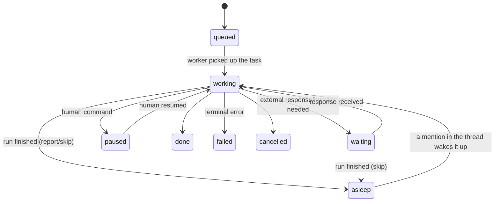

# 11. State Management

## Why does this matter?

An agent is running a long task (say, deploying an application), and the server reboots. The task is lost, the user waits, nothing happens. Without state management you cannot:
- Resume execution after a failure
- Guarantee idempotency (a repeated call creates no duplicates)
- Handle errors with retry
- Set deadlines for long-running tasks

State Management is what makes long-lived agents reliable. Without it, tasks that take minutes or hours fall apart quickly.

### A real-world case

**Situation:** An agent is deploying an application. The process takes 10 minutes. On minute 8 the server reboots.

**Problem:** The task is lost. The user has no idea what happened. When run again, the agent starts from scratch, creating duplicates.

**Solution:** Persisting state to a database, idempotent operations, retry with backoff, and deadlines. Now the agent resumes where it stopped, and repeated calls create no duplicates.

> **Junior employee model.** Idempotency and checkpoints for an agent automate the habit of "not pressing the button a second time until you've confirmed the first press didn't work." Retry with backoff = "wait and repeat carefully, not hammer away like a robot." Humans have this brake built in (repeating a destructive action feels psychologically painful); an agent doesn't — so we put it in code. See [Preface → Mental model](../00-preface/README.md#mental-model-an-agent-is-a-new-employee) and [Ch. 17: Security and Governance](../17-security-and-governance/README.md).

## The theory in plain words

### What is state management?

State management is persisting the agent's state across restarts. It lets you:
- Resume execution after a failure
- Track task progress
- Guarantee idempotency

### What is idempotency?

Idempotency is a property of an operation: calling it again yields the same result as the first call. For example, "create a file" is not idempotent (it creates a duplicate), while "create the file if it doesn't exist" is idempotent.

### How it relates to planning

State management is closely related to [Planning](../10-planning-and-workflows/README.md), but focuses on reliable execution rather than task decomposition. Planning creates the plan; state management guarantees it is executed reliably.

## How it works (step by step)

### Step 0: Agent run state and artifacts outside the context

In the examples below we store the state of a "task" (`Task`). In a production agent a separate **agent run** contract is useful: goal, constraints (HITL policy), budget, and plan. Simplified:

```json
{
  "goal": "Deploy service X to staging",
  "constraints": {
    "human_in_the_loop": { "required_for_risk_levels": ["write_local", "external_action"] }
  },
  "budget": { "max_steps": 20, "max_wall_time_ms": 300000, "max_llm_tokens": 200000 },
  "plan": ["Check current status", "Collect config", "Apply changes", "Verify again"]
}
```

Important: this is **not** part of the LLM context. The state is persisted in the database, separate from the message history, and enters the context only explicitly — as regular messages.

**Artifacts — outside the context.** Dumps, logs, and long command output are stored in a file or database; only a path/ID and a short excerpt go into the history:

```go
type Artifact struct {
    ID      string // "art_123"
    Path    string // /var/agent/artifacts/art_123.log
    Summary string // "nginx error log, 48 KB; excerpt — first 20 lines"
    Bytes   int64
}
```

A legitimate limit worth setting is a budget on the size of a **single tool result** (~128 KB in production): exceeding it → truncate or move it to an artifact. But "filtering relevant state" by scoring inside the context is an anti-pattern: which part of the history to keep is decided by condensation ([Chapter 13](../13-context-engineering/README.md)), not by manual fact scoring.

### Step 1: A task structure with state

Create a structure to store the task state:

```go
type TaskState string

const (
    TaskPending   TaskState = "pending"
    TaskRunning   TaskState = "running"
    TaskCompleted TaskState = "completed"
    TaskFailed    TaskState = "failed"
)

type Task struct {
    ID        string    `json:"id"`
    UserInput string    `json:"user_input"`
    State     TaskState `json:"state"`
    Result    string    `json:"result,omitempty"`
    Error     string    `json:"error,omitempty"`
    CreatedAt time.Time `json:"created_at"`
    UpdatedAt time.Time `json:"updated_at"`
}
```

### Step 2: Idempotent operations

Check whether the task has already been executed:

```go
func executeTask(ctx context.Context, store *TaskStore, id string) error {
    // Load the task from the store
    task, exists := store.Get(id)
    if !exists {
        return fmt.Errorf("task not found: %s", id)
    }
    
    // Check idempotency
    if task.State == TaskCompleted {
        return nil // Already done, nothing to do
    }
    
    // Set the state to "running"
    task.State = TaskRunning
    store.Save(task)
    
    // Execute the task...
    result, err := doWork(task.UserInput)
    
    if err != nil {
        task.State = TaskFailed
        task.Error = err.Error()
    } else {
        task.State = TaskCompleted
        task.Result = result
    }
    
    store.Save(task)
    
    return err
}
```

### Step 3: Retry with exponential backoff

Transient errors (network, API rate limits) are retried by the LLM client itself — exponential backoff with jitter; error classification and implementation are shown in [Chapter 04](../04-autonomy-and-loops/README.md). Here the contract is enough:

```go
// executeWithRetry retries fn on a transient error.
// Terminal errors (iteration limit, deadline) are returned immediately — they are not retried.
func executeWithRetry(ctx context.Context, fn func() error, maxRetries int) error
```

Planning and retries do not cancel boundaries: the run deadline and the iteration limit are terminal — exceeding them stops the run with a message to the human (see the FSM below).

### Step 4: Deadlines

Set a timeout for the whole agent run and for each step:

```go
func runAgentWithDeadline(ctx context.Context, agent *Agent, userInput string) (string, error) {
    // Deadline for the whole agent run (5 minutes)
    ctx, cancel := context.WithDeadline(ctx, time.Now().Add(5*time.Minute))
    defer cancel()
    
    // ... agent loop ...
    
    for i := 0; i < maxIterations; i++ {
        // Check the deadline before each iteration
        select {
        case <-ctx.Done():
            return "", fmt.Errorf("deadline exceeded")
        default:
        }
        
        // ... execution ...
    }
}
```

### Step 5: Persisting state

Save the task state after every meaningful change. In the examples below it lives in process memory; in production — SQLite or any other database (see the [Store](#store-database-backed-storage) section below):

```go
type TaskStore struct {
    mu    sync.RWMutex
    tasks map[string]*Task
}

func (s *TaskStore) Save(task *Task) {
    s.mu.Lock()
    defer s.mu.Unlock()
    task.UpdatedAt = time.Now()
    s.tasks[task.ID] = task
}

func (s *TaskStore) Get(id string) (*Task, bool) {
    s.mu.RLock()
    defer s.mu.RUnlock()
    task, exists := s.tasks[id]
    return task, exists
}
```

### Memory: linear history + condense

There is no separate "working memory" layer in an agent — that is a relic of older frameworks. An agent's memory is the **linear message history**: the current task, the plan, files read, and recent actions are already in it. When the context overflows, condensation kicks in: older messages are condensed into a brief summary while recent ones stay as is.

Persistence is about saving the history itself (checkpoints, see below): after a restart the agent loads the history and continues, without re-reading files or losing the plan. How condense and long-term memory work — [Chapters 12](../12-agent-memory/README.md) and [13](../13-context-engineering/README.md).

### Step 6: Resuming execution

Continue executing the task after a failure:

```go
func resumeTask(ctx context.Context, store *TaskStore, taskID string) error {
    task, exists := store.Get(taskID)
    if !exists {
        return fmt.Errorf("task not found: %s", taskID)
    }
    
    // If the task is already completed, do nothing
    if task.State == TaskCompleted {
        return nil
    }
    
    // If the task failed, it can be retried
    if task.State == TaskFailed {
        task.State = TaskPending
        store.Save(task)
    }
    
    // Continue execution
    return executeTask(taskID)
}
```

## Where to plug this into our code

### Integration point 1: Agent loop

> **Note:** the labs are not yet revised (still on the old stack) — use them as a pointer; the canonical material is in this chapter.

In [`labs/lab04-autonomy/main.go`](https://github.com/kshvakov/ai-agent-course/blob/main/labs/lab04-autonomy/main.go), add state saving:

```go
store := &TaskStore{tasks: map[string]*Task{}}

// At the start of the agent run:
task := &Task{
    ID:        generateTaskID(),
    UserInput: userInput,
    State:     TaskRunning,
    CreatedAt: time.Now(),
}
store.Save(task)

// After completion:
task.State = TaskCompleted
task.Result = finalAnswer
store.Save(task)
```

### Integration point 2: Tool execution

> **Note:** the labs are not yet revised (still on the old stack) — use them as a pointer; the canonical material is in this chapter.

In [`labs/lab02-tools/main.go`](https://github.com/kshvakov/ai-agent-course/blob/main/labs/lab02-tools/main.go), add retry for tools:

```go
func executeToolWithRetry(ctx context.Context, toolCall ToolCall) (string, error) {
    var result string
    err := executeWithRetry(ctx, func() error {
        var err error
        result, err = executeTool(toolCall)
        return err
    }, 3)
    return result, err
}
```

## Mini code example

> **Note:** this lab is not yet revised (still on the old stack) — use it as a pointer; the canonical material is in this chapter.

A complete example with a workflow and state management, based on [`labs/lab04-autonomy/main.go`](https://github.com/kshvakov/ai-agent-course/blob/main/labs/lab04-autonomy/main.go). The LLM client is neutral (`llm.Client`): retrying transient errors already happens inside the client; here we only manage state and boundaries:

```go
package main

import (
    "context"
    "fmt"
    "sync"
    "time"
)

type TaskState string

const (
    TaskPending   TaskState = "pending"
    TaskRunning   TaskState = "running"
    TaskCompleted TaskState = "completed"
    TaskFailed    TaskState = "failed"
)

type Task struct {
    ID        string    `json:"id"`
    UserInput string    `json:"user_input"`
    State     TaskState `json:"state"`
    Result    string    `json:"result,omitempty"`
    Error     string    `json:"error,omitempty"`
    CreatedAt time.Time `json:"created_at"`
    UpdatedAt time.Time `json:"updated_at"`
}

type TaskStore struct {
    mu    sync.RWMutex
    tasks map[string]*Task
}

func (s *TaskStore) Save(task *Task) {
    s.mu.Lock()
    defer s.mu.Unlock()
    task.UpdatedAt = time.Now()
    s.tasks[task.ID] = task
}

func (s *TaskStore) Get(id string) (*Task, bool) {
    s.mu.RLock()
    defer s.mu.RUnlock()
    task, exists := s.tasks[id]
    return task, exists
}

var tools = map[string]func() string{
    "check_disk": func() string { return "Disk usage: 95%, large folder: /var/log" },
    "clean_logs": func() string { return "Logs cleaned, freed 20 GB" },
}

func main() {
    // Deadline for the whole agent run — a terminal boundary
    ctx, cancel := context.WithDeadline(context.Background(), time.Now().Add(5*time.Minute))
    defer cancel()

    userInput := "I'm out of disk space. Deal with it."

    store := &TaskStore{tasks: map[string]*Task{}}
    task := &Task{
        ID:        fmt.Sprintf("task-%d", time.Now().UnixNano()),
        UserInput: userInput,
        State:     TaskRunning,
        CreatedAt: time.Now(),
    }
    store.Save(task)

    agent := NewAgent(llm.ClientFromEnv())

    const maxIterations = 5
    for i := 0; i < maxIterations; i++ {
        select {
        case <-ctx.Done():
            task.State, task.Error = TaskFailed, "deadline exceeded"
            store.Save(task)
            return
        default:
        }

        // One iteration: LLM call + executing tool calls
        reply, err := agent.Step(ctx, userInput)
        if err != nil {
            task.State, task.Error = TaskFailed, err.Error()
            store.Save(task)
            return
        }

        if reply.Done { // the model answered with text — the task is complete
            task.State, task.Result = TaskCompleted, reply.Text
            store.Save(task)
            fmt.Println("AI:", reply.Text)
            return
        }
    }

    // The iteration limit is a terminal error too
    task.State, task.Error = TaskFailed, "iteration limit exceeded"
    store.Save(task)
}
```

Note that the deadline and the iteration limit finish the task with the `failed` status and a message to the human — no "maybe it'll work on the sixth try" logic.

## Store: Database-backed Storage

In the examples above the state lives in process memory. For learning purposes this works, but not in production.

### Why process memory is not production

1. **Reboot = loss.** The state dies with the process.
2. **No concurrent access.** Two agent instances cannot safely work on the same tasks.
3. **No queries.** Finding all unfinished tasks requires scanning everything.

A database solves all three problems. PostgreSQL is a reliable production choice. SQLite is a good option for local development and a single instance.

### StateStore: the storage interface

We separate the interface from the implementation. This lets you swap the storage in tests and change it without rewriting the agent's logic.

```go
// StateStore is the storage contract for agent state.
// An implementation may use PostgreSQL, SQLite or an in-memory store.
type StateStore interface {
    Save(ctx context.Context, task *Task) error
    Get(ctx context.Context, id string) (*Task, error)
    ListByState(ctx context.Context, state TaskState) ([]*Task, error)
}
```

### PostgreSQL implementation

```go
type PgStateStore struct {
    db *sql.DB
}

func NewPgStateStore(dsn string) (*PgStateStore, error) {
    db, err := sql.Open("pgx", dsn)
    if err != nil {
        return nil, fmt.Errorf("connect to postgres: %w", err)
    }
    return &PgStateStore{db: db}, nil
}

func (s *PgStateStore) Save(ctx context.Context, task *Task) error {
    // UPSERT: insert a new task or update the existing one
    query := `
        INSERT INTO agent_tasks (id, user_input, state, result, error, created_at, updated_at)
        VALUES ($1, $2, $3, $4, $5, $6, now())
        ON CONFLICT (id) DO UPDATE SET
            state      = EXCLUDED.state,
            result     = EXCLUDED.result,
            error      = EXCLUDED.error,
            updated_at = now()`

    _, err := s.db.ExecContext(ctx, query,
        task.ID, task.UserInput, task.State,
        task.Result, task.Error, task.CreatedAt,
    )
    return err
}

func (s *PgStateStore) Get(ctx context.Context, id string) (*Task, error) {
    task := &Task{}
    err := s.db.QueryRowContext(ctx,
        `SELECT id, user_input, state, result, error, created_at, updated_at
         FROM agent_tasks WHERE id = $1`, id,
    ).Scan(
        &task.ID, &task.UserInput, &task.State,
        &task.Result, &task.Error,
        &task.CreatedAt, &task.UpdatedAt,
    )
    if errors.Is(err, sql.ErrNoRows) {
        return nil, nil
    }
    return task, err
}

func (s *PgStateStore) ListByState(ctx context.Context, state TaskState) ([]*Task, error) {
    rows, err := s.db.QueryContext(ctx,
        `SELECT id, user_input, state, result, error, created_at, updated_at
         FROM agent_tasks WHERE state = $1 ORDER BY created_at`, state,
    )
    if err != nil {
        return nil, err
    }
    defer rows.Close()

    var tasks []*Task
    for rows.Next() {
        t := &Task{}
        if err := rows.Scan(
            &t.ID, &t.UserInput, &t.State,
            &t.Result, &t.Error,
            &t.CreatedAt, &t.UpdatedAt,
        ); err != nil {
            return nil, err
        }
        tasks = append(tasks, t)
    }
    return tasks, rows.Err()
}
```

### Transactions for atomic updates

Whenever the agent performs a step, the state must be updated atomically. If the step fails, the state must not change.

```go
func (s *PgStateStore) ExecuteStep(ctx context.Context, taskID string, stepFn func(*Task) error) error {
    tx, err := s.db.BeginTx(ctx, nil)
    if err != nil {
        return fmt.Errorf("begin tx: %w", err)
    }
    defer tx.Rollback()

    // SELECT ... FOR UPDATE locks the row for the duration of the step.
    // Another agent cannot modify this task in parallel.
    task := &Task{}
    err = tx.QueryRowContext(ctx,
        `SELECT id, user_input, state, result, error, created_at, updated_at
         FROM agent_tasks WHERE id = $1 FOR UPDATE`, taskID,
    ).Scan(
        &task.ID, &task.UserInput, &task.State,
        &task.Result, &task.Error,
        &task.CreatedAt, &task.UpdatedAt,
    )
    if err != nil {
        return fmt.Errorf("lock task: %w", err)
    }

    // Run the business logic of the step
    if err := stepFn(task); err != nil {
        return fmt.Errorf("step failed: %w", err)
    }

    // Save the updated state inside the transaction
    _, err = tx.ExecContext(ctx,
        `UPDATE agent_tasks SET state=$1, result=$2, error=$3, updated_at=now() WHERE id=$4`,
        task.State, task.Result, task.Error, task.ID,
    )
    if err != nil {
        return fmt.Errorf("save state: %w", err)
    }

    return tx.Commit()
}
```

Either the step completes fully or it rolls back. There is no intermediate "half-done" state.

## MCP for State

The Model Context Protocol (MCP) lets you expose agent state externally as standardized resources: one agent writes progress, another reads it by URI and continues the work — without a custom API for every store. This makes sense in [multi-agent systems](../07-multi-agent/README.md), where several agents share one state; for a single agent, the `StateStore` from this chapter is enough. MCP is covered in detail in [Chapter 18: Tool Protocols and Tool Servers](../18-tool-protocols-and-servers/README.md).

## Artifacts Outside the Context (Instead of "Dynamic State Selection")

An agent accumulates artifacts: logs, command output, intermediate data. Over time their volume exceeds the LLM's context window. Send everything and the model loses focus; send nothing and it cannot make a decision.

**Anti-pattern — "Dynamic Context":** manually scoring known facts and artifacts ("priority 1: artifacts of the current step, priority 2: recent facts") and assembling a context slice from them on every step. This is hidden logic that bypasses the model: it cannot be tested, it conflicts with condensing, and it silently breaks when the context window changes.

**An approach that works:**

- Large artifacts are stored **outside** the history — in a file or a database; what goes into the context is a path/ID plus a short excerpt (see `Artifact` in "Step 0").
- The budget is placed on the size of a **single tool result** (~128 KB in production): exceeding it → truncate or move it into an artifact.
- What stays in the history on context overflow is decided by condensing, not manual scoring ([Chapter 13](../13-context-engineering/README.md)).

For context size and cost management, see [Chapter 20: Cost & Latency Engineering](../20-cost-latency-engineering/README.md).

## Advanced Checkpoint Strategies

The basic Checkpoint implementation (the structure, saving/loading, integration with the agent loop) is described in [Chapter 09: Anatomy of an Agent](../09-agent-architecture/README.md#checkpoint-and-resume). Here we look at advanced strategies for production.

### When to save: checkpoint granularity

A checkpoint is a state snapshot you can return to. How often you save is a trade-off between reliability and performance:

| Strategy | When we save | Pro | Con |
|-----------|----------------|------|-------|
| `every_step` | After every tool call | Minimal progress loss | Many DB writes |
| `every_iteration` | After every iteration of the loop | Balance between reliability and I/O | Intermediate steps are lost |
| `on_state_change` | Only on state change | Minimal I/O | Progress within a state is lost |

### CheckpointManager

```go
type CheckpointStrategy string

const (
    CheckpointEveryStep      CheckpointStrategy = "every_step"
    CheckpointEveryIteration CheckpointStrategy = "every_iteration"
    CheckpointOnStateChange  CheckpointStrategy = "on_state_change"
)

type CheckpointManager struct {
    store    StateStore
    strategy CheckpointStrategy
    maxAge   time.Duration // Maximum age of a checkpoint
    maxCount int           // How many checkpoints to keep per task
}

// MaybeSave saves a checkpoint if the current trigger matches the strategy.
func (cm *CheckpointManager) MaybeSave(
    ctx context.Context,
    task *Task,
    trigger CheckpointStrategy,
) error {
    if trigger != cm.strategy {
        return nil // Not our trigger — skip
    }
    return cm.store.Save(ctx, task)
}
```

### Validation before resuming

You cannot blindly resume a task from a checkpoint. A checkpoint may be stale, and its state may be invalid.

```go
// ValidateAndResume loads a checkpoint and checks whether it is usable.
func (cm *CheckpointManager) ValidateAndResume(ctx context.Context, taskID string) (*Task, error) {
    task, err := cm.store.Get(ctx, taskID)
    if err != nil {
        return nil, fmt.Errorf("load checkpoint: %w", err)
    }
    if task == nil {
        return nil, fmt.Errorf("checkpoint not found: %s", taskID)
    }

    // Check 1: the checkpoint has not expired
    age := time.Since(task.UpdatedAt)
    if age > cm.maxAge {
        return nil, fmt.Errorf("checkpoint expired: age %v exceeds max %v", age, cm.maxAge)
    }

    // Check 2: the state allows resuming
    switch task.State {
    case TaskCompleted:
        return task, nil // Already completed, no need to run again
    case TaskRunning, TaskFailed:
        return task, nil // Can be resumed
    default:
        return nil, fmt.Errorf("cannot resume from state: %s", task.State)
    }
}
```

### Checkpoint rotation

Checkpoints accumulate. Without cleanup they take up space and make recovery harder. Rotation keeps only the last N checkpoints and deletes expired ones.

```go
// Cleanup deletes expired checkpoints, keeping the last maxCount ones.
func (cm *CheckpointManager) Cleanup(ctx context.Context, taskID string) (int64, error) {
    result, err := cm.store.(*PgStateStore).db.ExecContext(ctx,
        `DELETE FROM agent_checkpoints
         WHERE task_id = $1
           AND created_at < $2
           AND id NOT IN (
               SELECT id FROM agent_checkpoints
               WHERE task_id = $1
               ORDER BY created_at DESC
               LIMIT $3
           )`,
        taskID, time.Now().Add(-cm.maxAge), cm.maxCount,
    )
    if err != nil {
        return 0, fmt.Errorf("cleanup checkpoints: %w", err)
    }
    return result.RowsAffected()
}
```

A good practice is to run rotation after every successful save or on a schedule.

## The FSM of an Autonomous Run

Production bots that live in a chat or a tracker for hours do not spin the agent loop forever. A task (an issue, a ticket, a message) goes through a finite state machine:

| State | What happens |
|-----------|----------------|
| `queued` | The task is queued, waiting for a worker |
| `working` | The agent loop is running: model, tools, plan steps |
| `waiting` | The run is suspended: waiting for an external response or a human |
| `paused` | A sticky pause set by a human command; survives a restart |
| `asleep` | The run has finished (report sent or skipped), the task is "listening" to the thread |
| `done` / `failed` / `cancelled` | Terminal states — there is no way out of them |



The key rules:

- **"Freedom inside the run, boundaries on the outside."** Inside the run (`working`) the agent is free: it builds the plan itself, calls tools, revises steps. On the outside there are hard boundaries: a **run deadline (~1 hour)** and an **iteration limit**. Exceeding either is a terminal error: the run ends with status `failed` and a message to the human — not "one more attempt".
- **`waiting` ≠ `paused`.** `waiting` — the agent itself is waiting for a response (an HTTP callback, a human confirmation) and will continue automatically. `paused` — a stop command from a human; only a human can lift the pause.
- **`asleep` — the task listens to the thread.** The run is finished, the report has been sent (or marked skip), but the task keeps watching the chat: a new message in which the task is **mentioned** wakes it up — a new `working` run begins. Without a mention the task sleeps and spends no tokens.
- **Ack after persist.** An incoming event is acknowledged to the delivery layer **only after** the state and the history have been successfully persisted to the DB. If the process dies before the persist, the event is not acknowledged and will be delivered again — which is why operations must be idempotent (see above). An undelivered response arrives on the next run — the task does not lose it while in `waiting`/`asleep`.
- The FSM state is stored in the same `StateStore` as the tasks and survives process restarts.

## Common Mistakes

### Mistake 1: No idempotency

**Symptom:** A repeated call creates duplicates (for example, creates two files instead of one).

**Cause:** Operations do not check whether they have already been performed.

**Fix:**
```go
// BAD:
func createFile(filename string) error {
    os.WriteFile(filename, []byte("data"), 0644)
    return nil
}

// GOOD:
func createFileIfNotExists(filename string) error {
    if _, err := os.Stat(filename); err == nil {
        return nil // Already exists
    }
    return os.WriteFile(filename, []byte("data"), 0644)
}
```

### Mistake 2: No retry on errors

**Symptom:** The agent fails on the first transient error (network error, timeout).

**Cause:** No retries on errors.

**Fix:**
```go
// BAD:
result, err := executeTool(toolCall)
if err != nil {
    return "", err // Return the error immediately
}

// GOOD:
err := executeWithRetry(func() error {
    result, err := executeTool(toolCall)
    return err
}, 3)
```

### Mistake 3: No deadlines

**Symptom:** The agent hangs forever while the user waits.

**Cause:** No timeout for operations.

**Fix:**
```go
// BAD:
resp, _ := agent.Step(ctx, input)
// May hang forever

// GOOD:
ctx, cancel := context.WithDeadline(ctx, time.Now().Add(5*time.Minute))
defer cancel()
resp, err := agent.Step(ctx, input)
```

### Mistake 4: State is not persisted

**Symptom:** After a restart the agent starts from scratch, losing progress.

**Cause:** State is kept only in memory.

**Fix:**
```go
// BAD:
var taskState = "running" // In memory only

// GOOD:
task.State = TaskRunning
store.Save(task) // Persist to the DB
```

### Mistake 5: History lost between sessions

**Symptom:** The agent re-reads files it already read in a previous session. The task plan is lost. Progress is not preserved.

**Cause:** The message history lives only in RAM and is lost on restart.

**Fix:** Persist the history itself — the linear message history together with the condensate, not some invented "working memory" layer:

```go
// GOOD: history + condensate are saved and restored
func handleSession(ctx context.Context, sessionID string) {
    history := loadHistory(sessionID) // from the DB
    defer saveHistory(sessionID, history)
    agent.Run(ctx, history)
}
```

## Exercises

### Exercise 1: Implement retry with backoff

Implement an execution function with retry:

```go
func executeWithRetry(fn func() error, maxRetries int) error {
    // Your code here
    // Retry the call with exponential backoff
}
```

**Expected result:**
- The function retries the call on error
- Exponential backoff is used (1s, 2s, 4s...)
- The function returns an error after the retries are exhausted

### Exercise 2: Implement idempotency

Create a function that checks whether a task has already been executed:

```go
func executeTaskIfNotDone(taskID string) error {
    // Your code here
    // Check the task state before executing
}
```

**Expected result:**
- If the task is already done, the function returns nil without executing it
- If the task is not done, the function executes it and saves the state

## Acceptance Criteria / Checklist

**Done (production-ready):**
- [x] Operations are idempotent (a repeated call creates no duplicates)
- [x] Retries with exponential backoff are implemented
- [x] Deadlines are set for the agent run and for individual operations
- [x] Task state persists across restarts
- [x] Task execution can be resumed after a failure
- [x] You understand the FSM of an autonomous run: working/waiting/paused/asleep, ack-after-persist

**Not done:**
- [ ] No idempotency
- [ ] No retry on errors
- [ ] No deadlines
- [ ] State is not persisted
- [ ] History is lost between sessions (no history checkpoints)

## Relation to Other Chapters

- **[Chapter 04: Autonomy and Loops](../04-autonomy-and-loops/README.md)** — The basic agent loop
- **[Chapter 10: Planning and Workflow Patterns](../10-planning-and-workflows/README.md)** — State management ensures reliable plan execution
- **[Chapter 19: Observability and Tracing](../19-observability-and-tracing/README.md)** — Logging task state
- **[Chapter 20: Cost & Latency Engineering](../20-cost-latency-engineering/README.md)** — Controlling the cost of long-running tasks

## What's Next?

Once you understand state management, move on to:
- **[12. Agent Memory Systems](../12-agent-memory/README.md)** — Learn how agents store and retrieve information

