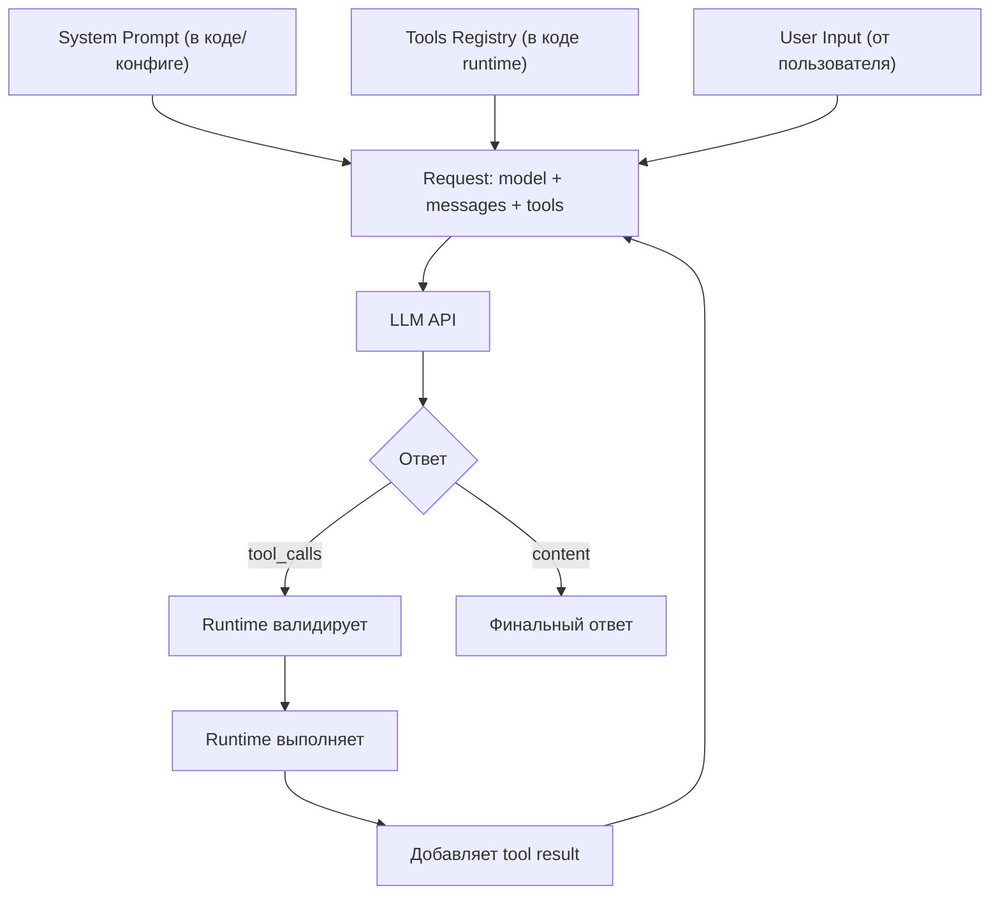

# 03. Инструменты и Function Calling — "руки" агента

> **Примечание о терминологии:** В этой главе используются термины "Function Calling" (название механизма в API) и "Tool Call" (конкретный вызов инструмента). Это одно и то же: механизм, при котором LLM возвращает структурированный запрос на вызов функции Go. В коде агента мы обычно говорим "tool" (инструмент), потому что это более общее понятие (инструмент может быть не только функцией Go, но и API-вызовом, командой и т.д.).

## Зачем это нужно?

Инструменты превращают LLM из болтуна в работника. Без инструментов агент может только отвечать текстом, но не может взаимодействовать с реальным миром.

Function Calling — это механизм, который даёт модели доступ к реальным действиям: вызывать функции Go, выполнять команды, читать данные.

### Реальный кейс

**Ситуация:** Вы создали чат-бота для DevOps. Пользователь пишет: "Проверь статус сервера web-01"

**Проблема:** Бот не может реально проверить сервер. Он только обещает: "Я проверю статус сервера web-01..." — но это просто текст.

**Решение:** Function Calling позволяет модели вызывать реальные функции Go. Модель генерирует структурированный JSON с именем функции и аргументами, ваш код выполняет функцию и возвращает результат обратно в модель.

> **Junior employee model.** Список инструментов агента — это «должностная инструкция нового сотрудника». Что не дали — того он сделать не сможет; что дали — может, причём очень быстро. Минимальный набор ролей, явные `ReadOnly` / `Parallel`-флаги и risk-категория для каждого tool — это то же самое, что для человека: «доступ только туда, куда нужно для работы». См. [Предисловие → Ментальная модель](../00-preface/README.md#ментальная-модель-агент-это-новый-сотрудник) и [Гл. 17: Security и Governance](../17-security-and-governance/README.md).

## Теория простыми словами

### Как работает Function Calling?

1. **Вы описываете функцию** в формате JSON Schema
2. **LLM видит описание** и решает: "Мне нужно вызвать эту функцию"
3. **LLM генерирует JSON** с именем функции и аргументами
4. **Ваш код парсит JSON** и выполняет реальную функцию
5. **Результат возвращается** в LLM для дальнейшей обработки

## Function Calling — механизм работы

**Function Calling** — это механизм, при котором LLM возвращает не текст, а структурированный JSON с именем функции и аргументами.

### Полный цикл: от определения до выполнения

Разберём **полный цикл** на примере инструмента `ping`:

Для примеров в этой главе используем нейтральные типы поверх нативного tool-calling API (OpenAI-совместимого). Это ровно то, что уходит в HTTP-запрос и приходит из ответа, — без привязки к конкретному SDK:

```go
// Описание инструмента — уходит в поле "tools" запроса.
type ToolDef struct {
    Name        string
    Description string
    Parameters  json.RawMessage // JSON Schema аргументов
}

// Сообщение истории. Role: "system" | "user" | "assistant" | "tool".
type Message struct {
    Role       string
    Content    string
    ToolCallID string    // для role="tool": связывает результат с вызовом
    ToolCalls  []ToolCall // для role="assistant": сгенерированные вызовы
}

// Один вызов инструмента, сгенерированный моделью.
type ToolCall struct {
    ID        string
    Name      string
    Arguments string // JSON-строка
}
```

#### Шаг 1: Определение инструмента (Tool Schema)

```go
tools := []ToolDef{
    {
        Name:        "ping",
        Description: "Ping a host to check connectivity",
        Parameters: json.RawMessage(`{
            "type": "object",
            "properties": {
                "host": {
                    "type": "string",
                    "description": "Hostname or IP address to ping"
                }
            },
            "required": ["host"]
        }`),
    },
}
```

**Что происходит:** Мы описываем инструмент в формате JSON Schema. Это описание отправляется в модель вместе с запросом.

#### Шаг 2: Запрос к модели

```go
messages := []Message{
    {Role: "system", Content: "You are a network admin. Use tools to check connectivity."},
    {Role: "user", Content: "Проверь доступность google.com"},
}

client, err := NewClient(...) // провайдер из конфига (гл. 04)

req := Request{
    Model:       "glm-5.3",
    Messages:    messages,
    Tools:       tools,  // Модель видит описание инструментов!
    Temperature: 0.2, // качество: меньше разброс в выборе инструментов
}

resp, err := client.Complete(ctx, req) // ошибка обрабатывается циклом (гл. 04)
msg := resp.Choices[0].Message
```

`client.Complete` — метод нейтрального клиента; полный канон типов — в [главе 04](../04-autonomy-and-loops/README.md).

**Что происходит:** Модель видит:
- System prompt (роль и инструкции)
- User input (запрос пользователя)
- **Tools schema** (описание доступных инструментов)

#### Шаг 3: Ответ модели (Tool Call)

Модель **не возвращает текст** "Я проверю ping". Она возвращает **структурированный tool call**:

```go
// msg.ToolCalls содержит:
[]ToolCall{
    {
        ID:        "call_abc123",
        Name:      "ping",
        Arguments: `{"host": "google.com"}`,
    },
}
```

**Что происходит:** Модель **сгенерировала tool_call** для инструмента `ping` и JSON с аргументами. Тут нет магии: модель увидела `Description: "Ping a host to check connectivity"` и сопоставила его с запросом пользователя.

**Как модель выбирает между несколькими инструментами?**

Расширим пример и добавим несколько инструментов:

```go
tools := []ToolDef{
    {
        Name:        "ping",
        Description: "Ping a host to check network connectivity. Use this when user asks about network reachability or connectivity.",
    },
    {
        Name:        "check_http",
        Description: "Check HTTP status code of a website. Use this when user asks about website availability or HTTP errors.",
    },
    {
        Name:        "traceroute",
        Description: "Trace the network path to a host. Use this when user asks about network routing or path analysis.",
    },
}

userInput := "Проверь доступность google.com"
```

**Процесс выбора:**

1. Модель видит **все три инструмента** и их `Description`:
    - `ping`: "check network connectivity... Use this when user asks about network reachability"
    - `check_http`: "Check HTTP status... Use this when user asks about website availability"
    - `traceroute`: "Trace network path... Use this when user asks about routing"

2. Модель сопоставляет запрос "Проверь доступность google.com" с описаниями:
    - [x] `ping` — описание содержит "connectivity" и "reachability" → **выбирает этот**
    - [ ] `check_http` — про HTTP статус, не про сетевую доступность
    - [ ] `traceroute` — про маршрутизацию, не про проверку доступности

3. Модель возвращает tool call для `ping`:
    ```json
    {"name": "ping", "arguments": "{\"host\": \"google.com\"}"}
    ```

**Пример с другим запросом:**

```go
userInput := "Проверь, отвечает ли сайт google.com"

// Модель видит те же 3 инструмента
// Сопоставляет:
// - ping: про сетевую доступность → не совсем то
// - check_http: "Use this when user asks about website availability" → ВЫБИРАЕТ ЭТОТ
// - traceroute: про маршрутизацию → не подходит

// Модель возвращает:
// {"name": "check_http", "arguments": "{\"url\": \"https://google.com\"}"}
```

**Суть:** Модель выбирает инструмент на основе **семантического соответствия** между запросом пользователя и `Description`. Чем точнее и конкретнее `Description`, тем лучше модель выбирает нужный инструмент.

#### Что делает LLM, а что делает Runtime?

**LLM (модель):**
- Видит описание инструментов в `tools[]`
- Генерирует JSON с именем инструмента и аргументами
- Возвращает структурированный ответ в поле `tool_calls`

**Runtime (ваш код):**
- Парсит `tool_calls` из ответа модели
- Валидирует имя инструмента (существует ли он?)
- Валидирует JSON аргументов (корректен ли?)
- Выполняет реальную функцию Go
- Добавляет результат в историю (`messages[]`)
- Отправляет обновленную историю обратно в модель

**Важно:** LLM не выполняет код. Она только генерирует JSON с запросом на выполнение. Ваш Runtime выполняет реальный код.

#### Шаг 4: Валидация (Runtime)

```go
// Проверяем, что инструмент существует
if msg.ToolCalls[0].Name != "ping" {
    return fmt.Errorf("unknown tool: %s", msg.ToolCalls[0].Name)
}

// Валидируем JSON аргументов
var args struct {
    Host string `json:"host"`
}
if err := json.Unmarshal([]byte(msg.ToolCalls[0].Arguments), &args); err != nil {
    return fmt.Errorf("invalid JSON: %v", err)
}

// Проверяем обязательные поля
if args.Host == "" {
    return fmt.Errorf("host is required")
}
```

**Что происходит:** Runtime валидирует вызов перед выполнением. Это **критично** для безопасности.

#### Шаг 5: Выполнение инструмента

```go
func executePing(host string) string {
    cmd := exec.Command("ping", "-c", "1", host)
    output, err := cmd.CombinedOutput()
    if err != nil {
        return fmt.Sprintf("Error: %s", err)
    }
    return string(output)
}

result := executePing(args.Host)  // "PING google.com: 64 bytes from ..."
```

**Что происходит:** Runtime выполняет **реальную функцию** (в данном случае системную команду `ping`).

#### Шаг 6: Возврат результата в модель

```go
// Добавляем результат в историю как сообщение с ролью "tool"
messages = append(messages, Message{
    Role:       "tool",
    Content:    result,  // "PING google.com: 64 bytes from ..."
    ToolCallID: msg.ToolCalls[0].ID,  // Связываем с вызовом
})

// Отправляем обновленную историю в модель снова
resp2, err := client.Complete(ctx, Request{
    Model:    "glm-5.3",
    Messages: messages,  // Теперь включает результат инструмента!
    Tools:    tools,
}) // ошибка обрабатывается циклом (гл. 04)
```

**Что происходит:** Модель видит результат выполнения инструмента и может:
- Сформулировать финальный ответ пользователю
- Вызвать другой инструмент, если нужно
- Задать уточняющий вопрос

#### Шаг 7: Финальный ответ

```go
finalMsg := resp2.Choices[0].Message
if len(finalMsg.ToolCalls) == 0 {
    // Это финальный текстовый ответ
    fmt.Println(finalMsg.Content)  // "google.com доступен, время отклика 10ms"
}
```

**Что происходит:** Модель видела результат `ping` и сформулировала понятный ответ для пользователя.

## Сквозной протокол: полный запрос и два хода

Теперь разберем **полный протокол** с точки зрения разработчика агента: где что хранится, как собирается запрос, и как runtime обрабатывает ответы.

### Где что хранится в коде агента?



**Схема хранения:**

1. **System Prompt** — хранится в коде агента (константа или конфиг):
    - Инструкции (Role, Goal, Constraints)
    - Few-shot примеры (если используются)
    - SOP (алгоритм действий)

2. **Tools Schema** — хранится в **registry runtime** (не в промпте!):
    - Определения инструментов (JSON Schema)
    - Функции-обработчики инструментов
    - Валидация и выполнение

3. **User Input** — приходит от пользователя:
    - Текущий запрос
    - История диалога (хранится в `messages[]`)

4. **Tool Results** — генерируются runtime'ом:
    - После выполнения инструмента
    - Добавляются в `messages[]` с `Role = "tool"`

### Полный протокол: JSON запросы и ответы (2 хода)

**Ход 1: Request с несколькими инструментами**

```json
{
  "model": "glm-5.3",
  "messages": [
    {
      "role": "system",
      "content": "Ты DevOps инженер. Используй инструменты для проверки сервисов.\n\nПримеры использования:\nUser: \"Проверь статус nginx\"\nAssistant: возвращает tool_call check_status(\"nginx\")\n\nUser: \"Перезапусти сервер\"\nAssistant: возвращает tool_call restart_service(\"web-01\")"
    },
    {
      "role": "user",
      "content": "Проверь статус nginx"
    }
  ],
  "tools": [
    {
      "type": "function",
      "function": {
        "name": "check_status",
        "description": "Check if a service is running. Use this when user asks about service status.",
        "parameters": {
          "type": "object",
          "properties": {
            "service": {
              "type": "string",
              "description": "Service name"
            }
          },
          "required": ["service"]
        }
      }
    },
    {
      "type": "function",
      "function": {
        "name": "restart_service",
        "description": "Restart a systemd service. Use this when user explicitly asks to restart a service.",
        "parameters": {
          "type": "object",
          "properties": {
            "service_name": {
              "type": "string",
              "description": "Service name to restart"
            }
          },
          "required": ["service_name"]
        }
      }
    }
  ],
  "tool_choice": "auto"
}
```

**Где что находится:**
- **System Prompt** (инструкции + few-shot примеры) → `messages[0].content`
- **User Input** → `messages[1].content`
- **Tools Schema** (2 инструмента с полными JSON Schema) → отдельное поле `tools[]`

**Response #1 (tool call):**

```json
{
  "id": "chatcmpl-abc123",
  "choices": [{
    "message": {
      "role": "assistant",
      "content": null,
      "tool_calls": [
        {
          "id": "call_xyz789",
          "type": "function",
          "function": {
            "name": "check_status",
            "arguments": "{\"service\": \"nginx\"}"
          }
        }
      ]
    }
  }]
}
```

**Runtime обрабатывает tool call:**
1. Валидирует: `tool_calls[0].function.name` существует в registry
2. Парсит: `json.Unmarshal(tool_calls[0].function.arguments)` → `{"service": "nginx"}`
3. Выполняет: `check_status("nginx")` → результат: `"Service nginx is ONLINE"`
4. Добавляет tool result в `messages[]`

**Ход 2: Request с tool result**

```json
{
  "model": "glm-5.3",
  "messages": [
    {
      "role": "system",
      "content": "Ты DevOps инженер. Используй инструменты для проверки сервисов.\n\nПримеры использования:\nUser: \"Проверь статус nginx\"\nAssistant: возвращает tool_call check_status(\"nginx\")\n\nUser: \"Перезапусти сервер\"\nAssistant: возвращает tool_call restart_service(\"web-01\")"
    },
    {
      "role": "user",
      "content": "Проверь статус nginx"
    },
    {
      "role": "assistant",
      "content": null,
      "tool_calls": [
        {
          "id": "call_xyz789",
          "type": "function",
          "function": {
            "name": "check_status",
            "arguments": "{\"service\": \"nginx\"}"
          }
        }
      ]
    },
    {
      "role": "tool",
      "content": "Service nginx is ONLINE",
      "tool_call_id": "call_xyz789"
    }
  ],
  "tools": [
    {
      "type": "function",
      "function": {
        "name": "check_status",
        "description": "Check if a service is running. Use this when user asks about service status.",
        "parameters": {
          "type": "object",
          "properties": {
            "service": {
              "type": "string",
              "description": "Service name"
            }
          },
          "required": ["service"]
        }
      }
    },
    {
      "type": "function",
      "function": {
        "name": "restart_service",
        "description": "Restart a systemd service. Use this when user explicitly asks to restart a service.",
        "parameters": {
          "type": "object",
          "properties": {
            "service_name": {
              "type": "string",
              "description": "Service name to restart"
            }
          },
          "required": ["service_name"]
        }
      }
    }
  ]
}
```

**Где что находится:**
- **System Prompt** → `messages[0].content` (тот же)
- **User Input** → `messages[1].content` (тот же)
- **Tool Call** → `messages[2]` (добавлен runtime'ом после первого ответа)
- **Tool Result** → `messages[3].content` (добавлен runtime'ом после выполнения)
- **Tools Schema** → поле `tools[]` (тот же)

**Response #2 (финальный ответ):**

```json
{
  "id": "chatcmpl-def456",
  "choices": [{
    "message": {
      "role": "assistant",
      "content": "nginx работает нормально, сервис ONLINE",
      "tool_calls": null
    }
  }]
}
```

### Эволюция messages[] массива (JSON)

**До первого запроса:**
```json
[
  {"role": "system", "content": "Ты DevOps инженер..."},
  {"role": "user", "content": "Проверь статус nginx"}
]
```

**После первого запроса (runtime добавляет tool call):**
```json
[
  {"role": "system", "content": "Ты DevOps инженер..."},
  {"role": "user", "content": "Проверь статус nginx"},
  {
    "role": "assistant",
    "content": null,
    "tool_calls": [{
      "id": "call_xyz789",
      "type": "function",
      "function": {
        "name": "check_status",
        "arguments": "{\"service\": \"nginx\"}"
      }
    }]
  }
]
```

**После выполнения инструмента (runtime добавляет tool result):**
```json
[
  {"role": "system", "content": "Ты DevOps инженер..."},
  {"role": "user", "content": "Проверь статус nginx"},
  {
    "role": "assistant",
    "content": null,
    "tool_calls": [{
      "id": "call_xyz789",
      "type": "function",
      "function": {
        "name": "check_status",
        "arguments": "{\"service\": \"nginx\"}"
      }
    }]
  },
  {
    "role": "tool",
    "content": "Service nginx is ONLINE",
    "tool_call_id": "call_xyz789"
  }
]
```

**После второго запроса (модель видит tool result и формулирует ответ):**
- Модель видит весь контекст (system + user + tool call + tool result)
- Генерирует финальный ответ: `"nginx работает нормально, сервис ONLINE"`

**Примечание:** Для реализации на Go см. примеры в [Lab 02: Tools](https://github.com/kshvakov/ai-agent-course/tree/main/translations/ru/labs/lab02-tools) и [Lab 04: Autonomy](https://github.com/kshvakov/ai-agent-course/tree/main/translations/ru/labs/lab04-autonomy). Лабы 02 и 04 переведены на нейтральный клиент; канонический материал — в этой главе.

### Ключевые моменты для разработчика

1. **System Prompt и Tools Schema — разные вещи:**
    - System Prompt — текст в `Messages[0].Content` (может содержать few-shot примеры)
    - Tools Schema — отдельное поле `Tools` в запросе (JSON Schema)

2. **Few-shot примеры — внутри System Prompt:**
    - Это текст, показывающий модели формат ответа или выбор инструментов
    - Отличается от Tools Schema (которая описывает структуру инструментов)

3. **Runtime управляет циклом:**
    - Валидирует `tool_calls`
    - Выполняет инструменты
    - Добавляет результаты в `messages`
    - Отправляет следующий запрос

4. **Tools не "внутри промпта":**
    - В API они передаются отдельным полем `Tools`
    - Модель видит их вместе с промптом, но это разные части запроса

См. как писать инструкции и примеры: **[Глава 02: Промптинг](../02-prompt-engineering/README.md)**

Практика: **[Lab 02: Tools](https://github.com/kshvakov/ai-agent-course/tree/main/translations/ru/labs/lab02-tools)**, **[Lab 04: Autonomy](https://github.com/kshvakov/ai-agent-course/tree/main/translations/ru/labs/lab04-autonomy)**

### Что происходит на деле?

**Коротко:**

1. **Модель видит описание ВСЕХ инструментов** — она не "знает" про инструменты из коробки, она видит их `Description` в JSON Schema. Модель выбирает нужный инструмент, сопоставляя запрос пользователя с описаниями.

2. **Механизм выбора основан на семантике** — модель ищет соответствие между:
    - Запросом пользователя ("Проверь доступность")
    - Описанием инструмента ("Use this when user asks about network reachability")
    - Контекстом предыдущих результатов (если есть)

3. **Модель возвращает структурированный JSON** — это не текст "я вызову ping", а конкретный tool call с именем инструмента и аргументами

4. **Runtime делает всю работу** — парсинг, валидация, выполнение, возврат результата

5. **Модель видит результат** — она получает результат как новое сообщение в истории и продолжает работу

**Пример выбора между похожими инструментами:**

```go
tools := []ToolDef{
    {
        Name:        "check_service_status",
        Description: "Check if a systemd service is running. Use this for Linux services like nginx, mysql, etc.",
    },
    {
        Name:        "check_http_status",
        Description: "Check HTTP response code of a web service. Use this for checking if a website or API is responding.",
    },
}

// Запрос 1: "Проверь статус nginx"
// Модель выбирает: check_service_status (nginx - это systemd service)

// Запрос 2: "Проверь, отвечает ли сайт example.com"
// Модель выбирает: check_http_status (сайт - это HTTP сервис)
```

**Обрати внимание:** Если описания инструментов слишком похожи или неясны, модель может выбрать неправильный инструмент. Поэтому `Description` должен быть **конкретным и различимым**. Полное определение инструмента со схемой аргументов — в «Шаге 1» выше; полный разбор JSON-протокола — в разделе «Сквозной протокол».

**Главное:** `Description` — это самое важное поле! LLM ориентируется именно по нему, решая, какой инструмент вызвать.

## Цена инструментов в контексте

Блок `tools` — это не разовая настройка: он отправляется **в каждом запросе** цикла и оплачивается токенами каждый раз. Ориентир: 4 компактных инструмента — это уже ~742 токена, и это только схема, до system prompt и истории.

Практические следствия:

- **`Description` — самое важное поле, но и самая дорогая строка.** Каждое слово в нём платится в каждом ходе. Пишите плотно: что делает инструмент, когда его выбирать, что возвращает. Вычёркивайте всё, что не помогает модели выбрать.
- **Проверяйте бюджет до добавления каждого tool'а.** Новый инструмент должен оправдывать свои токены: если модель вызывает его раз в сто задач, возможно, ему не место в постоянном наборе (см. раздел «Много инструментов ≠ нужен их каталог» в [Главе 06: RAG](../06-rag/README.md)).
- **Число и размер описаний — вопрос дизайна №1.** Больше 20 инструментов с длинными описаниями — сигнал пересмотреть дизайн: возможно, вам нужны не tool-обёртки, а скилы и `exec` с progressive disclosure (см. [Главу 09: Архитектура агента](../09-agent-architecture/README.md) и [Главу 06: RAG](../06-rag/README.md)).

> **Как это устроено в реальном SDK.** Описания не пишут руками: инструмент объявляется типизированным конструктором, и JSON Schema генерируется из Go-структуры ввода — рассинхрона схемы и кода просто не бывает. Результат исполнения — объект с двумя версиями контента: полная для UI и аудита, отфильтрованная для модели.

## Примеры инструментов в разных доменах

Инструменты разных доменов устроены одинаково — меняется только `Description` и схема аргументов. Сводка типичных примеров:

| Домен | Инструмент | Суть описания | Особенность |
|-------|------------|---------------|-------------|
| DevOps | `check_service_status` | Check if a systemd service is running | read-only |
| DevOps | `restart_service` | Restart a systemd service | даунтайм — требует подтверждения |
| DevOps | `read_logs` | Read the last N lines of service logs | read-only |
| Support | `search_kb` | Search knowledge base for solutions | read-only |
| Support | `draft_reply` | Draft a reply to the ticket | черновик, не отправка |
| Data | `sql_select` | Execute a SELECT query on the database | только SELECT на стороне кода, не на словах |
| Data | `describe_table` | Get table schema and column information | read-only |
| Security | `query_siem` | Query security events | read-only |
| Security | `isolate_host` | Isolate a host from the network | деструктивный — требует подтверждения |

Два примера, где формулировка `Description` решает всё:

```go
// DevOps: деструктивная операция — описание объясняет последствия
{
    Name:        "restart_service",
    Description: "Restart a systemd service. This interrupts the service and may cause downtime for users; the tool returns the new service status.",
    Parameters:  `{"service_name": "string"}`,
}

// Security: опасный инструмент — описание говорит, что он делает и почему требует подтверждения
{
    Name:        "isolate_host",
    Description: "Cut a host off from the network to contain an active security incident. This severs all connections on the host; execution requires confirmation through the agent's Confirm mechanism.",
    Parameters:  `{"host": "string"}`,
}
```

Обратите внимание: подтверждение для `isolate_host` обеспечивает **код runtime** (Confirm-коллбек и обязательный аргумент `confirmed_by`), а не просьба в Description. Подробный разбор — в [Главе 05: Safety и HITL](../05-safety-and-hitl/README.md), а полная коллекция инструментов по доменам — в [Главе 15: Кейсы](../15-case-studies/README.md).

## Обработка ошибок инструментов

Если инструмент вернул ошибку, агент должен это увидеть и обработать.

**Пример:**

```go
// Агент вызывает ping("nonexistent-host")
result := ping("nonexistent-host")
// result = "Error: Name or service not known"

// Добавляем ошибку в историю
messages = append(messages, Message{
    Role:       "tool",
    Content:    result,  // Модель увидит ошибку!
    ToolCallID: call.ID,
})

// Модель получит ошибку и может:
// 1. Попробовать другой хост
// 2. Сообщить пользователю о проблеме
// 3. Эскалировать проблему
```

**Запомни:** Ошибка — это тоже результат! Не скрывайте ошибки от модели.

## Валидация вызова инструментов

Перед выполнением инструмента нужно валидировать аргументы.

**Пример валидации:**

```go
func executeTool(name string, args json.RawMessage) (string, error) {
    switch name {
    case "restart_service":
        var params struct {
            ServiceName string `json:"service_name"`
        }
        if err := json.Unmarshal(args, &params); err != nil {
            return "", fmt.Errorf("invalid args: %v", err)
        }
        
        // Валидация
        if params.ServiceName == "" {
            return "", fmt.Errorf("service_name is required")
        }
        
        // Проверка безопасности: allowlist, не denylist.
        // Явно перечисляем то, что разрешено перезапускать; всё остальное — отказ.
        var allowedServices = map[string]bool{
            "nginx":    true,
            "redis":    true,
            "worker":   true,
        }
        if !allowedServices[params.ServiceName] {
            return "", fmt.Errorf("service %q is not in the restart allowlist; restart is permitted only for explicitly allowed services", params.ServiceName)
        }
        
        return restartService(params.ServiceName), nil
    }
    return "", fmt.Errorf("unknown tool: %s", name)
}
```

## Repair аргументов tool call (если JSON/схема невалидны)

В продакшене это случается регулярно: модель иногда возвращает:

- синтаксически невалидный JSON (пропущена `}`, кавычки и т.д.),
- валидный JSON, но **не проходящий** вашу JSON Schema (не те поля/типы).

Первую категорию чините детерминированно — **устойчивым парсером вроде `jsonrepair`**, до отказа модели. Типовые поломки (хвостовые запятые, одинарные кавычки, незакрытые скобки, обёртка в ```json-фенс) парсер устраняет без вызова LLM:

```go
args := call.Arguments
if !json.Valid([]byte(args)) {
    repaired, err := jsonrepair.Repair(args) // детерминированный repair
    if err != nil {
        // починить не удалось — возвращаем понятную ошибку как результат для модели
        return "Error: invalid arguments JSON, re-send as valid JSON matching the schema", nil
    }
    args = repaired
}
// дальше — обычная валидация: json.Unmarshal + проверка схемы
```

Если JSON синтаксически цел, но не проходит схему, — можно один раз вернуть модели ошибку с текстом схемы и попросить повторить вызов. Ключевое правило: repair **не меняет намерение**, он чинит формат.

> **Как это устроено в реальном SDK.** Бывает, что модель «протекает»: выдаёт вызов инструмента текстом прямо в `content`, вместо поля `tool_calls`. У зрелых SDK есть recovery-парсеры, которые распознают такие протёкшие вызовы в тексте и достраивают их до полноценных tool calls. Это запасной путь на случай сбоев модели, а не штатный режим работы — рассчитывать на него в дизайне не нужно.

## Tool Descriptions в .md файлах

В production-агентах описания инструментов хранятся **в отдельных .md файлах**, а не в Go-коде:

```
internal/agent/tool/
├── read/
│   ├── read.go          // реализация
│   └── read.md          // описание для LLM
├── edit/
│   ├── edit.go
│   └── edit.md
└── exec/
    ├── exec.go
    └── exec.md
```

Описание загружается через `go:embed`:

```go
import _ "embed"

//go:embed read.md
var description string

type ReadTool struct{}

func (t *ReadTool) Name() string        { return "read" }
func (t *ReadTool) Description() string { return description }
```

Преимущества:
- **Markdown легче редактировать** — не нужно менять Go-код для улучшения описания
- **Ревью описаний отдельно от кода** — product-менеджер может улучшить описание без знания Go
- **Single Source of Truth** — `Tool.Description()` единственный источник описания

### Антипаттерн: двойное описание

Распространённая ошибка: описание инструмента дублируется в system prompt **и** в tool definitions API. Модель получает противоречивые указания:

```
// В system.md (system prompt):
"ALWAYS use ask tool to ask questions. Never write questions as plain text."

// В ask.Description() (tool definition):
"Use ONLY when you need the user to pick from options. For free-text, just ask in your message."
```

Модель получает **взаимоисключающие** инструкции. Для Raw-провайдеров (Qwen, DeepSeek) описание может оказаться **трижды**: system prompt + tool definition + `<tools>` injection.

**Правило:** System prompt содержит **правила поведения и workflow**, но **не описания инструментов**. Описания — только через Tool API.

## Fallbacks вместо маршрутизации

### Когда разные модели НЕ нужны

Это ядро раздела, начнём с него:

- **Прототип / MVP:** одна модель проще. Оптимизируйте потом.
- **Мало вызовов:** если агент делает 1-2 вызова в день — экономия не оправдает сложность.
- **Критичная согласованность:** некоторые задачи требуют, чтобы одна модель "помнила" свои рассуждения между итерациями. Смена модели может нарушить цепочку рассуждений.

Для основного цикла агента берите **одну** модель (GLM-5.3 или Fable 5.1) и не усложняйте.

### Почему маршрутизация по стадиям — over-engineering

Идея «на tool selection — дешёвую модель, на анализ результатов — мощную» звучит разумно, но на практике ломает агент:

1. **Она убивает prompt cache.** У каждой модели свой кэш промптов. Переключение моделей внутри одного Run сбрасывает кэшируемый префикс (system prompt + tools + история) — а именно он даёт основную экономию в длинных циклах. Экономия на «дешёвой итерации» оборачивается полной оплатой префикса заново.
2. **Она усложняет тестирование.** Поведение агента начинает зависеть от того, какая модель обработала какую итерацию. Воспроизвести баг становится намного труднее.
3. **Этап нельзя предсказать.** Заранее неизвестно, вызовет ли модель инструмент или ответит текстом, — «маршрутизатор» всё равно угадывает.

### Правильная форма: primary + явные fallback'и

Вместо маршрутизации по стадиям — одна primary-модель и **явный список резервных**. При transient-ошибке (таймаут, 429/5xx) или переполнении контекста запрос повторяется к резервной модели:

```go
type ModelConfig struct {
    Primary  string   // основная модель цикла
    Fallbacks []string // резервные, по порядку
}

cfg := ModelConfig{
    Primary:   "glm-5.3",
    Fallbacks: []string{"fable-5.1"}, // другая модель, тот же tool-calling протокол
}
```

Правила:

- каждый fallback срабатывает **не более одного раза за Run** — иначе агент зациклится на повторных ошибках;
- fallback — это про доступность (transient-ошибки, переполнение контекста), а не про «экономию на простой итерации»;
- все модели в цепочке должны поддерживать один и тот же протокол tools, чтобы messages[] переносились без конвертации.

### Где место дешёвой модели

Дешёвая модель (GLM-5.3 Flash) нужна не в основном цикле, а на **служебных узлах вне его** — там, где нет длинного кэшируемого префикса и задача действительно простая:

- классификация входящего запроса,
- structured output для извлечения полей.

Condense — исключение: суммаризация идёт на той же модели с тем же кэшируемым префиксом, чтобы head читался из прогретого кэша ([гл. 20](../20-cost-latency-engineering/README.md), [гл. 13](../13-context-engineering/README.md)).

Основной цикл — GLM-5.3 или Fable 5.1; служебные узлы — GLM-5.3 Flash.

Подробнее о стоимости и оптимизации см. [Главу 20: Cost & Latency Engineering](../20-cost-latency-engineering/README.md).

## Типовые ошибки

### Ошибка 1: Модель не генерирует tool_call

**Симптом:** Агент получает от модели текстовый ответ вместо `tool_calls`. Модель отвечает текстом вместо вызова инструмента.

**Причина:** 
- Модель не обучена на function calling
- Плохое описание инструмента (`Description` неясное)
- Слишком высокая `Temperature` — хуже следование инструкциям при выборе инструмента

**Решение:**
```go
// ХОРОШО: Используйте модель с поддержкой tools
// Проверьте через Lab 00: Capability Check

// ХОРОШО: Улучшите Description
Description: "Check the status of a server by hostname. Use this when user asks about server status or availability."

// ХОРОШО: Низкая Temperature — качество, меньше разброс в выборе инструментов
Temperature: 0.2,
```

### Ошибка 2: Сломанный JSON в аргументах

**Симптом:** `json.Unmarshal` возвращает ошибку. JSON в аргументах некорректен.

**Причина:** Модель генерирует некорректный JSON (пропущены скобки, неправильный формат).

**Решение:**
```go
// ХОРОШО: Валидация JSON перед парсингом
if !json.Valid([]byte(call.Arguments)) {
    return "Error: Invalid JSON", nil
}

// ХОРОШО: Низкая Temperature — меньше ошибок в генерации JSON
Temperature: 0.2,
```

### Ошибка 3: Галлюцинации инструментов

**Симптом:** Агент вызывает несуществующий инструмент. Модель генерирует tool_call с именем, которого нет в списке.

**Причина:** Модель не видит четкий список доступных инструментов или список слишком большой.

**Решение:**
```go
// ХОРОШО: Валидация имени инструмента перед выполнением
allowedFunctions := map[string]bool{
    "get_server_status": true,
    "ping":              true,
}
if !allowedFunctions[call.Name] {
    return "Error: Unknown function", nil
}
```

**Примечание:** Если у вас большое пространство инструментов (сотни или тысячи), сначала пересмотрите дизайн: скилы + exec вместо каталога обёрток (см. [Главу 06: RAG](../06-rag/README.md)). **Tool retrieval** — динамический выбор релевантных инструментов перед планированием — вынужденная мера, когда tool'ы реально разные и их много.

### Ошибка 4: Плохое описание инструмента

**Симптом:** Модель выбирает неправильный инструмент или не выбирает его вообще.

**Причина:** `Description` слишком общее или не содержит ключевых слов из запроса пользователя.

**Решение:**
```text
// ПЛОХО
Description: "Ping a host"

// ХОРОШО
Description: "Ping a host to check network connectivity. Use this when user asks about network reachability or connectivity."
```

### Ошибка 5: Дублирование описания инструмента

**Симптом:** Модель ведёт себя непредсказуемо — иногда использует инструмент, иногда пишет вопрос текстом. Разные провайдеры дают разное поведение.

**Причина:** Описание инструмента продублировано в system prompt и в tool definition. Описания противоречат друг другу.

**Решение:**
```go
// ПЛОХО: описание в двух местах
systemPrompt := "Use read tool to read files. Always read before editing."
readTool := Tool{Description: "Read a file from the filesystem. Returns file content."}

// ХОРОШО: описание только в tool definition
systemPrompt := "Before editing, always read the file first." // правило, не описание
readTool := Tool{Description: "Read a file. Returns content with line numbers."}
```

## Мини-упражнения

### Упражнение 1: Создайте инструмент

Создайте инструмент `check_disk_usage`, который проверяет использование диска:

```go
tools := []ToolDef{
    {
        Name:        "check_disk_usage",
        Description: "...",  // Ваш код здесь
        Parameters:  json.RawMessage(`{
            // Ваш код здесь
        }`),
    },
}
```

**Ожидаемый результат:**
- `Description` содержит ключевые слова: "disk", "usage", "space"
- JSON Schema корректна
- Обязательные поля указаны в `required`

### Упражнение 2: Валидация аргументов

Реализуйте функцию валидации аргументов для инструмента:

```go
func validateToolCall(call ToolCall) error {
    // Проверьте имя инструмента
    // Проверьте валидность JSON
    // Проверьте обязательные поля
}
```

**Ожидаемый результат:**
- Функция возвращает ошибку, если имя инструмента неизвестно
- Функция возвращает ошибку, если JSON некорректен
- Функция возвращает ошибку, если отсутствуют обязательные поля

## Критерии сдачи / Чек-лист

**Сдано:**
- [x] `Description` конкретное и понятное (содержит ключевые слова)
- [x] JSON Schema корректна
- [x] Обязательные поля указаны в `required`
- [x] Валидация аргументов реализована
- [x] Ошибки обрабатываются и возвращаются агенту
- [x] Критические инструменты требуют подтверждения
- [x] Модель успешно генерирует tool_call

**Не сдано:**
- [ ] Модель не генерирует tool_call (плохое описание или неподходящая модель)
- [ ] JSON в аргументах сломан (нет валидации)
- [ ] Модель вызывает несуществующий инструмент (нет валидации имени)
- [ ] `Description` слишком общее (модель не может выбрать правильный инструмент)
- [ ] Описание инструмента дублируется в system prompt и tool definition

## Связь с другими главами

- **Физика LLM:** Почему модель выбирает tool call вместо текста, см. [Главу 01: Физика LLM](../01-llm-fundamentals/README.md)
- **Промптинг:** Как описать инструменты так, чтобы модель их правильно использовала, см. [Главу 02: Промптинг](../02-prompt-engineering/README.md)
- **Цикл:** Как результаты инструментов возвращаются в модель, см. [Главу 04: Автономность](../04-autonomy-and-loops/README.md)
- **MCP:** Стандартный протокол подключения инструментов к агентам — [Model Context Protocol](https://modelcontextprotocol.io/). Подробности в [Главе 18: Протоколы Инструментов](../18-tool-protocols-and-servers/README.md)

## Полный пример: компактный рабочий цикл

Полный разбор JSON-протокола (запросы, ответы, эволюция `messages[]`) уже дан выше в разделе «Сквозной протокол» — здесь только компактный рабочий цикл на нейтральных типах из начала главы:

```go
// Цикл агента с одним инструментом. client — нейтральный клиент (гл. 04):
// Complete — вызов вашего LLM-провайдера
// (OpenAI-совместимый tool-calling endpoint).
func runAgent(ctx context.Context, client Client) error {
    tools := []ToolDef{{
        Name:        "check_status",
        Description: "Check the status of a server by hostname. Use this when user asks about server status.",
        Parameters:  json.RawMessage(`{"type":"object","properties":{"hostname":{"type":"string","description":"Server hostname"}},"required":["hostname"]}`),
    }}

    messages := []Message{
        {Role: "system", Content: "Ты DevOps инженер. Используй инструменты для проверки сервисов."},
        {Role: "user", Content: "Проверь статус сервера web-01"},
    }

    for i := 0; i < 10; i++ {
        resp, err := client.Complete(ctx, Request{
            Model:       "glm-5.3",
            Messages:    messages,
            Tools:       tools,
            Temperature: 0.2, // качество: меньше разброс в выборе инструментов
        })
        if err != nil {
            return fmt.Errorf("LLM call failed: %w", err)
        }

        msg := resp.Choices[0].Message
        messages = append(messages, msg)

        if len(msg.ToolCalls) == 0 { // финальный ответ
            fmt.Println("Agent:", msg.Content)
            return nil
        }

        for _, call := range msg.ToolCalls { // runtime: валидация и выполнение
            result := executeTool(call) // ошибка — тоже результат для модели
            messages = append(messages, Message{
                Role:       "tool",
                Content:    result,
                ToolCallID: call.ID,
            })
        }
    }
    return fmt.Errorf("iteration limit reached")
}

func executeTool(call ToolCall) string {
    if call.Name != "check_status" {
        return fmt.Sprintf("Error: unknown tool %s", call.Name)
    }
    var args struct {
        Hostname string `json:"hostname"`
    }
    if err := json.Unmarshal([]byte(call.Arguments), &args); err != nil {
        return fmt.Sprintf("Error: invalid arguments: %v", err)
    }
    return fmt.Sprintf("Server %s is ONLINE", args.Hostname) // в реальности — API или команда
}
```

**Запуск:** `go run main.go` — ключ и endpoint вашего LLM-провайдера задаются переменными окружения.

## Что дальше?

После изучения инструментов переходите к:
- **[04. Автономность и Циклы](../04-autonomy-and-loops/README.md)** — как агент работает в цикле


