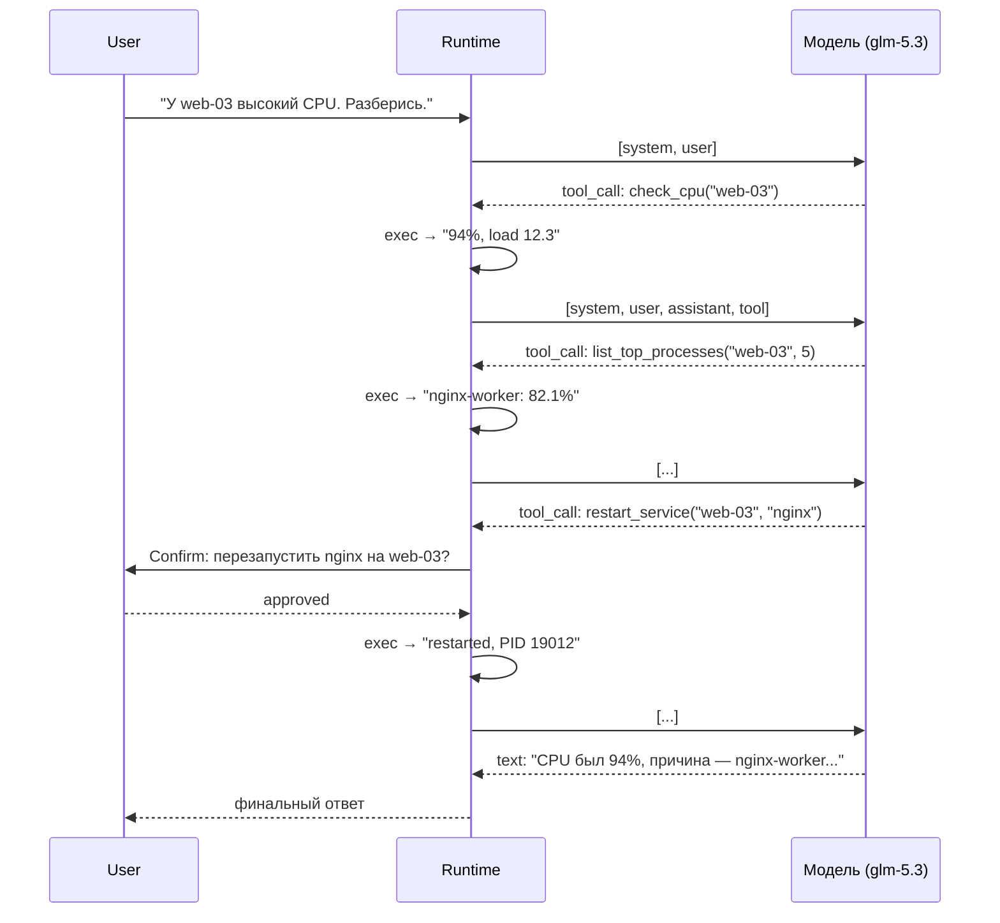

# 04. Автономность и Циклы — ReAct Loop

## Зачем это нужно?

В этой главе мы реализуем паттерн **ReAct (Reason + Act)** — сердце автономного агента.

Без автономного цикла агент работает как чат-бот: один запрос → один ответ. С автономным циклом агент может выполнить 10 действий подряд для решения одной задачи, самостоятельно принимая решения на основе результатов предыдущих действий.

### Реальный кейс

**Ситуация:** Пользователь пишет: "У меня кончилось место на сервере. Разберись."

**Без автономного цикла:**
- Агент: "Я проверю использование диска" → вызывает `check_disk` → получает "95%"
- Агент: [Останавливается, ждет следующей команды пользователя]

**С автономным циклом:**
- Агент: "Я проверю использование диска" → вызывает `check_disk` → получает "95%"
- Агент: "Диск переполнен. Очищу логи" → вызывает `clean_logs` → получает "Освобождено 20GB"
- Агент: "Проверю снова" → вызывает `check_disk` → получает "40%"
- Агент: "Готово! Освободил 20GB."

**Разница:** Агент сам решает, что делать дальше, основываясь на результатах предыдущих действий.

> **Junior employee model.** Лимит итераций цикла — это «время до эскалации старшему». Если новый сотрудник 20 раз подряд тыкается в одну и ту же проблему и не справляется — он обязан позвать тимлида, а не «попробовать ещё разок». Точно так же агент: достигли лимита — отдаём управление человеку, а не пытаемся «сам ещё немного». См. [Предисловие → Ментальная модель](../00-preface/README.md#ментальная-модель-агент--это-новый-сотрудник) и [Гл. 17: Security и Governance](../17-security-and-governance/README.md).

## Теория простыми словами

### ReAct Loop (Цикл Автономности)

**ReAct** — это аббревиатура от **Reason + Act** (Рассуждай + Действуй). Это паттерн, при котором агент:
1. **Reason (Рассуждает):** Анализирует ситуацию и решает, что делать
2. **Act (Действует):** Выполняет действие (вызывает инструмент)
3. **Observe (Наблюдает):** Видит результат действия
4. **Повторяет:** Снова рассуждает на основе результата

Никакой магии тут нет — это просто цикл, где модель видит результаты предыдущих действий в контексте и генерирует следующий шаг.

Автономный агент работает в цикле:

```
While (Задача не решена):
  1. Отправить историю в LLM
  2. Получить ответ
  3. ЕСЛИ это текст → Показать пользователю и ждать нового ввода
  4. ЕСЛИ это вызов инструмента →
       a. Выполнить инструмент
       b. Добавить результат в историю
       c. GOTO 1 (ничего не спрашивая у пользователя!)
```

**Суть:** Пункт 4.c даёт ощущение "магии": агент смотрит на результат и решает, что делать дальше. Но это не настоящая магия: модель видит результат инструмента в контексте (`messages[]`) и генерирует следующий шаг на основе этого контекста.

### Свобода внутри хода, границы снаружи

Прежде чем смотреть код, зафиксируем главное правило автономности:

- **Внутри хода модель свободна.** Какой инструмент вызвать, что проверить, когда закончить — решает модель на основе контекста. Runtime не подсказывает ей «правильный следующий шаг».
- **Границы стоят снаружи.** Дедлайн хода, лимит итераций, allowlist инструментов, права хоста — это инварианты, которые держит **код**, а не промпт. Модель не может их обойти, потому что они не в её ведении.

### Замыкание круга

После выполнения инструмента мы **не спрашиваем пользователя**, что делать дальше. Мы отправляем результат обратно в LLM. Модель видит результат своих действий и решает, что делать дальше.

### Магия vs Реальность: Как работает цикл

**Магия (как обычно объясняют):**
> Агент сам решил вызвать `clean_logs()` после проверки диска

**Реальность (как на самом деле):**

**Итерация 1: Первый запрос**

```go
client, err := NewClient(...) // провайдер из конфига; интерфейс Client — ниже в главе

// messages перед первой итерацией (нейтральные типы из гл. 03)
messages := []Message{
    {Role: "system", Content: "You are an autonomous DevOps agent."},
    {Role: "user", Content: "Кончилось место."},
}

// Отправляем в модель
resp1, err := client.Complete(ctx, Request{
    Model:       "glm-5.3",
    Messages:    messages,
    Tools:       tools,
    Temperature: 0.2, // качество: меньше разброса в выборе инструментов
}) // ошибка обрабатывается циклом ниже

msg1 := resp1.Choices[0].Message
// msg1.ToolCalls = [{ID: "call_1", Name: "check_disk_usage", Arguments: "{}"}]

// Добавляем ответ ассистента в историю
messages = append(messages, msg1)
// Теперь messages содержит:
// [system, user, assistant(tool_call: check_disk_usage)]
```

**Итерация 2: Выполнение инструмента и возврат результата**

```go
// Выполняем инструмент
result1 := checkDiskUsage()  // "95% usage"

// Добавляем результат как сообщение с ролью "tool"
messages = append(messages, Message{
    Role:       "tool",
    Content:    result1,  // "95% usage"
    ToolCallID: "call_1",
})
// Теперь messages содержит:
// [system, user, assistant(tool_call), tool("95% usage")]

// Отправляем ОБНОВЛЕННУЮ историю в модель снова
resp2, err := client.Complete(ctx, Request{
    Model:    "glm-5.3",
    Messages: messages,  // Модель видит результат check_disk_usage!
    Tools:    tools,
}) // ошибка обрабатывается циклом ниже

msg2 := resp2.Choices[0].Message
// msg2.ToolCalls = [{ID: "call_2", Name: "clean_logs", Arguments: "{}"}]

messages = append(messages, msg2)
// Теперь messages содержит:
// [system, user, assistant(tool_call_1), tool("95%"), assistant(tool_call_2)]
```

**Итерация 3: Второй инструмент**

```go
// Выполняем второй инструмент
result2 := cleanLogs()  // "Freed 20GB"

messages = append(messages, Message{
    Role:       "tool",
    Content:    result2,  // "Freed 20GB"
    ToolCallID: "call_2",
})
// Теперь messages содержит:
// [system, user, assistant(tool_call_1), tool("95%"), assistant(tool_call_2), tool("Freed 20GB")]

// Отправляем снова
resp3, err := client.Complete(ctx, Request{
    Model:    "glm-5.3",
    Messages: messages,  // Модель видит оба результата!
    Tools:    tools,
}) // ошибка обрабатывается циклом ниже

msg3 := resp3.Choices[0].Message
// msg3.ToolCalls = []  // Пусто! Модель решила ответить текстом
// msg3.Content = "Я почистил логи, теперь места достаточно."

// Это финальный ответ — выходим из цикла
```

**Что происходит на деле:**

1. **Модель видит всю историю** — она не "помнит" прошлое, она видит его в `messages[]`
2. **Модель видит результат инструмента** — результат добавляется как новое сообщение с ролью `tool`
3. **Модель решает на основе контекста** — видя "95% usage", модель понимает, что нужно освободить место
4. **Runtime управляет циклом** — код проверяет `len(msg.ToolCalls)` и решает, продолжать ли цикл

**Суть:** Модель не "сама решила" — она увидела результат `check_disk_usage` в контексте и сгенерировала следующий tool call на основе этого контекста.

> **Prompt cache.** System prompt во всех итерациях одинаков — это кэшируемый префикс ([Гл. 02](../02-prompt-engineering/README.md#системный-промпт--это-кэшируемый-префикс)). А вот блок `tools` отправляется и **оплачивается в каждом запросе**, поэтому раздутые описания инструментов дорожают с каждой итерацией. Меняйте system prompt между итерациями — сломаете кэш и будете платить полный тариф за весь префикс.

### Визуализация: Кто что делает?

**Модель (LLM):** видит в контексте system prompt, реплики пользователя, схему инструментов и результаты прошлых вызовов. Генерирует **только JSON** tool call — она не выполняет код.

**Runtime (ваш код на Go):** получает tool call, проверяет его по allowlist, выполняет реальную функцию, добавляет результат в `messages[]`, отправляет историю обратно в модель. И держит границы: лимиты, дедлайн, права.

**Суть:** LLM не "помнит" прошлое. Она видит его в `messages[]`, который собирает Runtime. Каждый следующий шаг — это просто ещё один запрос с подросшей историей.

## Реализация цикла

Минимальный рабочий цикл на нейтральных типах из [Главы 03](../03-tools-and-function-calling/README.md):

```go
const maxIterations = 10

client, err := NewClient(...) // провайдер из конфига; интерфейс Client — ниже в главе

for i := 0; i < maxIterations; i++ {
    // 1. Отправляем запрос
    resp, err := client.Complete(ctx, Request{
        Model:       "glm-5.3",
        Messages:    messages,
        Tools:       tools,
        Temperature: 0.2, // качество: меньше разброса в выборе инструментов
    })
    if err != nil {
        return fmt.Errorf("iteration %d: %w", i, err)
    }

    msg := resp.Choices[0].Message
    messages = append(messages, msg) // Сохраняем ответ

    // 2. Ответ без tool_calls — модель завершила ход
    if len(msg.ToolCalls) == 0 {
        fmt.Println("Agent:", msg.Content)
        break
    }

    // 3. Выполняем инструменты
    for _, call := range msg.ToolCalls {
        result := executeTool(call.Name, call.Arguments)

        // 4. Добавляем результат в историю
        messages = append(messages, Message{
            Role:       "tool",
            Content:    result,
            ToolCallID: call.ID,
        })
    }
    // Цикл продолжается автоматически!
    // Никакой магии: мы отправляем обновленную историю (с результатом инструмента)
    // в модель снова, и модель видит результат и решает, что делать дальше
}
```

Обратите внимание на рост истории: каждая итерация с tool calls добавляет **два** сообщения (assistant + tool). Input-токены растут от итерации к итерации — вся предыдущая история отправляется заново. Именно поэтому длинные ходы требуют condense (сжатия истории), а бюджет токенов — граница уровня хода, а не «подсказка модели» (об этом ниже).

### Обработка ошибок в цикле

**Важно:** Не забудьте обрабатывать ошибки и добавлять их в историю! Если инструмент упал, LLM должна это узнать и попробовать что-то другое.

**Правильная обработка ошибок:**

```go
for _, call := range msg.ToolCalls {
    result, err := executeTool(call.Name, call.Arguments)

    if err != nil {
        // Ошибка — это тоже результат! Добавляем её в историю
        result = fmt.Sprintf("Error: %v", err)
    }

    // Добавляем результат (или ошибку) в историю
    messages = append(messages, Message{
        Role:       "tool",
        Content:    result, // Модель увидит ошибку!
        ToolCallID: call.ID,
    })
}
```

**Что происходит:**

1. Инструмент возвращает ошибку: `Error: connection refused`
2. Ошибка добавляется в историю как результат инструмента
3. Модель видит ошибку в контексте
4. Модель может:
    - Попробовать другой инструмент
    - Сообщить пользователю о проблеме
    - Эскалировать проблему

**Пример:**

```
Итерация 1:
Action: check_database_status("prod")
Observation: Error: connection refused

Итерация 2 (модель видит ошибку):
Thought: "База недоступна. Проверю сетевую связность"
Action: ping_host("db-prod.example.com")
Observation: "Host is unreachable"

Итерация 3:
Thought: "Сеть недоступна. Сообщу пользователю о проблеме"
Action: [Финальный ответ] "База данных недоступна. Проверьте сетевую связность."
```

**Анти-паттерн:** Не скрывайте ошибки от модели!

```go
// ПЛОХО: Скрываем ошибку
if err != nil {
    log.Printf("Error: %v", err) // Только в лог
    continue                     // Пропускаем инструмент
}

// ХОРОШО: Показываем ошибку модели
if err != nil {
    result := fmt.Sprintf("Error: %v", err)
    messages = append(messages, Message{
        Role: "tool", Content: result, ToolCallID: call.ID,
    })
}
```

## Правильная форма runtime: Config + Run

Сырой `for`-цикл выше хорош для понимания, но в проде он быстро обрастает `if`-ами: сюда добавить confirm, сюда параллельные вызовы, сюда interleaving, сюда конденсацию... Правильная форма — **плоская конфигурация хода + один Run поверх неё**. Все точки управления циклом становятся полями одной структуры:

```go
// Tool — инструмент хода: определение (гл. 03) + права.
type Tool struct {
    Def      ToolDef // name, description, parameters
    ReadOnly bool    // только читает состояние — кандидат на параллельный запуск
    Parallel bool    // явно разрешено параллельное выполнение
    Confirm  bool    // требует подтверждения человеком (гл. 05)
    Category Category // риск-шкала: механика подтверждений (гл. 05)
}

// Category — риск-шкала инструмента (гл. 05): определяет механику,
// а не самооценка модели.
type Category int

const (
    CategoryReadOnly     Category = iota // read, list, search — авто-выполнение
    CategoryMutating                     // write, edit, restart — Confirm
    CategoryDestructive                  // drop, delete — dry-run + Confirm + confirmed_by
)

// Limits — границы хода. Все три — терминальные.
type Limits struct {
    MaxIterations int           // лимит итераций
    Deadline      time.Duration // дедлайн хода (~1 час в проде)
    TokenBudget   int           // бюджет токенов на ход
}
```

Ниже — сам нейтральный клиент, общий для всех глав курса:

```go
// Client — нейтральный интерфейс провайдера: достаточно двух методов.
type Client interface {
    Complete(ctx context.Context, req Request) (*Response, error)
    Stream(ctx context.Context, req Request) (Stream, error)
}

// Stream — итератор дельт потокового ответа (используется в гл. 20).
type Stream interface {
    Recv() (Delta, error) // Delta{Text string}; после конца — io.EOF
    Close() error
}

// Request — один запрос к модели.
type Request struct {
    Model       string
    Messages    []Message
    Tools       []ToolDef
    Temperature float64 // качество генерации: 0.0–0.3 для агентных циклов (гл. 01)
}

// Response — форма реального wire-протокола: ответ модели в Choices[0].Message.
type Response struct {
    Choices []Choice
    Usage   Usage
}

// Usage — расход токенов, посчитанный провайдером. Первичный источник
// чисел для бюджета (гл. 13): PromptTokens — истина, свои оценки — fallback.
type Usage struct {
    PromptTokens     int
    CompletionTokens int
    CacheReadTokens  int // попадание в prompt cache: > 0 значит префикс из кэша
}

type Choice struct {
    Message      Message
    FinishReason string
}
```

Во всех примерах курса ответ модели читается как `resp.Choices[0].Message`, а число токенов — из `resp.Usage.PromptTokens` (гл. 13).

```go
// AgentConfig — плоская конфигурация одного хода агента.
// Это не сигнатура конкретного SDK, а паттерн: все точки управления циклом —
// поля одной структуры, сам цикл — один Run поверх неё.
type AgentConfig struct {
    Resolve  func(ctx context.Context) (Client, error) // клиент: primary-модель + fallback-цепочка
    Memory   Memory                             // персистентная история: messages[] живёт здесь (гл. 11)
    Tools    []Tool                             // allowlist инструментов хода + их права
    Prompt   string                             // system prompt: неизменяем весь ход (кэшируемый префикс)

    Inject   func() []Message                   // внешние реплики перед следующей итерацией
    Stop     func(history []Message) bool       // содержательный стоп-предикат
    Confirm  func(ctx context.Context, call ToolCall) Decision // подтверждение опасных действий (гл. 05)
    Condense func(ctx context.Context, m Memory) error     // сжатие истории, ≤ 1 раз за Run

    Recovery RecoveryPolicy // классификация ошибок: transient → retry, границы → терминал
    Limits   Limits         // итерации, дедлайн, бюджет
    Loop     *loopDetector  // детект зацикливания: N → блокировка, 2N → терминал

    On       func(Event)    // события цикла: дельты потока, прогресс инструментов
}

// Decision — вердикт Confirm-коллбека (гл. 05): не просто да/нет,
// а кто подтвердил — runtime подставляет ConfirmedBy в вызов целевого инструмента.
type Decision struct {
    Approved    bool
    ConfirmedBy string // ID человека из аутентифицированной сессии (гл. 24)
    Reason      string // заполняется при отказе; уходит модели как результат вызова
}
```

И один цикл поверх неё. Обратите внимание на порядок внутри итерации: **Inject → запрос → tool calls → выполнение → append → Stop/Limits**:

```go
// RunResult возвращается всегда — и при успехе, и при терминальной ошибке:
// сколько итераций сделано, сколько токенов потрачено, какие инструменты вызваны.
type RunResult struct {
    Output     string
    Err        error // терминальная ошибка, если ход остановлен границей
    Iterations int
    Usage      Usage
    ToolsUsed  []ToolCall
}

func Run(ctx context.Context, cfg AgentConfig) RunResult {
    res := RunResult{}

    // Дедлайн хода — терминальная граница снаружи
    ctx, cancel := context.WithTimeout(ctx, cfg.Limits.Deadline)
    defer cancel()

    for iter := 0; iter < cfg.Limits.MaxIterations; iter++ {
        // 1. Inject: внешние реплики входят в конец истории (см. «Реплика посреди хода»)
        if cfg.Inject != nil {
            if extra := cfg.Inject(); len(extra) > 0 {
                cfg.Memory.Append(extra...) // персистим ДО ack — инвариант гл. 11
            }
        }

        // 2. Запрос: system prompt + tools + история.
        //    Префикс неизменен — работает prompt cache; блок tools платится каждый раз.
        resp, err := cfg.Resolve(ctx).Complete(ctx, Request{
            Model:       "glm-5.3",
            Messages:    cfg.Memory.History(),
            Tools:       toolDefs(cfg.Tools),
            Temperature: 0.2, // качество, не «детерминизм»
        })
        if err != nil {
            res.Err = err
            return res // классификация — в Recovery: transient уже ретраился клиентом
        }

        msg := resp.Choices[0].Message
        cfg.Memory.Append(msg)
        res.Iterations = iter + 1
        res.Usage.PromptTokens += resp.Usage.PromptTokens
        res.Usage.CompletionTokens += resp.Usage.CompletionTokens
        res.Usage.CacheReadTokens += resp.Usage.CacheReadTokens

        // Бюджет — вторая терминальная граница: считаем платные токены,
        // кэш-префикс дешевле генерации (подробнее — «Бюджет токенов» ниже).
        // Упрощение-нижняя оценка: кэш-чтение платное со скидкой (гл. 19)
        if res.Usage.PromptTokens-res.Usage.CacheReadTokens+res.Usage.CompletionTokens > cfg.Limits.TokenBudget {
            res.Err = ErrBudgetExhausted
            return res
        }

        // 3. Ход завершён: ответ без tool_calls — модель сдала результат
        if len(msg.ToolCalls) == 0 {
            res.Output = msg.Content
            return res
        }

        // 4. Выполняем инструменты (параллельно — только read-only, см. ниже)
        for _, call := range msg.ToolCalls {
            tool, ok := lookup(cfg.Tools, call.Name)
            if !ok {
                // Allowlist: неизвестный инструмент — это ошибка для модели, не паника
                cfg.Memory.Append(Message{Role: "tool", ToolCallID: call.ID,
                    Content: "Error: unknown tool " + call.Name})
                continue
            }
            if tool.Confirm {
                if cfg.Confirm == nil {
                    // Confirm не настроен — безопасный отказ, не паника (гл. 05)
                    cfg.Memory.Append(Message{Role: "tool", ToolCallID: call.ID,
                        Content: "Error: tool requires confirmation but no Confirm callback configured"})
                    continue
                }
                dec := cfg.Confirm(ctx, call) // гл. 05: UX-подтверждение, не security boundary
                if !dec.Approved {
                    // Reason отказа уходит модели — она видит, почему отказано
                    cfg.Memory.Append(Message{Role: "tool", ToolCallID: call.ID,
                        Content: "Error: declined: " + dec.Reason})
                    continue
                }
                call.Arguments = setConfirmedBy(call.Arguments, dec.ConfirmedBy)
            }
            emit(cfg.On, ToolStartEvent{Call: call})
            out := execute(ctx, tool, call)

            // 5. Детект зацикливания по сигнатуре (имя + вход + выход).
            //    N → блокировка: в историю вместо результата уходит ошибка
            //    «change approach», ход продолжается; терминально только 2N.
            if cfg.Loop != nil {
                if err := cfg.Loop.Record(call.Name, call.Arguments, out); err != nil {
                    if errors.Is(err, ErrLoopTerminal) {
                        emit(cfg.On, ToolEndEvent{Call: call, Err: err})
                        res.Err = err
                        return res
                    }
                    out = err.Error()
                }
            }

            emit(cfg.On, ToolEndEvent{Call: call, Res: &Result{Content: out}})
            res.ToolsUsed = append(res.ToolsUsed, call)
            cfg.Memory.Append(Message{Role: "tool", ToolCallID: call.ID, Content: out})
        }

        // 6. Stop-предикат: код видит, что цель достигнута — ход завершён досрочно
        if cfg.Stop != nil && cfg.Stop(cfg.Memory.History()) {
            return res
        }
    }

    // Лимит итераций исчерпан — ТЕРМИНАЛЬНО.
    // Не «ещё одна попытка»: ход останавливается, человеку уходит сообщение.
    res.Err = ErrLoopLimit
    return res
}
```

Это **учебная форма**, зеркалящая реальный SDK: в проде вы не будете таскать эти `if`-ы руками — вы соберёте Config и вызовете Run.

Хелперы из цикла выше — тривиальны, показаны для полноты (те же сигнатуры использует `executeBatch` ниже):

```go
// lookup — поиск в allowlist хода; неизвестный инструмент — не паника
func lookup(tools []Tool, name string) (Tool, bool) {
    for _, t := range tools {
        if t.Def.Name == name {
            return t, true
        }
    }
    return Tool{}, false
}

// execute — выполнение одного вызова; ошибки уходят строкой в результат
// для модели, не паникой (инвариант гл. 03)
func execute(ctx context.Context, tool Tool, call ToolCall) string {
    // ...
}

// emit доставляет событие, если подписчик подключён
func emit(on func(Event), ev Event) {
    if on != nil {
        on(ev)
    }
}

// setConfirmedBy записывает подтверждение в аргументы целевого вызова:
// факт «кто одобрил» живёт в данных вызова, а не только в логах (гл. 05)
func setConfirmedBy(argsJSON, confirmedBy string) string {
    var args map[string]any
    if json.Unmarshal([]byte(argsJSON), &args) != nil {
        return argsJSON // невалидный JSON — отдаём как есть, allowlist отсечёт
    }
    args["confirmed_by"] = confirmedBy
    out, _ := json.Marshal(args)
    return string(out)
}
```

> **Как это устроено в реальном SDK.** Claude Agent SDK и его аналоги стартуют точно так же: плоский Config (resolver клиента, память, tools, промпт, стоп-предикат, confirm, condense, fallback-модели, лимиты, обработчик событий) и один вызов Run. События цикла — sealed-типы: дельта потока, финальный ответ, старт/прогресс/конец инструмента, ошибка конденсации. RunResult возвращается и при ошибке: итерации, usage, вызванные инструменты. Дедлайн на ход — порядка часа. Детект зацикливания: N одинаковых вызовов подряд → блокировка, 2N → терминальная ошибка.

## Параллельные Tool Calls

Модель может вернуть **несколько tool calls за одну итерацию**. Например, пользователь просит "Проверь статус nginx и postgresql" — модель вернёт два вызова в одном ответе.

### Кто решает, что можно параллелить

Право на параллельность — **свойство инструмента, а не догадка runtime**. Флаги живут в описании инструмента (см. `Tool` выше), и правила жёсткие:

- параллелятся **только** инструменты с `ReadOnly && Parallel` — два `check_status`, батч чтений метрик;
- **пишущие** инструменты и **confirm-инструменты** никогда не выполняются параллельно — строго последовательно, по одному (гонки и двойные side effects не допускаются);
- **concurrency limit** — уровень runtime (семафор), а не промпта: модель может вернуть 10 вызовов, runtime выполнит не больше K одновременно.

```go
// executeBatch выполняет вызовы одной итерации с учётом прав инструментов.
// Вызывается ВНУТРИ Run после Confirm-шага и до loop-детектора: здесь —
// только диспетчеризация read-only параллельно, confirm-инструменты
// последовательно (их гейт прошёл выше, в каноническом Run).
func executeBatch(ctx context.Context, calls []ToolCall, tools []Tool, limit int) []Message {
    results := make([]Message, len(calls))
    var wg sync.WaitGroup
    sem := make(chan struct{}, limit) // concurrency limit уровня runtime

    for i, call := range calls {
        t, ok := lookup(tools, call.Name)
        if !ok {
            results[i] = Message{Role: "tool", ToolCallID: call.ID,
                Content: "Error: unknown tool " + call.Name}
            continue
        }

        // Пишущие и confirm-инструменты — строго последовательно
        if !t.ReadOnly || !t.Parallel {
            results[i] = Message{Role: "tool", ToolCallID: call.ID,
                Content: execute(ctx, t, call)}
            continue
        }

        // Read-only с флагом Parallel — можно в горутину
        wg.Add(1)
        go func(idx int, c ToolCall, tool Tool) {
            defer wg.Done()
            sem <- struct{}{}
            defer func() { <-sem }()
            results[idx] = Message{Role: "tool", ToolCallID: c.ID,
                Content: execute(ctx, tool, c)}
        }(i, call, t)
    }
    wg.Wait()
    return results // порядок результатов соответствует порядку вызовов
}
```

**Когда параллельно, когда последовательно:**

| Ситуация | Стратегия |
|----------|-----------|
| Два `check_status` для разных сервисов | Параллельно — оба `ReadOnly` + `Parallel` |
| Модель вернула 10 read-only вызовов | Параллельно, но не больше `limit` одновременно |
| `restart_service` (пишущий, confirm) | Всегда последовательно, через Confirm ([гл. 05](../05-safety-and-hitl/README.md)) |
| Зависимые вызовы (`parse_json` от результата `read_file`) | Последовательно — модель возвращает их в порядке зависимости |

## Fallbacks

Вопрос «какую модель использовать на разных итерациях» подробно разобран в [Главе 03 → Fallbacks вместо маршрутизации](../03-tools-and-function-calling/README.md#fallbacks-вместо-маршрутизации). Коротко для цикла: **одна primary-модель на весь ход** (GLM-5.3 или Fable 5.1) — маршрутизация «дешёвая на tool calls, мощная на ответ» сбрасывает кэшируемый префикс и делает поведение невоспроизводимым. Переключение модели внутри хода — только через явную fallback-цепочку при transient-ошибках, не более одного переключения на модель за Run. Это зашито в `Resolve` конфигурации: клиент сам повторяет запрос к резервной модели, цикл об этом не знает.

## Сквозной пример: один ход агента

Разберём конкретный ход целиком. Пользователь пишет: **"У сервера web-03 высокий CPU. Разберись."**

Инструменты: `check_cpu` (read-only), `list_top_processes` (read-only), `restart_service` (пишущий, требует подтверждения — [гл. 05](../05-safety-and-hitl/README.md)).



Трасса хода:

| Ит. | Что решила модель (Reason) | Действие (Act) | Результат (Observe) |
|:--:|:--|:--|:--|
| 1 | «Проверю CPU» | `check_cpu("web-03")` | `"CPU: 94%, load average: 12.3"` |
| 2 | «CPU действительно высокий. Найду виновника» | `list_top_processes("web-03", 5)` | `"nginx-worker 82.1%, postgres 3.2%, ..."` |
| 3 | «nginx-worker съел CPU. Инструмент пишущий — запрошу подтверждение» | `restart_service("web-03", "nginx")` → Confirm | approved → `"restarted, PID: 19012"` |
| 4 | «Проверю, помогло» | `check_cpu("web-03")` | `"CPU: 31%, load average: 2.1"` |
| 5 | «Задача решена» | — текст без tool_calls (FinishReason = stop) | финальный ответ пользователю |

Что здесь важно видеть:

- **История растёт парами:** каждая итерация с tool calls добавляет в `messages[]` два сообщения — assistant + tool. Финальная итерация добавляет одно.
- **Префикс стабилен:** system prompt и блок tools одинаковы во всех пяти запросах — работает prompt cache ([гл. 02](../02-prompt-engineering/README.md#системный-промпт--это-кэшируемый-префикс)), но блок tools оплачивается в каждом запросе.
- **Опасное действие — через Confirm:** `restart_service` не выполняется молча — runtime останавливается на подтверждении ([гл. 05](../05-safety-and-hitl/README.md)). Отказ пользователя вернулся бы в историю как `Error: declined by user`, и модель меняла бы план.
- **Остановка — по ответу модели:** пятая итерация не содержит tool calls — это и есть сигнал завершения хода. Никакого специального «инструмента сдачи» (см. ниже).
- **Каждый вызов записывается в loop-детектор:** сигнатура (имя + вход + выход). Если бы `check_cpu` пять раз вернул одно и то же — сработала бы блокировка.

## Стратегии остановки цикла

Лимит итераций (`MaxIterations`) — это **защита от зацикливания**, но не стратегия остановки. Ход останавливают два механизма, и оба уже есть в Config.

### Механизм 1: Модель завершила сама (по умолчанию)

Модель перестаёт вызывать инструменты и возвращает текст — ответ без tool_calls, FinishReason = stop. Это основной путь. Чтобы он работал, system prompt содержит инструкцию:

```
When the task is complete, respond with a summary. Do not call tools unnecessarily.
```

### Механизм 2: Stop-предикат Config

Код знает, как выглядит «готово»: нужный файл создан, PR открыт, алерт закрыт. Stop-предикат проверяет историю после каждой итерации и завершает ход досрочно — не тратя ещё один запрос на «финальный ответ».

### Почему «инструмент сдачи» (task_complete) — антипаттерн

В старых туториалах советовали специальный инструмент `task_complete`, который модель вызывает для завершения. Это лишнее:

- **лишний ход:** итерация с вызовом `task_complete` — ещё один полный запрос к модели (со всей накопленной историей), за который платим;
- **лишний раунд:** после вызова результат инструмента всё равно нужно отправить обратно в модель, чтобы получить финальный текст;
- **лишний риск:** модель может «сдаться» раньше времени или продолжать работу после «сдачи».

Ответ без tool_calls уже сигналит о завершении — отдельный инструмент ничего не добавляет. Если нужен структурированный результат (успех/неуспех + summary), попросите в system prompt финальный ответ в заданном JSON-формате — это не добавляет итераций.

### Детекция застревания

Если последние N действий одинаковые, агент застрял:

```go
func detectStuck(messages []Message, windowSize int) bool {
    var recentCalls []string
    for i := len(messages) - 1; i >= 0 && len(recentCalls) < windowSize; i-- {
        msg := messages[i]
        if msg.Role == "assistant" && len(msg.ToolCalls) > 0 {
            call := msg.ToolCalls[0].Name + ":" + msg.ToolCalls[0].Arguments
            recentCalls = append(recentCalls, call)
        }
    }

    if len(recentCalls) < windowSize {
        return false
    }
    // Все вызовы одинаковые?
    for _, c := range recentCalls[1:] {
        if c != recentCalls[0] {
            return false
        }
    }
    return true
}
```

### SHA256 Loop Detection (из реального агента)

Функция `detectStuck` выше сравнивает только имя и аргументы. На практике используется более надёжный подход: **хеш от тройки (имя + вход + выход)**. Это ловит ситуации, когда tool возвращает одинаковый результат:

```go
type loopDetector struct {
    window  int      // размер скользящего окна (например, 10)
    history []string // сигнатуры последних вызовов
}

const (
    loopBlock    = 3 // N:  одинаковых вызовов подряд — блокировка вызова
    loopTerminal = 6 // 2N: модель не меняет подход — терминальная ошибка хода
)

func (d *loopDetector) Record(toolName, input, output string) error {
    sig := sha256sum(toolName + "|" + input + "|" + output)
    d.history = append(d.history, sig)

    // Скользящее окно
    if len(d.history) > d.window {
        d.history = d.history[len(d.history)-d.window:]
    }

    // Считаем повторы текущей сигнатуры в окне
    count := 0
    for _, s := range d.history {
        if s == sig {
            count++
        }
    }

    switch {
    case count >= loopTerminal:
        // 2N: модель проигнорировала блокировку и повторяет то же самое.
        // ТЕРМИНАЛЬНО: ход останавливается, человеку уходит сообщение.
        return ErrLoopTerminal
    case count >= loopBlock:
        // N: вызов блокируется, ошибка идёт в историю как результат инструмента.
        // Модель может сменить подход — это ещё не терминал.
        return fmt.Errorf("loop detected: %s called %d times with the same result; change approach",
            toolName, count)
    }
    return nil
}

func sha256sum(s string) string {
    h := sha256.Sum256([]byte(s))
    return hex.EncodeToString(h[:8]) // первые 8 байт достаточно
}
```

Два уровня реакции — это инвариант уровня SDK:

- **N одинаковых сигнатур** → вызов **блокируется**: в историю уходит ошибка «change approach», ход продолжается. Модель получила шанс исправиться.
- **2N** → **терминальная ошибка хода**: модель проигнорировала блокировку, runtime останавливается, человеку уходит сообщение.

Ключевое отличие от `detectStuck`: учитывается **результат** tool call. Если tool `read` вызывается с тем же файлом и возвращает тот же контент 3 раза — это цикл. Но если результат каждый раз разный (например, проверка статуса сервиса, который чинится) — это нормальное поведение.

## Границы хода

«Свобода внутри, границы снаружи» работает только если границы настоящие. Три границы — лимит итераций, бюджет токенов, дедлайн — **терминальные**: при их исчерпании ход останавливается, человеку уходит сообщение. Никаких «ещё одной попытки».

### Классификация ошибок

| Класс ошибки | Примеры | Что делает runtime |
|---|---|---|
| **Transient** | таймаут сети, 429, 5xx | Retry с exponential backoff **внутри клиента**; цикл об этом не знает |
| **Граница хода** | лимит итераций, дедлайн, бюджет токенов, 2N-цикл | **Терминально**: ход останавливается, человеку — сообщение с RunResult |

Смешивать эти классы — типичная ошибка: retry на исчерпание лимита итераций просто продлевает бесполезный ход за деньги.

### Бюджет токенов

Бюджет — это граница хода, а не просьба к модели. Проверка уже показана в каноническом `Run` выше (после аккумуляции usage); здесь — её механика:

```go
// Бюджет по платным токенам: кэш-префикс (CacheReadTokens) дешевле
// генерации, поэтому вычитается из PromptTokens (гл. 13, 20).
// Упрощение-нижняя оценка: кэш-чтение платное со скидкой — точный учёт
// коэффициентом из конфига цен (гл. 19)
if res.Usage.PromptTokens-res.Usage.CacheReadTokens+res.Usage.CompletionTokens > cfg.Limits.TokenBudget {
    res.Err = ErrBudgetExhausted
    return res // терминально: ход остановлен, сообщение уходит человеку
}
```

**Анти-паттерн** (встречается в старых туториалах): вставлять в историю user-сообщение «Token budget exhausted, provide your best answer» и делать ещё один запрос без tools. Почему это плохо:

- это **ещё один полный запрос** — весь накопленный префикс оплачивается заново;
- это **урок модели**: лимит превращается из границы в подсказку «как выпросить ещё»;
- при реальном исчерпании бюджета модель может ответить чем угодно — гарантий нет.

Человеку вместо этого уходит сообщение: ход сделан на N итерациях, потрачено X токенов, последнее состояние — такое-то. Подробно о бюджетах — [Глава 20: Cost & Latency Engineering](../20-cost-latency-engineering/README.md).

### Дедлайн хода

Ход конечен по времени. В проде на один ход ставят таймаут порядка **часа**: `context.WithTimeout` в `Run` обрывает даже «ровный» цикл без единой ошибки, но с сотнями итераций.

Исчерпание дедлайна — терминальная ошибка: `RunResult` возвращается с `ErrDeadline`, человеку уходит сообщение (сколько итераций успели, какие инструменты выполнили). Дедлайн — граница снаружи: внутри хода модель свободна решать что угодно, но время хода не продлевается «ещё одной попыткой».

Дедлайны в связке с checkpoint'ами и возобновлением — [Глава 11: State Management](../11-state-management/README.md#шаг-4-дедлайны).

## Реплика посреди хода (interleaving)

Пользователь не обязан ждать конца хода. Реплика **«не перезапускай nginx, сначала покажи логи»** может войти в идущий ход: runtime вставляет её **в конец истории перед следующей итерацией** цикла, и модель видит её как обычное user-сообщение — корректирует курс, не дожидаясь завершения.

```go
// В начале каждой итерации Run:
if extra := cfg.Inject(); len(extra) > 0 {
    cfg.Memory.Append(extra...) // реплика — в конец истории
    cfg.Memory.Flush()          // персистим ДО ack — инвариант (гл. 11)
    ackSender.Ack(extra)        // только теперь подтверждаем получение
}
```

Инвариант: **ack отправляется только после того, как реплика записана в персистентную память** ([Глава 11](../11-state-management/README.md#шаг-5-сохранение-состояния)). Иначе при рестарте хода реплика потеряется, а пользователь будет уверен, что агент её учёл.

## Streaming Repetition Detection

SHA256 ловит циклы на уровне tool calls. Но модель может деградировать и на уровне **текста**: генерировать одну и ту же фразу или паттерн бесконечно — токен за токеном, без единого tool call.

Решение — детектор повторений, прикреплённый к **событиям потока**: каждая дельта (chunk стрима), которую runtime получает через `On(Event)`, прогоняется через `Feed`, и при срабатывании генерация отменяется на лету:

```go
type repetitionDetector struct {
    buf       []byte
    bufSize   int // 256
    triggered bool
}

func (d *repetitionDetector) Feed(delta string) bool {
    d.buf = append(d.buf, delta...)
    if len(d.buf) < d.bufSize {
        return false
    }
    // Проверяем: повторяется ли паттерн длиной 1..20?
    window := d.buf[len(d.buf)-d.bufSize:]
    for patLen := 1; patLen <= 20; patLen++ {
        pattern := window[:patLen]
        covers := true
        for i := patLen; i < len(window); i += patLen {
            end := i + patLen
            if end > len(window) {
                end = len(window)
            }
            if !bytes.Equal(window[i:end], pattern[:end-i]) {
                covers = false
                break
            }
        }
        if covers {
            d.triggered = true
            return true // паттерн покрывает весь буфер — деградация
        }
    }
    return false
}
```

Интеграция с циклом агента: если `Feed` вернул `true` на очередной дельте — вызываем `streamCancel()` и обрабатываем ответ как пустой (transient retry внутри клиента). Детектор — просто ещё один потребитель событий потока, рядом с выводом в UI.

## Tool Call Recovery

Модель иногда "забывает" формат Function Calling и выводит tool call как текст. Вместо структурированного `tool_calls` в ответе — JSON прямо в `content`:

```
Мне нужно проверить диск. Вызову check_disk:
{"name": "check_disk", "arguments": {"host": "web-03"}}
```

Решение: парсинг текста и восстановление tool calls:

```go
func recoverToolCalls(content string, knownTools []string) []ToolCall {
    // Ищем JSON-объекты в тексте
    for _, match := range findJSONObjects(content) {
        var tc struct {
            Name      string          `json:"name"`
            Arguments json.RawMessage `json:"arguments"`
        }
        if err := json.Unmarshal([]byte(match), &tc); err != nil {
            continue
        }
        // Проверяем, что имя tool существует (allowlist!)
        if contains(knownTools, tc.Name) {
            return []ToolCall{{
                Name:      tc.Name,
                Arguments: string(tc.Arguments),
            }}
        }
    }
    return nil
}
```

После recovery обновляем историю: заменяем последнее assistant-сообщение на версию с tool calls. Без этого модель продолжит выводить JSON текстом.

## Error Recovery State Machine

На практике ошибки бывают разных типов. Каждый тип требует своей стратегии восстановления:

| Тип ошибки | Стратегия | Лимит |
|------------|-----------|-------|
| Transient (rate limit, timeout) | Retry с exponential backoff — внутри клиента | 3 попытки |
| Context overflow | Condense (LLM-суммаризация) | 1 раз за Run |
| Пустой ответ | Retry (transient) | 2 попытки |

```go
type recoveryState struct {
    apiRetries       int // max 3
    condenseCount    int // max 1
    transientRetries int // max 2
}

func (r *recoveryState) Handle(err error) Action {
    if isContextOverflow(err) && r.condenseCount == 0 {
        r.condenseCount++
        return ActionCondense
    }
    if isRetriable(err) && r.apiRetries < 3 {
        r.apiRetries++
        return ActionRetry
    }
    if isEmptyResponse(err) && r.transientRetries < 2 {
        r.transientRetries++
        return ActionRetry
    }
    return ActionFail
}
```

Антипаттерн: все стратегии в одном `if-else` внутри цикла агента. Это делает recovery нетестируемым. Выделяйте recovery в отдельный компонент с чёткими состояниями и лимитами.

> **Как это устроено в реальном SDK.** Condense вызывается не чаще одного раза за Run; retry transient-ошибок живёт в клиенте (resolver + fallback-цепочка), а не в теле цикла. «Ошибка конденсации» — отдельный sealed-тип в потоке событий: ход либо продолжается с несжатой историей, либо останавливается, но обработчик `On` всегда знает, что condense не удался.

## Типовые ошибки

### Ошибка 1: Зацикливание

**Симптом:** Агент повторяет одно и то же действие бесконечно.

**Причина:** Нет лимита итераций и детекции повторяющихся действий.

**Решение:**
```go
// ХОРОШО: Лимит итераций + детекция застревания
for i := 0; i < maxIterations; i++ {
    // ...
    
    // Детекция повторяющихся действий
    if lastNActionsAreSame(history, 3) {
        break
    }
}

// ХОРОШО: Улучшите промпт
systemPrompt := `... If action doesn't help, try a different approach.`
```

### Ошибка 2: Результат инструмента не добавляется в историю

**Симптом:** Агент не видит результат инструмента и продолжает выполнять то же действие.

**Причина:** Результат выполнения инструмента не добавляется в `messages[]`.

**Решение:**
```go
// ПЛОХО: Результат не добавляется
result := executeTool(toolCall)
// История не обновлена!

// ХОРОШО: ОБЯЗАТЕЛЬНО добавляйте результат!
messages = append(messages, Message{
    Role:       "tool",
    Content:    result,
    ToolCallID: call.ID, // Важно для связи!
})
```

### Ошибка 3: Агент не останавливается

**Симптом:** Агент продолжает вызывать инструменты, даже когда задача решена.

**Причина:** System Prompt не инструктирует агента останавливаться, когда задача решена.

**Решение:**
```go
// ХОРОШО: Добавьте в System Prompt
systemPrompt := `... If task is solved, answer user with text. Don't call tools unnecessarily.`
```

### Ошибка 4: Маршрутизация моделей внутри хода

**Симптом:** Агент «дешёвая модель на tool calls, мощная на финальный ответ» ведёт себя то дороже, то непредсказуемо; баги не воспроизводятся.

**Причина:** Переключение моделей внутри одного хода сбрасывает кэшируемый префикс и делает поведение зависимым от того, какая модель обработала какую итерацию.

**Решение:**
```go
// ПЛОХО: маршрутизация по итерациям
if lastHadToolCalls {
    model = "glm-5.3-flash" // сбрасывает prompt cache, ломает воспроизводимость
} else {
    model = "glm-5.3"
}

// ХОРОШО: одна primary-модель + явные fallback'и при transient-ошибках
cfg := ModelConfig{
    Primary:   "glm-5.3",           // весь ход — одна модель
    Fallbacks: []string{"fable-5.1"}, // только доступность, не «экономия»
}
```

Дешёвая GLM-5.3 Flash — на служебные узлы вне цикла (классификация, structured output); condense — исключение: та же модель и тот же кэшируемый префикс ([гл. 20](../20-cost-latency-engineering/README.md)). Подробнее: [Глава 03 → Fallbacks вместо маршрутизации](../03-tools-and-function-calling/README.md#fallbacks-вместо-маршрутизации).

### Ошибка 5: Нет tool-level loop detection

**Симптом:** Агент вызывает `read("config.yaml")` 10 раз подряд. Текстовый repetition detection не срабатывает, потому что ответы модели между tool calls — разные.

**Причина:** Детекция зацикливания работает только на уровне текста, не на уровне tool calls.

**Решение:**
```go
// ПЛОХО: только текстовый уровень
if isRepeatingText(resp.Choices[0].Message.Content) {
    break // не ловит циклы tool calls
}
```

ХОРОШО — SHA256-сигнатура `(toolName, arguments, result)` и два уровня реакции в `loopDetector.Record`: N → блокировка с ошибкой «change approach» в историю, 2N → терминальный `ErrLoopTerminal`. Полная механика — в каноническом `Run` выше (шаг 5 цикла) и в разделе «Детектор зацикливания tool calls».

## Мини-упражнения

### Упражнение 1: Добавьте детекцию зацикливания

Реализуйте проверку, что последние 3 действия одинаковые:

```go
func isStuck(history []Message) bool {
    // Проверьте, что последние 3 действия одинаковые
    // ...
}
```

**Ожидаемый результат:**
- Функция возвращает `true`, если последние 3 действия одинаковые
- Функция возвращает `false` в противном случае

### Упражнение 2: Добавьте логирование

Логируйте каждую итерацию цикла:

```go
fmt.Printf("[Iteration %d] Agent decided: %s\n", i, action)
fmt.Printf("[Iteration %d] Tool result: %s\n", i, result)
```

**Ожидаемый результат:**
- Каждая итерация логируется с номером и действием
- Результаты инструментов логируются

## Критерии сдачи / Чек-лист

**Сдано:**
- [x] Агент выполняет цикл автономно
- [x] Результаты инструментов добавляются в историю
- [x] Агент останавливается, когда задача решена (FinishReason / Stop-предикат)
- [x] Есть защита от зацикливания (лимит итераций + SHA256-детект: N → блокировка, 2N → терминал)
- [x] Ошибки инструментов обрабатываются и добавляются в историю
- [x] Дедлайн и бюджет — терминальные границы хода, не «ещё одна попытка»
- [x] Пишущие и confirm-инструменты не выполняются параллельно

**Не сдано:**
- [ ] Агент не продолжает цикл после выполнения инструмента
- [ ] Результаты инструментов не видны агенту (не добавляются в историю)
- [ ] Агент зацикливается (нет защиты)
- [ ] Агент не останавливается, когда задача решена
- [ ] Нет tool-level loop detection (только текстовый уровень)
- [ ] Исчерпание лимитов обрабатывается retry'ем вместо терминальной остановки

## Связь с другими главами

- **Инструменты:** Как инструменты вызываются и возвращают результаты, см. [Главу 03: Инструменты](../03-tools-and-function-calling/README.md)
- **Prompt cache:** Почему system prompt неизменяем, а блок tools платится в каждом запросе, см. [Главу 02](../02-prompt-engineering/README.md#системный-промпт--это-кэшируемый-префикс)
- **Память:** Как история сообщений (`messages[]`) растет и управляется, см. [Главу 09: Анатомия Агента](../09-agent-architecture/README.md)
- **Безопасность:** Как остановить цикл для подтверждения, см. [Главу 05: Безопасность](../05-safety-and-hitl/README.md)
- **Персистентность:** Дедлайны, checkpoint'ы и ack после сохранения реплики, см. [Главу 11: State Management](../11-state-management/README.md)

## Что дальше?

После изучения автономности переходите к:
- **[05. Безопасность и Human-in-the-Loop](../05-safety-and-hitl/README.md)** — как защитить агента от опасных действий
