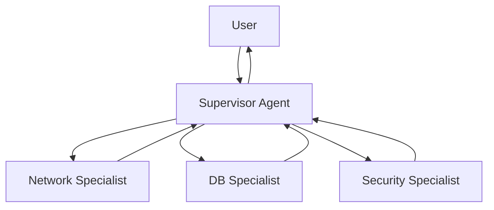

# 07. Multi-Agent Systems

## Зачем это нужно?

Когда у агента становится много инструментов (20+), первый порыв — «нанять команду»: Supervisor и узкие специалисты. Это почти всегда неверный ответ. Правильный — **скилы и progressive disclosure** ([гл. 09](../09-agent-architecture/README.md)): модель видит одну строку на скил и подтягивает детали сама, только когда они нужны; длинные описания не ездят в каждом запросе. Дешёвое решение той же проблемы «слишком много всего в контексте» — RAG ([гл. 06](../06-rag/README.md)).

Мультиагентность решает другую проблему — **изоляцию контекста и независимую проверку**:

1. **Ревью с чистой памятью.** Модель, ревьюящая собственную работу, соглашается с собой: в истории она видит, *почему* приняла решение, и проверяет своё оправдание, а не результат. Субагент-ревьюер получает только артефакт (диф, отчёт) и критерии — без истории родителя.
2. **Вынос шумного чтения.** Поиск по логам, анализ кодовой базы — десятки `read`/`search` вызовов с большими результатами. Субагент перекачивает их через свою короткую историю и возвращает родителю одну страницу выводов, не раздувая его память.

Разделение на «узких специалистов» — не базовый ответ на «много инструментов», а исключение с обоснованием (когда — см. ниже паттерн Supervisor).

### Реальный кейс

**Ситуация:** Вы создали агента для DevOps с 15 инструментами: проверка сетей, работа с БД, управление сервисами, логи, метрики, безопасность и т.д.

**Проблема:** Агент путается в инструментах. Когда пользователь просит "Проверь доступность БД и узнай версию", агент может вызвать неправильный инструмент или пропустить шаг.

**Первый шаг — не мультиагент.** Уберите шум из контекста: скилы для групп инструментов (гл. 09), progressive disclosure для описаний. В большинстве случаев этого достаточно, и вы заканчиваете с одним агентным циклом.

**Когда Supervisor/Worker всё же оправдан:** домены действительно разные (сеть, БД, безопасность), чтение в каждом домене шумное (десятки вызовов с большими результатами), и изоляция контекста даёт реальную экономию. Тогда Supervisor делегирует: Network Expert для проверки доступности, DB Expert для версии — не потому что «в команде должны быть роли», а потому что каждый специалист перекачивает шум через свою короткую историю.

> **Junior employee model.** Делегирование субагенту = делегирование человеку: вместе с задачей передаётся **только нужный** контекст, обратно возвращается отчёт, а не «весь мой инструментарий». Субагент — чистая функция `task → result`: память родителя не наследуется. См. [Предисловие → Ментальная модель](../00-preface/README.md#ментальная-модель-агент--это-новый-сотрудник) и [Гл. 17: Security и Governance](../17-security-and-governance/README.md).

## Теория простыми словами

### Как работает Multi-Agent?

1. **Supervisor получает задачу** от пользователя
2. **Supervisor анализирует задачу** и решает, какие специалисты нужны
3. **Supervisor вызывает специалистов** через tool calls
4. **Специалисты выполняют задачи** в изолированном контексте
5. **Результаты возвращаются Supervisor-у**, который собирает ответ

**Суть:** Изоляция контекста — каждый специалист видит только свою задачу, а не всю историю Supervisor-а. Это экономит токены и фокусирует внимание.

## Паттерн Supervisor (Начальник-Подчиненный)

> Это паттерн-исключение, а не дефолт. Оправдан, когда домены действительно разные и чтение в каждом из них шумное — тогда изоляция контекста окупается. Если мотивация «у агента много инструментов», правильный ответ — скилы ([гл. 09](../09-agent-architecture/README.md)), а не Supervisor.

**Архитектура:**

- **Supervisor:** Главный мозг. Не имеет инструментов, но знает, кто что умеет.
- **Workers:** Специализированные агенты с узким набором инструментов.

**Изоляция контекста:** Worker не видит всей переписки Supervisor-а, только свою задачу. Это экономит токены и фокусирует внимание.



## Пример для DevOps — Магия vs Реальность

**Магия:**
> Supervisor "думает" и "делегирует" задачи специалистам

**Реальность:**

### Как работает Multi-Agent на практике

**Шаг 1: Supervisor получает задачу**

```go
// Supervisor имеет инструменты для вызова Workers (нейтральные типы — гл. 03)
supervisorTools := []ToolDef{
    {
        Name:        "ask_network_expert",
        Description: "Ask the network specialist about connectivity, pings, ports",
        Parameters: json.RawMessage(`{
            "type": "object",
            "properties": {
                "question": {"type": "string"}
            },
            "required": ["question"]
        }`),
    },
    {
        Name:        "ask_database_expert",
        Description: "Ask the DB specialist about SQL, schemas, data",
        Parameters: json.RawMessage(`{
            "type": "object",
            "properties": {
                "question": {"type": "string"}
            },
            "required": ["question"]
        }`),
    },
}

supervisorMessages := []Message{
    {Role: "system", Content: "You are a Supervisor. Delegate tasks to specialists."},
    {Role: "user", Content: "Проверь, доступен ли сервер БД, и если да — узнай версию"},
}
```

**Шаг 2: Supervisor генерирует tool calls для Workers**

```go
client, err := NewClient(...) // провайдер из конфига (гл. 04)

supervisorResp, err := client.Complete(ctx, Request{
    Model:    "glm-5.3",
    Messages: supervisorMessages,
    Tools:    supervisorTools,
}) // ошибка обрабатывается циклом (гл. 04)

supervisorMsg := supervisorResp.Choices[0].Message
// supervisorMsg.ToolCalls = [
//     {ID: "call_1", Name: "ask_network_expert", Arguments: "{\"question\": \"Проверь доступность db-host.example.com\"}"},
//     {ID: "call_2", Name: "ask_database_expert", Arguments: "{\"question\": \"Какая версия PostgreSQL на db-host?\"}"},
// ]
```

**Почему Supervisor вызвал оба инструмента?**
- Supervisor видит задачу "проверить доступность" → связывает с Network Expert
- Supervisor видит "узнай версию" → связывает с DB Expert
- Supervisor понимает последовательность: сначала сеть, потом БД

**Шаг 3: Runtime (ваш код) вызывает Worker для Network Expert**

> **Примечание:** Runtime — это код агента, который вы пишете на Go. См. [Главу 00: Предисловие](../00-preface/README.md#runtime-среда-выполнения) для определения.

```go
// Runtime перехватывает tool call "ask_network_expert"
func askNetworkExpert(question string) string {
    client, err := NewClient(...) // провайдер из конфига (гл. 04)

    // Создаем НОВЫЙ контекст для Worker (изоляция!)
    workerMessages := []Message{
        {Role: "system", Content: "You are a Network Specialist. Use ping tool to check connectivity."},
        {Role: "user", Content: question},  // Только вопрос, без всей истории Supervisor!
    }
    
    // Worker имеет свои инструменты
    workerTools := []ToolDef{
        {
            Name:        "ping",
            Description: "Ping a host to check connectivity",
            Parameters: json.RawMessage(`{
                "type": "object",
                "properties": {"host": {"type": "string"}},
                "required": ["host"]
            }`),
        },
    }
    
    // Запускаем Worker как отдельного агента
    workerResp, err := client.Complete(ctx, Request{
        Model:    "glm-5.3-flash", // Worker — модель дешевле: задача узкая
        Messages: workerMessages,  // Изолированный контекст!
        Tools:    workerTools,
    })
    if err != nil {
        return fmt.Sprintf("Error: %v", err) // ошибка — тоже результат для Supervisor
    }
    
    workerMsg := workerResp.Choices[0].Message
    // workerMsg.ToolCalls = [{ID: "call_1", Name: "ping", Arguments: `{"host": "db-host.example.com"}`}]
    
    // Выполняем ping
    pingResult := ping("db-host.example.com")  // "Host is reachable"
    
    // Worker видит результат и формулирует ответ
    workerMessages = append(workerMessages, workerMsg)
    workerMessages = append(workerMessages, Message{
        Role:       "tool",
        Content:    pingResult,
        ToolCallID: "call_1",
    })
    
    workerResp2, err := client.Complete(ctx, Request{
        Model:    "glm-5.3-flash",
        Messages: workerMessages,
        Tools:    workerTools,
    })
    if err != nil {
        return fmt.Sprintf("Error: %v", err) // ошибка — тоже результат для Supervisor
    }
    
    // Возвращаем финальный ответ Worker-а Supervisor-у
    return workerResp2.Choices[0].Message.Content  // "Host db-host.example.com is reachable"
}
```

**Суть изоляции:**
- Worker **не видит** всю историю Supervisor-а
- Worker видит только свой вопрос и свой контекст
- Это экономит токены и фокусирует внимание Worker-а

**Шаг 4: Runtime (ваш код) вызывает Worker для DB Expert**

DB Expert устроен идентично Network Expert-у — тот же цикл «вопрос → tool call → результат → ответ». Не дублируйте реализацию: одна функция `runWorker(cfg WorkerConfig, question string) string`, меняется только конфигурация.

| Параметр | Network Expert | DB Expert |
|----------|----------------|-----------|
| System prompt | "You are a Network Specialist. Use ping tool to check connectivity." | "You are a DB Specialist. Use SQL tools." |
| Инструменты | `ping` (host) | `sql_query` (query, только SELECT) |
| Модель | glm-5.3-flash | glm-5.3-flash |
| Возвращает | "Host db-host.example.com is reachable" | "PostgreSQL 15.2" |

**Шаг 5: Результаты Workers возвращаются Supervisor-у**

```go
// Runtime добавляет результаты как tool messages
supervisorMessages = append(supervisorMessages, supervisorMsg)
supervisorMessages = append(supervisorMessages, Message{
    Role:       "tool",
    Content:    askNetworkExpert("Проверь доступность db-host.example.com"),  // "Host is reachable"
    ToolCallID: supervisorMsg.ToolCalls[0].ID,
})
supervisorMessages = append(supervisorMessages, Message{
    Role:       "tool",
    Content:    askDatabaseExpert("Какая версия PostgreSQL на db-host?"),  // "PostgreSQL 15.2"
    ToolCallID: supervisorMsg.ToolCalls[1].ID,
})
```

**Шаг 6: Supervisor собирает результаты и отвечает**

```go
// Отправляем Supervisor-у результаты Workers
supervisorResp2, err := client.Complete(ctx, Request{
    Model:    "glm-5.3",
    Messages: supervisorMessages,  // Supervisor видит результаты обоих Workers!
    Tools:    supervisorTools,
}) // ошибка обрабатывается циклом (гл. 04)

finalMsg := supervisorResp2.Choices[0].Message
// finalMsg.Content = "Сервер БД доступен (ping успешен). Версия PostgreSQL: 15.2"
```

**Что происходит на деле:**

1. **Supervisor вызывает Workers как обычные tools** — это не "делегирование", а tool call
2. **Workers — это отдельные агенты** — каждый со своим контекстом и инструментами
3. **Изоляция контекста** — Worker не видит историю Supervisor-а, только свой вопрос
4. **Runtime управляет всем** — он перехватывает tool calls Supervisor-а, запускает Workers, собирает результаты

**Суть:** Multi-Agent — это не "командование", а механизм вызова специализированных агентов через tool calls с изоляцией контекста.

## Другие паттерны Multi-Agent систем

Supervisor/Worker — паттерн для случая действительно разных доменов; по умолчанию же — один агентный цикл + скилы ([гл. 09](../09-agent-architecture/README.md)). На практике используются и другие паттерны.

### Паттерн: Router Agent (Маршрутизатор)

Router Agent получает запрос и направляет его к одному подходящему специалисту. В отличие от Supervisor, Router **не координирует** несколько агентов — он выбирает одного.

```
┌──────┐     ┌────────┐     ┌────────────────┐
│ User │────→│ Router │────→│ Network Agent  │
└──────┘     │        │     └────────────────┘
             │        │────→│ DB Agent       │
             │        │     └────────────────┘
             │        │────→│ Security Agent │
             └────────┘     └────────────────┘
```

**Реализация:**

```go
// Router определяет, какому агенту отправить запрос
func routeRequest(ctx context.Context, query string) (string, error) {
    client, err := NewClient(...) // провайдер из конфига (гл. 04)

    resp, err := client.Complete(ctx, Request{
        Model: "glm-5.3-flash", // дешёвая модель — задача классификации
        Messages: []Message{
            {
                Role: "system",
                Content: `Classify the request and route to the correct specialist.
Available specialists:
- "network": connectivity, DNS, ports, network troubleshooting
- "database": SQL, schemas, queries, DB performance
- "security": access, vulnerabilities, incidents
Return ONLY the specialist name.`,
            },
            {Role: "user", Content: query},
        },
        Temperature: 0.2, // качество: стабильный выбор маршрута
    })
    if err != nil {
        return "", err
    }
    return strings.TrimSpace(resp.Choices[0].Message.Content), nil
}

// Использование
specialist, _ := routeRequest(ctx, "Не могу подключиться к PostgreSQL")
// specialist = "database"
result := runSpecialist(specialist, query) // Запуск нужного агента
```

**Когда Router лучше Supervisor:**
- Запрос относится к одному домену (не нужна координация)
- Нужна минимальная задержка (один вызов LLM для роутинга вместо нескольких)
- У вас 10+ специалистов — Router проще масштабировать

### Паттерн: Handoffs (Передача контекста)

Handoff — это когда один агент **передаёт управление** другому, включая часть контекста. В отличие от Supervisor/Worker, здесь нет "начальника" — агенты равноправны.

**Горячая передача** — следующий агент получает полный контекст:

```go
type Handoff struct {
    FromAgent string    // Кто передаёт
    ToAgent   string    // Кому передаёт
    Context   []Message // Что передаёт
    Reason    string    // Почему
}

func performHandoff(h Handoff) (string, error) {
    // Формируем контекст для принимающего агента
    handoffMessages := []Message{
        {
            Role: "system",
            Content: fmt.Sprintf(
                "You are a %s specialist. You received a handoff from %s.\nReason: %s\nContinue the conversation.",
                h.ToAgent, h.FromAgent, h.Reason,
            ),
        },
    }
    // Добавляем переданный контекст
    handoffMessages = append(handoffMessages, h.Context...)

    resp, err := client.Complete(ctx, Request{
        Model:    "glm-5.3",
        Messages: handoffMessages,
        Tools:    getToolsForAgent(h.ToAgent),
    })
    if err != nil {
        return "", err
    }
    return resp.Choices[0].Message.Content, nil
}
```

**Холодная передача** — следующий агент получает только саммари:

```go
// Вместо полного контекста передаём сжатое описание
summary := summarizeConversation(messages)
handoff := Handoff{
    FromAgent: "l1_support",
    ToAgent:   "l2_engineer",
    Context: []Message{
        {Role: "user", Content: summary},
    },
    Reason: "Issue requires deeper investigation",
}
```

**Когда Handoffs:**
- Эскалация (L1 Support → L2 Engineer)
- Смена домена (сетевая проблема оказалась проблемой БД)
- Долгие задачи с несколькими этапами

### Паттерн: Subagents (Иерархия агентов)

Subagent — это агент, которого родитель запускает для подзадачи. Это не «роль в команде», а **чистая функция**: вход — самодостаточное задание, выход — отчёт, память родителя не наследуется.

Оправданных причин для субагента всего две (подробный разбор — [гл. 09](../09-agent-architecture/README.md)):

- **Ревью с чистой памятью** — модель, ревьюящая себя, соглашается с собой; субагент-ревьюер видит только артефакт и критерии, без оправданий автора.
- **Вынос шумного чтения** — десятки `read`/`search` с большими результатами остаются в короткой истории субагента, родитель получает страницу выводов.

```go
// Субагент: минимальный Config — узкий промпт, read-only инструменты, свои лимиты.
// Структуры Run/RunResult/AgentConfig — гл. 04.
func runSubagent(ctx context.Context, task string) (string, error) {
    cfg := AgentConfig{
        SystemPrompt: "You are a focused agent. Complete the specific task given to you.",
        Tools:        readOnlyTools, // только read/list/search — никаких пишущих
        Limits:       Limits{MaxIterations: 15},
    }
    res := Run(ctx, cfg)
    if res.Err != nil {
        return "", res.Err
    }
    return res.Output, nil // отчёт текстом; история родителя не наследуется
}
```

### Когда субагент оправдан (и когда нет)

| Ситуация | Субагент? | Почему |
|----------|-----------|--------|
| Ревью собственной работы (диф, отчёт, план) | ✅ | Чистая память: ревьюер не видит, *почему* автор принял решение |
| Анализ кодовой базы, поиск по логам, чтение документации | ✅ | Шумное чтение не раздувает историю родителя |
| Подзадача сводится к 2–3 tool call | ❌ | Обычный tool call в основном цикле |
| «Разделить роли» внутри одной задачи (планировщик, критик, писатель, исследователь...) | ❌ | Антипаттерн: несколько агентов с общей задачей не работают лучше одного, а координация, latency и стоимость растут |
| Слишком много инструментов в одном домене | ❌ | Это задача скилов и progressive disclosure — [гл. 09](../09-agent-architecture/README.md) |

У субагента **нет пишущих внешних инструментов**: никакого `exec` с записью, создания MR, деплоя, изменений БД. Все записи делает родитель, получив отчёт, — так аудит действий остаётся в одной истории.

### Depth Control

Субагент не должен порождать субагентов. Глубина ограничивается явно — стандартный максимум один уровень вложенности:

```go
const maxDepth = 1

func spawnSubagent(ctx context.Context, task string) (string, error) {
    depth := getDepth(ctx)
    if depth >= maxDepth {
        return "", fmt.Errorf("max subagent depth %d reached", maxDepth)
    }
    ctx = withDepth(ctx, depth+1)

    return runSubagent(ctx, task)
}
```

Глубина передаётся через `context.Value` — без глобального состояния. Каждый следующий уровень умножает стоимость и усложняет отладку.

### Паттерн: Custom DAG Workflows

Для задач со сложными зависимостями — DAG (направленный ациклический граф). Агенты выполняются в порядке зависимостей, независимые — параллельно.

```go
type WorkflowStep struct {
    AgentID      string   // Какой агент выполняет
    DependsOn    []string // От каких шагов зависит
    Task         string   // Задача
}

type Workflow struct {
    Steps []WorkflowStep
}

// Пример: Анализ инцидента
workflow := Workflow{
    Steps: []WorkflowStep{
        {AgentID: "log_analyzer", DependsOn: nil, Task: "Проанализируй логи за последний час"},
        {AgentID: "metrics_checker", DependsOn: nil, Task: "Проверь метрики CPU и memory"},
        {AgentID: "correlator", DependsOn: []string{"log_analyzer", "metrics_checker"}, Task: "Сопоставь результаты"},
        {AgentID: "reporter", DependsOn: []string{"correlator"}, Task: "Составь отчёт об инциденте"},
    },
}

// log_analyzer и metrics_checker выполняются параллельно (нет зависимостей)
// correlator ждёт оба результата
// reporter ждёт correlator
```

Подробнее о workflow-паттернах см. [Главу 10: Planning и Workflows](../10-planning-and-workflows/README.md).

### Правило 10 файлов

Эвристика из реальной практики: **если задача требует чтения более 10 файлов, декомпозируйте на субагенты**.

Один агент с 10+ файлами в контексте теряет фокус. Вместо этого — паттерн map-reduce:

1. **List** — собрать список файлов
2. **Group** — сгруппировать по модулям/каталогам
3. **Map** — запустить субагент на каждую группу
4. **Reduce** — собрать результаты

```go
func analyzeProject(ctx context.Context, path string) (string, error) {
    files := listFiles(path)
    if len(files) <= 10 {
        return analyzeDirect(ctx, files) // один агент справится
    }

    groups := groupByDirectory(files)
    var results []string
    for _, group := range groups {
        result, err := spawnSubagent(ctx,
            fmt.Sprintf("Analyze files in %s: %v", group.Dir, group.Files))
        if err != nil {
            continue
        }
        results = append(results, result)
    }

    return spawnSubagent(ctx,
        "Combine analysis results:\n" + strings.Join(results, "\n---\n"))
}
```

### Изоляция контекста субагентов

Субагент — **чистая функция**: `task → result`. У него нет доступа к conversation родителя. Это осознанное ограничение:

- Родитель **обязан передать** всё необходимое: точные пути файлов, критерии поиска, ожидаемый формат результата
- Субагент **не проходит routing** — ему не нужна классификация задачи, он уже получил конкретное задание
- Субагент **не наследует память родителя**: у него своя чистая история, которая начинается с его `task` — поэтому его вывод не замусорен ходом мысли родителя, а родитель не платит токенами за шум поиска

```go
// ПЛОХО: неконкретная задача
result, _ := spawnSubagent(ctx, "Изучи проект и найди проблемы")

// ХОРОШО: конкретная задача с контекстом и критерием завершения.
// Субагент read-only: он подтверждает диагноз и находит места, правит — родитель.
result, _ := spawnSubagent(ctx,
    "Проверь JWT-валидацию в internal/auth/middleware.go:45: "+
    "проверка expiry использует time.Now() вместо time.Now().UTC(). "+
    "Подтверди проблему и найди все другие места с той же ошибкой. "+
    "Верни список: файл:строка + обоснование")
```

### Субагент с чистой памятью для ревью

Почему ревью отдельным субагентом работает лучше, чем «проверь свой же результат» в том же цикле: модель, ревьюящая собственную работу, **соглашается с собой** — в истории она видит, *почему* приняла решение, и проверяет своё оправдание, а не результат. Субагент-ревьюер этого контекста не имеет.

- **Вход:** самодостаточное задание — артефакт (диф, отчёт, план) + критерии ревью («ищи утечки, гонки, забытые обработки ошибок»)
- **Выход:** verdict + findings — список проблем с указанием мест; ревьюер ничего не «исправляет»
- **Инструменты:** только read-only (read/search/list) — правит код родитель, получив findings

```
Родитель: написал диф → SpawnSubagent(reviewCfg, диф + критерии)
  Субагент (чистая память, read-only): читает диф → findings
Родитель: читает findings и правит код сам
```

> **Как это устроено в реальном SDK.** Никакой специальной сущности «субагент» нет: это тот же агентный цикл, запущенный вторым Run с минимальным Config и чистой историей. Корреляция суб-хода с родительским — через общий `run_id` в телеметрии, чтобы в трейсах видеть всю цепочку (гл. 19).

### A2A (Agent-to-Agent) протокол

В паттернах выше агенты общаются через runtime (ваш код). [A2A](https://a2a-protocol.org/) — это **стандартизированный протокол** для межагентной коммуникации. Инициатива Google, с 2025 года развивается под эгидой Linux Foundation.

**Ключевые концепции:**

- **Agent Card** — JSON-описание агента: что он умеет, какие задачи принимает.
- **Task** — единица работы с жизненным циклом: `submitted → working → completed/failed`.
- **Message/Artifact** — обмен данными между агентами.

```go
// Agent Card — описание агента для других агентов
type AgentCard struct {
    Name         string   `json:"name"`
    Description  string   `json:"description"`
    URL          string   `json:"url"`           // Endpoint агента
    Capabilities []string `json:"capabilities"`  // Что умеет
    InputSchema  json.RawMessage `json:"input_schema"` // Какие данные принимает
}

// Task — единица работы
type A2ATask struct {
    ID      string `json:"id"`
    Status  string `json:"status"` // "submitted", "working", "completed", "failed"
    Input   string `json:"input"`
    Output  string `json:"output,omitempty"`
}

// Агент-клиент отправляет задачу другому агенту
func sendA2ATask(agentURL string, task A2ATask) (*A2ATask, error) {
    body, _ := json.Marshal(task)
    resp, err := http.Post(agentURL+"/tasks", "application/json", bytes.NewReader(body))
    if err != nil {
        return nil, err
    }
    defer resp.Body.Close()

    var result A2ATask
    json.NewDecoder(resp.Body).Decode(&result)
    return &result, nil
}
```

**Когда A2A нужен:**
- Агенты работают на **разных серверах** (микросервисная архитектура)
- Агенты написаны на **разных языках** (Go + Python)
- Нужен **стандартный интерфейс** для интеграции с внешними агентами

**Когда A2A избыточен:**
- Все агенты в одном процессе — используйте tool calls (Supervisor/Worker)
- Прототип — начните с простых функций

Подробнее об A2A см. [Главу 18: Протоколы Инструментов](../18-tool-protocols-and-servers/README.md#a2a-agent-to-agent-protocol).

### Масштабирование Multi-Agent систем

Пул воркеров и балансировка (round-robin, по загрузке, по специализации) — общеинженерная тема, не специфичная для агентов: каналы задач на каждый тип Worker, общий канал результатов — обычный Go-воркерпул. Отличий от любого другого воркерпула здесь нет. При росте системы главное быстро становится не «как распределить задачи», а «как всё это трассировать» — см. [Главу 19: Observability и Tracing](../19-observability-and-tracing/README.md).

### Таблица решений: когда какой паттерн

| Паттерн | Когда использовать | Сложность |
|---------|-------------------|-----------|
| Один цикл + скилы | Много инструментов в одном домене (дефолт, см. [гл. 09](../09-agent-architecture/README.md)) | Низкая |
| Supervisor/Worker | Действительно разные домены, нужна изоляция контекста | Средняя |
| Router | Запрос относится к одному домену | Низкая |
| Handoffs | Эскалация, смена домена | Средняя |
| Subagents | Ревью с чистой памятью; вынос шумного чтения | Высокая |
| DAG Workflow | Задачи со сложными зависимостями | Высокая |
| A2A | Распределённые агенты на разных серверах | Высокая |

## Типовые ошибки

### Ошибка 1: Нет изоляции контекста

**Симптом:** Worker видит всю историю Supervisor-а, что приводит к переполнению контекста и путанице.

**Причина:** Worker получает полную историю сообщений Supervisor-а вместо изолированного контекста.

**Решение:**
```go
// ПЛОХО: Worker видит всю историю Supervisor-а
workerMessages := supervisorMessages  // Вся история!

// ХОРОШО: Worker получает только свой вопрос
workerMessages := []Message{
    {Role: "system", Content: "You are a Network Specialist."},
    {Role: "user", Content: question},  // Только вопрос!
}
```

### Ошибка 2: Supervisor не знает, кого вызвать

**Симптом:** Supervisor не вызывает нужных специалистов или вызывает неправильных.

**Причина:** Описания инструментов для вызова Workers недостаточно четкие.

**Решение:**
```go
// ХОРОШО: Четкое описание, когда вызывать каждого специалиста
{
    Name: "ask_network_expert",
    Description: "Ask the network specialist about connectivity, pings, ports, network troubleshooting. Use this when user asks about network issues, connectivity, or network-related problems.",
},
{
    Name: "ask_database_expert",
    Description: "Ask the DB specialist about SQL, schemas, data, database queries. Use this when user asks about database, SQL, or data-related questions.",
},
```

### Ошибка 3: Worker не возвращает результат

**Симптом:** Supervisor не получает ответ от Worker-а или получает пустой ответ.

**Причина:** Worker не завершает свою работу или результат не возвращается Supervisor-у.

**Решение:**
```go
// ХОРОШО: Worker завершает работу и возвращает результат
func askNetworkExpert(question string) string {
    // ... Worker выполняет задачу ...
    
    // Возвращаем финальный ответ Worker-а
    return workerResp2.Choices[0].Message.Content  // "Host is reachable"
}

// Supervisor получает результат
supervisorMessages = append(supervisorMessages, Message{
    Role:       "tool",
    Content:    askNetworkExpert("..."),  // Результат Worker-а
    ToolCallID: supervisorMsg.ToolCalls[0].ID,
})
```

### Ошибка 4: Субагент зависает в цикле

**Симптом:** Субагент работает долго, потребляет токены, но не возвращает результат. В логах — повторяющиеся tool calls.

**Причина:** Неконкретная задача. Субагент не знает, когда задача решена, и продолжает исследование.

**Решение:**
```go
// ПЛОХО: расплывчатая задача
spawnSubagent(ctx, "Изучи проект и расскажи, как он устроен")

// ХОРОШО: конкретная задача с критерием завершения
spawnSubagent(ctx,
    "Найди все файлы с gRPC-сервисами в internal/. "+
    "Для каждого: имя файла, имя сервиса, список методов. "+
    "Верни результат в формате: service_name: [method1, method2]")
```

Реальный случай из Atlas: при запуске субагентов для анализа проекта один из них завис в цикле повторного чтения файлов. Решение: перезапуск с более чёткими инструкциями и добавление лимита итераций в Config субагента.

## Мини-упражнения

### Упражнение 1: Реализуйте изоляцию контекста

Реализуйте функцию создания изолированного контекста для Worker-а:

```go
func createWorkerContext(question string, workerRole string) []Message {
    // Создайте изолированный контекст для Worker-а
    // Только System Prompt и вопрос пользователя
}
```

**Ожидаемый результат:**
- Worker получает только System Prompt и свой вопрос
- Worker не видит историю Supervisor-а

### Упражнение 2: Реализуйте Supervisor с двумя специалистами

Создайте Supervisor-а с двумя специалистами (Network Expert и DB Expert):

```go
supervisorTools := []ToolDef{
    // Ваш код здесь
}
```

**Ожидаемый результат:**
- Supervisor может вызвать оба специалиста
- Описания инструментов четкие и понятные
- Supervisor правильно выбирает специалиста для задачи

## Критерии сдачи / Чек-лист

**Сдано:**
- [x] Supervisor правильно делегирует задачи специалистам
- [x] Workers работают в изолированном контексте
- [x] Результаты Workers возвращаются Supervisor-у
- [x] Supervisor собирает результаты и формулирует финальный ответ
- [x] Описания инструментов для вызова Workers четкие
- [x] Понимаете, когда субагент оправдан (ревью с чистой памятью, шумное чтение), а когда — нет
- [x] Знаете правило 10 файлов

**Не сдано:**
- [ ] Worker видит всю историю Supervisor-а (нет изоляции)
- [ ] Supervisor не знает, кого вызвать (плохие описания)
- [ ] Worker не возвращает результат Supervisor-у
- [ ] Supervisor не собирает результаты от Workers
- [ ] Субагенты без ограничения глубины
- [ ] Неконкретные задачи для субагентов

## Прод-заметки

При использовании Multi-Agent систем в продакшене:

- **Кореляция по `run_id`:** Используйте единый `run_id` для всей цепочки Supervisor → Worker → Tool. Это позволяет отслеживать полный путь запроса в логах.
- **Трейсинг цепочки:** Трассируйте каждый шаг цепочки (Supervisor → Worker → Tool) для отладки. Подробнее: [Глава 19: Observability и Tracing](../19-observability-and-tracing/README.md).
- **Изоляция контекста:** Каждый Worker должен иметь свой изолированный контекст (уже описано выше). Это критично для предотвращения переполнения контекста.

## Связь с другими главами

- **Инструменты:** Как Supervisor вызывает Workers через tool calls, см. [Главу 03: Инструменты](../03-tools-and-function-calling/README.md)
- **Автономность:** Как Supervisor управляет циклом работы, см. [Главу 04: Автономность](../04-autonomy-and-loops/README.md)
- **Архитектура:** Компоненты агента (Runtime, Memory, Planning), из которых строятся мульти-агентные системы, см. [Главу 09: Анатомия Агента](../09-agent-architecture/README.md)

## Что дальше?

После изучения Multi-Agent переходите к:
- **[08. Evals и Надежность](../08-evals-and-reliability/README.md)** — как тестировать агентов


