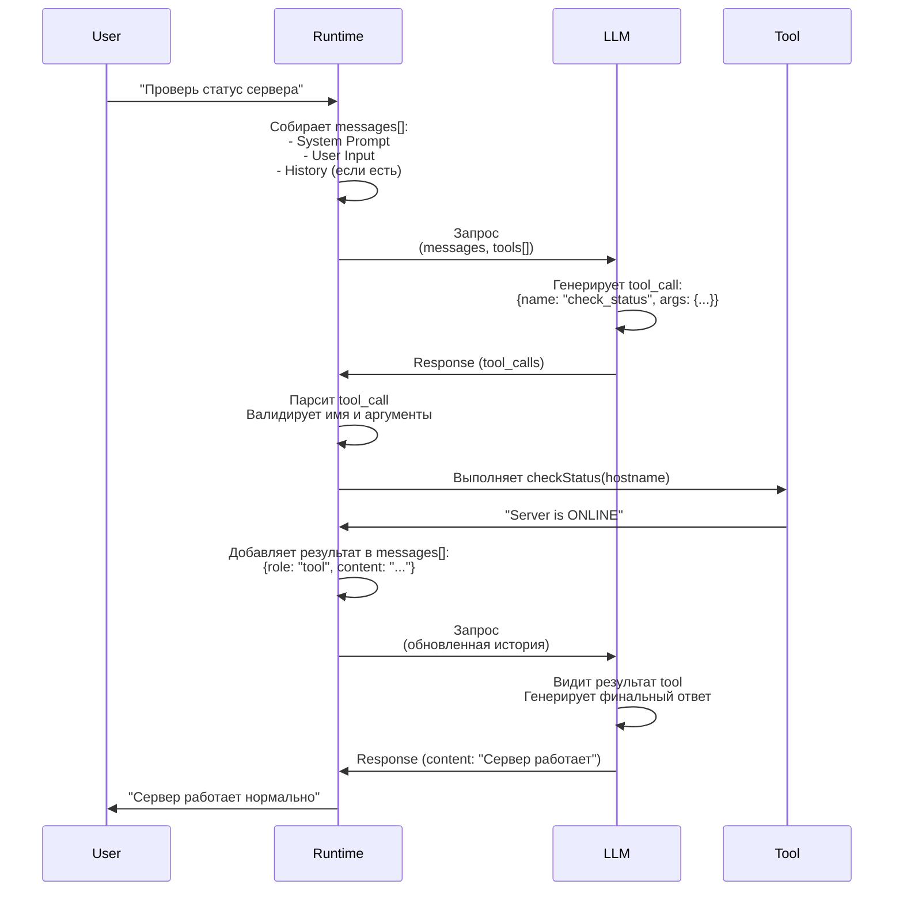

# 09. Анатомия агента — компоненты и их взаимодействие

## Зачем это нужно?

Агент — это **простая** система. В основе — цикл «LLM отвечает → вызывает инструменты → получает результат → отвечает дальше», плюс линейная история сообщений и стабильный system prompt. Никаких «мета-архитектур», графов состояний и многоуровневой памяти в базовом случае не нужно (см. [Предисловие: ментальная модель](../00-preface/README.md)).

Но чтобы этот цикл работал **надёжно в проде**, важно понимать, из чего он реально состоит: где хранятся сообщения, что такое system prompt и почему его нельзя менять на каждом шаге, как защищаться от бесконечных циклов, как изолировать субагента. Без этой анатомии легко начать «чинить» проблему не там, где она есть, и внедрять модные паттерны, которые усложняют агента и ничего не решают.

В этой главе разберём **минимальный набор компонентов** и как они связаны между собой, чтобы вы могли:
- Правильно управлять контекстом и историей диалога (линейная история + один `condense`).
- Реализовать автономный цикл работы агента с предсказуемыми ограничителями.
- Оптимизировать использование токенов через prompt cache, а не через «умные» стратегии.
- Строить расширяемую систему через tools, а не через переусложнённые абстракции внутри ядра.

### Реальный кейс

**Ситуация:** Вы создали агента для DevOps. После 20 сообщений агент "забывает" начало разговора и перестает помнить контекст задачи.

**Проблема:** История диалога переполняет контекстное окно модели. Старые сообщения "выталкиваются", и агент теряет важную информацию.

**Решение:** Если понимать, как устроена память, вы сможете при переполнении сжать (condense) старую часть истории через LLM в краткое summary, не ломая `tool_call ↔ tool_result` пары и не трогая стабильный системный префикс. Подробности — в [гл. 13: Context Engineering](../13-context-engineering/README.md). Переупорядочивать сообщения «по важности» **не нужно**: это антипаттерн, который убивает prompt cache (см. [гл. 12: Память Агента](../12-agent-memory/README.md)).

## Теория простыми словами

Упрощённая формула:

$$ Agent = LLM + Memory + Tools + Planning $$

## Memory (Память)

Агент должен "помнить" контекст разговора и историю действий.

### Short-term Memory (Краткосрочная память)

Это история сообщений (`messages` array). Ограничена контекстным окном.

**Структура сообщения:**

```go
type Message struct {
    Role       string     // "system", "user", "assistant", "tool"
    Content    string
    ToolCalls  []ToolCall // вызовы инструментов (только для assistant)
    ToolCallID string     // ID вызова (только для role="tool")
}

type ToolCall struct {
    ID        string
    Name      string
    Arguments string // JSON-строка с аргументами
}
```

**Пример истории:**

```go
messages := []Message{
    {Role: "system", Content: "Ты DevOps инженер"},
    {Role: "user", Content: "Проверь статус сервера"},
    {Role: "assistant", Content: "", ToolCalls: [...]},  // Вызов инструмента
    {Role: "tool", Content: "Server is ONLINE", ToolCallID: "call_123"},
    {Role: "assistant", Content: "Сервер работает нормально"},
}
```

**Проблема:** Если история слишком длинная, она не влезает в контекстное окно.

**Пример проблемы:**

```go
// Контекстное окно модели: 128 000 токенов
// System Prompt:           500 токенов
// История диалога:    127 000 токенов  // 30 итераций c большими tool_result
// Новый запрос:           1 000 токенов
// ИТОГО: 128 500 токенов > 128 000 [ОШИБКА: context overflow]
```

Текущие модели имеют окна от ~128k до ~1M токенов у отдельных моделей (точное значение — в документации провайдера). Проблема не исчезла — просто сместилась: при длинной агентной сессии и больших tool_result (логи, дампы, веб-страницы) переполнение наступает на 20-50-й итерации.

**Два правила, которые делают эту память рабочей** (детально — в [гл. 12](../12-agent-memory/README.md) и [гл. 13](../13-context-engineering/README.md)):

1. **История иммутабельна.** Сообщения добавляются только в конец, ничего не переупорядочивается, не вычёркивается «по важности», старые сообщения не редактируются. Любая мутация префикса убивает prompt cache провайдера, а это удорожание ввода в 5-10 раз и рост latency.
2. **System prompt стабилен внутри одного Run.** Любое «динамическое» обновление system prompt между итерациями (live state, факты, прогресс плана) — антипаттерн. Динамика живёт в `tool_result` и в последнем `user`-сообщении, а не в системном префиксе.

При переполнении окна применяется одна реакция — `condense`: вызвать LLM, попросить кратко изложить старую часть истории, заменить её одним `user`-сообщением «Контекст предыдущей работы: ...». Лимит — 1 condense на Run; число токенов берём из `usage.PromptTokens` ответа провайдера, а не из своих счётчиков. Подробности — [гл. 13](../13-context-engineering/README.md).

### Long-term Memory (Долгосрочная память)

Это векторная база данных (RAG). В ней можно хранить гигабайты документов и искать нужное по смыслу (Semantic Search).

**Как это работает:**

1. Документы разбиваются на чанки (chunks)
2. Каждый чанк преобразуется в вектор (embedding)
3. При запросе агента ищутся похожие векторы
4. Релевантные чанки добавляются в контекст

**Примеры использования:**

- **DevOps:** Хранение регламентов, runbooks, документации по сервисам
- **Support:** База знаний с решениями типовых проблем
- **Data:** Схемы баз данных, документация по API
- **Security:** Playbooks для инцидентов, политики безопасности

См. [Глава 06: RAG](../06-rag/README.md)

## Planning (Планирование)

**Planning** — это способность агента разбить сложную задачу на шаги и выполнить их в правильном порядке. Сразу зафиксируем рамку: в базовой архитектуре этой книги **нет отдельного «модуля планировщика»**. План рождается в том же агентном цикле, что и всё остальное, и живёт как обычный текст в истории сообщений. Никаких мета-архитектур в базовом случае (см. [Предисловие: ментальная модель](../00-preface/README.md)).

### Планирование «на лету»: ReAct

В простейшем случае агент не строит явного плана — он рассуждает по шагам: `Thought → Action → Observation`. Это паттерн **ReAct**, и по сути это просто агентный цикл из [гл. 04](../04-autonomy-and-loops/README.md), в котором модель между вызовами инструментов объясняет себе, что она делает и зачем.

**Пример (DevOps):**

```
Thought: Пользователь жалуется на тормоза. Надо проверить CPU.
Action: get_cpu_metrics()
Observation: CPU 99%, process: ffmpeg
Thought: ffmpeg жрёт все ресурсы. Посмотрю, что это за процесс.
Action: get_process_info(pid=123)
Observation: Видеоконвертация, запущена пользователем
Thought: Легитимный процесс, но блокирует систему. Предложу ограничить приоритет.
Action: [финальный ответ пользователю]
```

ReAct гибок и достаточен для большинства задач. Но на длинных задачах (5+ шагов) модель может «заблудиться»: пропустить шаг, забыть про верификацию, повторить уже сделанное.

### План — это тоже артефакт

Ключевая идея явного планирования: **план — не структура в коде и не отдельный сервис, а артефакт, который модель видит в своей истории и обновляет по ходу работы**. Два рабочих варианта:

- **Plan → Execute.** Первый ответ модели — список шагов. Дальше агент выполняет их по очереди; план лежит в истории как обычное сообщение.
- **Plan-and-Revise.** Когда шаг провалился или открылись новые данные, модель выдаёт обновлённый план — снова как обычное сообщение в конец истории. Это стоит одно сообщение и не требует никакого «планировщика» в рантайме.

Пример плана (DevOps, инцидент «сервис отдаёт 502»):

```
1. Проверить HTTP статус сервиса (check_http)
2. Если не 200 — прочитать последние 50 строк логов (read_logs)
3. Найти причину в логах (config error / connection refused / OOM)
4. Применить фикс: rollback / restart — по найденной причине
5. Верифицировать: check_http снова
```

**Как план живёт в контексте, не ломая кэш.** План и «прогресс плана» — это сообщения в конце истории (`assistant`-текст или `tool_result`), а не часть system prompt. Промпт-функция, которая пересобирает system prompt на каждой итерации, чтобы «вставить актуальный план», — антипаттерн: она убивает prompt cache всей истории (см. [гл. 13](../13-context-engineering/README.md)).

### Хороший план vs плохой

- Шаги атомарны: не «разобраться и починить», а «проверить статус» → «прочитать логи» → «применить фикс».
- Порядок осмыслен: сначала диагноз, потом действие.
- В конце — явная верификация результата.
- У каждого шага есть критерий успеха («CPU снизился до 50%», а не «стало лучше»).

### Для общего развития: ToT и Self-Consistency

- **Tree-of-Thoughts (ToT):** модель генерирует несколько альтернативных путей решения, оценивает их и выбирает лучший. Оправдан, когда у задачи есть несколько принципиально разных подходов.
- **Self-Consistency:** модель генерирует N независимых планов и собирает финальный из наиболее часто встречающихся элементов. Дорогой приём (N полных генераций), в проде встречается редко.

Оба семейства приёмов — с примерами и границами применимости — разобраны в [гл. 10: Planning и Workflow-паттерны](../10-planning-and-workflows/README.md).

### Иерархическое планирование — не дефолт

«Supervisor разбивает задачу на подпланы и раздаёт субагентам» — это уже мультиагентная архитектура, [гл. 07: Multi-Agent](../07-multi-agent/README.md). Она оправдана в узких случаях (о них — в разделе [Subagents](#subagents-под-агенты) ниже), но по умолчанию один агентный цикл плюс явный план в истории решает тот же класс задач проще, дешевле и предсказуемее. Не начинайте проект с мультиагента.

### Reflexion (Самокоррекция)

Агенты часто ошибаются. Reflexion добавляет шаг критики: после неудачного действия модель объясняет себе, **почему** не получилось и что изменить.

Цикл: `Act → Observe → Fail → Reflect → Plan Again`

**Пример:**

```
Action: read_file("/etc/nginx/nginx.conf")
Observation: Permission denied
Reflection: "Файл не читается — у меня нет прав. Сначала проверю права доступа."
Action: check_permissions("/etc/nginx/nginx.conf")
Observation: File is readable by root only
Action: read_file_sudo("/etc/nginx/nginx.conf")
```

Рефлексия — это тоже просто текст в истории. Модель видит свою ошибку, свой вывод из неё и следующий ход; никаких специальных механизмов в рантайме не нужно.

## Runtime (Среда выполнения)

Runtime — это код, который связывает LLM с инструментами: отправляет историю в модель, парсит ответ, выполняет инструменты, дописывает результаты в конец истории и решает, когда остановиться.

**Нейтральные структуры сообщений** (без привязки к конкретному SDK; `Message` и `ToolCall` определены выше, здесь добавляется `ToolDef` — описание инструмента для блока `tools[]`):

```go
type ToolDef struct {
    Name        string
    Description string
    Parameters  json.RawMessage // JSON Schema
}
```

### Интерфейс Tool

```go
type Tool interface {
    Name() string
    Description() string
    Parameters() json.RawMessage
    Execute(ctx context.Context, args json.RawMessage) (*Result, error)
}

// Result — результат выполнения инструмента.
type Result struct {
    Content         string // полный результат: для UI, логов и аудита
    FilteredContent string // то, что модель реально увидит в tool_result
}
```

Два поля `Result` — главный рычаг экономии контекста. Пример: `read_logs` вернул 500 строк. В `Content` лежат все 500 — UI покажет их целиком, аудит сохранит. А в `tool_result` модели уходит `FilteredContent` — 30 строк, отобранных и обрезанных. Модель не должна платить токенами за шум.

> **Сайдбар: флаги на инструменте.** В реальных SDK у инструмента бывают метаданные: `ReadOnly` (нет побочных эффектов — можно запускать параллельно и без подтверждения), `Parallel` (явно разрешено параллельное выполнение), `Confirm` (опасное действие — сначала спросить человека, [гл. 05](../05-safety-and-hitl/README.md)). Это просто поля структуры рядом с `ToolDef`; runtime читает их до вызова `Execute`. Разбор — в [гл. 04](../04-autonomy-and-loops/README.md).

### Tool Registry — кратко

Чтобы runtime не знал про конкретные инструменты, их держат в реестре: map «имя → Tool» плюс метод, отдающий `[]ToolDef` для блока `tools[]` запроса.

```go
type ToolRegistry struct{ tools map[string]Tool }

func (r *ToolRegistry) Register(t Tool)              { r.tools[t.Name()] = t }
func (r *ToolRegistry) Get(name string) (Tool, bool) { t, ok := r.tools[name]; return t, ok }
func (r *ToolRegistry) ToolDefs() []ToolDef          // сериализуется в tools[] запроса
```

Новый инструмент = реализовать интерфейс и зарегистрировать. Runtime остаётся неизменным; валидация, логирование и метрики встраиваются на уровне реестра. Полную реализацию (валидация аргументов, генерация схем, параллельное выполнение) см. в [гл. 03: Инструменты и Function Calling](../03-tools-and-function-calling/README.md), фреймворковые варианты — в [гл. 14](../14-ecosystem-and-frameworks/README.md).

**Помните о цене блока `tools[]`.** Он отправляется в **каждом** запросе и оплачивается каждый раз — даже если в этой итерации не вызван ни один инструмент. Ориентир: 4 компактных инструмента ≈ 742 токена только на схемы ([гл. 03](../03-tools-and-function-calling/README.md)). Число инструментов и длина описаний — вопрос дизайна №1; если инструментов стало много, часть из них должна стать скилом (раздел ниже) или одной универсальной командой.

### Схема потока данных в агенте



**Ключевые моменты:**
- LLM не выполняет код, только генерирует JSON. Настоящий код выполняет runtime.
- Runtime управляет всем циклом; история (`messages[]`) собирается runtime'ом и передаётся в каждый запрос целиком.
- Результаты инструментов дописываются в конец истории перед следующим запросом.

### Минимальный цикл агента

Всё вместе — компактный цикл на нейтральных структурах (полная версия с лимитами, confirm и condense — [гл. 04](../04-autonomy-and-loops/README.md)):

```go
func runOnce(ctx context.Context, client Client, registry *ToolRegistry, messages []Message) error {
    for i := 0; i < maxIterations; i++ {
        resp, err := client.Complete(ctx, Request{Messages: messages, Tools: registry.ToolDefs()})
        if err != nil {
            return err // transient-ошибки ретраит сам клиент (гл. 04)
        }

        msg := resp.Choices[0].Message
        messages = append(messages, msg) // assistant-ответ — в конец истории

        if len(msg.ToolCalls) == 0 {
            fmt.Println(msg.Content) // финальный ответ — выходим
            return nil
        }

        for _, tc := range msg.ToolCalls {
            tool, ok := registry.Get(tc.Name)
            if !ok {
                messages = append(messages, Message{
                    Role:       "tool",
                    ToolCallID: tc.ID,
                    Content:    "Error: unknown tool " + tc.Name,
                })
                continue
            }
            res, err := tool.Execute(ctx, json.RawMessage(tc.Arguments))
            var content string
            if err != nil {
                // Ошибка — тоже результат для модели (гл. 03); разыменовываем
                // res только на успешном пути: Execute вернул (nil, err)
                content = "Error: " + err.Error()
            } else {
                content = res.FilteredContent
            }
            messages = append(messages, Message{
                Role:       "tool",
                ToolCallID: tc.ID,
                Content:    content,
            })
        }
    }
    // Лимит итераций — терминальная ошибка: остановились и сообщили человеку
    return fmt.Errorf("превышен лимит итераций (%d)", maxIterations)
}
```

### Config: плоская инъекция поведения

На практике один тип `Agent` обслуживает разные режимы не через наследование и if-ветвления, а через **инъекцию поведения через Config**: все точки управления циклом — поля одной плоской структуры (клиент/модель, system prompt, tools с правами, лимиты, стоп-предикат, confirm, condense, обработчик событий), а сам цикл — один `Run` поверх неё. Канонический листинг `AgentConfig` и `Run` — в [гл. 04: Автономность и Циклы](../04-autonomy-and-loops/README.md#правильная-форма-runtime-config-run); здесь не дублируем.

Один и тот же `Agent` работает как:
- **Main agent** — полный Config: промпт со всей ролью, tools, condense на переполнение.
- **Subagent** — минимальный Config: узкий промпт под подзадачу, короткий список read-only tools.
- **Triage agent** — узкий промпт + усечённый список Tools.
- **ChatOnly** — Tools = nil, простой диалог.

**Почему Prompt и Tools — это поля, а не функции `func(state)`?** Потому что `system` сообщение и блок `tools[]` лежат в самом начале запроса и формируют **префикс**, который провайдер кэширует. Если на каждой итерации возвращать разный текст промпта или разный список инструментов — кэш промахивается на каждом шаге, ввод дорожает в 5-10 раз, latency растёт. Динамика — в `tool_result` и в `user`-сообщениях в конце истории, а не в системном префиксе. Если поведение меняется радикально (новая роль, другой набор tools) — это **новый Run**, не модификация текущего.

Субагент при таком устройстве не нуждается ни в каком «Working Memory» — у него своя короткая история на свой `task`. Если основной агент хочет передать ему контекст, он передаёт его текстом в `task`, а не через общую структуру.

### RunResult: результат возвращается даже при ошибке

`Run` всегда возвращает структуру результата — в том числе когда ход остановлен терминальной ошибкой (лимит итераций, дедлайн, бюджет):

```go
type RunResult struct {
    Output     string     // финальный ответ (если есть)
    Err        error      // терминальная ошибка, nil при успехе
    Iterations int        // сколько итераций сделано
    Usage      Usage      // токены по всем итерациям
    ToolsUsed  []ToolCall // какие инструменты были вызваны
}
```

Даже если Run упал на 14-й итерации, вызывающий код знает, сколько токенов потрачено, какие инструменты вызывались и на чём остановились. Это нужно для логов, биллинга и отладки — поэтому ошибка здесь — поле результата, а не только второе возвращаемое значение.

> **Сайдбар: как это устроено в реальном SDK.** `RunResult` возвращается даже при ошибке: итерации, usage, вызванные tools, итоговая модель. События цикла — sealed-типы (закрытая иерархия): дельта потока, финальный ответ, старт/прогресс/конец инструмента, ошибка конденсации.

### Событийная модель (Event System)

Агент генерирует события по ходу работы. UI, логирование и метрики подписываются на них независимо:

```go
// События одного Run. Множество закрыто (sealed):
// интерфейс с непроэкспортированным методом нельзя реализовать снаружи.
type Event interface{ isEvent() }

type DeltaEvent struct{ Text string }                     // фрагмент стриминга
type ResponseEvent struct{ Msg Message }                  // полный ответ модели за итерацию
type ToolStartEvent struct{ Call ToolCall }               // инструмент начал выполняться
type ToolUpdateEvent struct {                             // прогресс долгого инструмента
    Call ToolCall
    Note string
}
type ToolEndEvent struct {                                // инструмент завершился
    Call ToolCall
    Res  *Result
    Err  error
}
type CondenseErrorEvent struct{ Err error }               // condense не смог спасти Run
```

Доставка — fan-out через простой брокер: каждое событие уходит всем подписчикам по каналам с буфером, медленный подписчик не блокирует цикл (при переполнении буфера событие отбрасывается или копится в лог — но агент не ждёт).

```go
type Broker[T any] struct {
    mu          sync.RWMutex
    subscribers []chan T
}

func (b *Broker[T]) Subscribe() <-chan T { /* канал с буфером */ ... }
func (b *Broker[T]) Publish(ev T) {
    b.mu.RLock()
    defer b.mu.RUnlock()
    for _, ch := range b.subscribers {
        select {
        case ch <- ev:
        default: // не блокируем цикл ради медленного подписчика
        }
    }
}
```

UI рисует стриминг, логгер пишет в файл, метрики считают tool calls — и все работают параллельно, не мешая агенту.

## Skills (Навыки)

Агент с фиксированным System Prompt ограничен. Навыки (Skills) позволяют динамически менять поведение агента в зависимости от задачи.

[Agent Skills](https://agentskills.io/) — открытый формат для расширения возможностей агентов. Стандарт поддерживается Cursor, Claude Code, VS Code, GitHub и другими инструментами. По сути, навык — это папка с файлом `SKILL.md`. Агент загружает его содержимое в контекст по мере необходимости.

### Зачем нужны навыки?

Представьте: агент для DevOps умеет работать с Docker. Завтра появляется задача работы с Kubernetes. Без навыков придётся переписывать System Prompt и добавлять инструкции прямо в код.

С навыками вы просто загружаете нужный модуль поведения.

### Skill — это не Tool

Навык и инструмент — разные вещи. Инструмент выполняет конкретное действие (вызывает API, читает файл). Навык описывает **как себя вести** в определённой ситуации.

**Аналогия:**
- **Tool** — молоток, пила, отвёртка (конкретные действия)
- **Skill** — инструкция "как собрать шкаф" (последовательность действий и правила)

### Skills — Магия vs Реальность

**Магия (как обычно объясняют):**
> Навыки — это AI-модули, которые агент "выучил" и применяет автоматически.

**Реальность (как на самом деле):**

Навык — это текстовый файл с инструкциями. Когда навык нужен, модель читает его содержимое в свою историю (обычным инструментом `read`). Никакого обучения не происходит — модель просто получает дополнительный текст в контексте.

### Формат Agent Skills (SKILL.md)

[Спецификация Agent Skills](https://agentskills.io/specification) определяет стандартный файлый формат. Навык — это директория с файлом `SKILL.md`:

```
docker-debugging/
├── SKILL.md        # Обязательно: метаданные + инструкции
├── scripts/        # Опционально: исполняемый код
├── references/     # Опционально: дополнительная документация
└── assets/         # Опционально: шаблоны, схемы
```

Файл `SKILL.md` содержит YAML frontmatter и Markdown-инструкции:

```yaml
---
name: docker-debugging
description: >
  Debug Docker containers — check status, logs, resources,
  restart loops. Use when user mentions Docker problems.
---

# Docker Debugging

## When to use this skill
Use when the user reports Docker container issues...

## Steps
1. Check container status (docker ps)
2. Read logs (docker logs)
3. Check resources (docker stats)
4. If container is restarting — check exit code
5. Never run docker rm -f without confirmation
```

Два поля обязательны: `name` (идентификатор, строчные буквы + дефисы) и `description` (когда применять навык). Markdown-тело содержит инструкции.

### Progressive Disclosure (Постепенное раскрытие)

Навыки используют трёхуровневую загрузку для экономии контекста:

1. **Discovery.** При старте агент загружает только `name` и `description` каждого навыка. Это ~100 токенов на навык.
2. **Activation.** Когда задача совпадает с описанием навыка, агент читает полное тело `SKILL.md` в контекст.
3. **Execution.** Агент следует инструкциям, подгружая файлы из `scripts/`, `references/` только по мере необходимости.

Агент остаётся быстрым, но при этом имеет доступ к детальным инструкциям по запросу.

### Реализация в Runtime: progressive disclosure

Как это ложится на агентный цикл со стабильным system prompt:

1. **Discovery.** При старте Run runtime читает все `SKILL.md` и добавляет в system prompt **одну строку на скил**: имя + `description`. 20 скилов ≈ 20 строк — это вся цена обнаружения.
2. **Activation.** Когда модель решает, что навык нужен, она читает тело `SKILL.md` **сама**, обычным инструментом `read`. Текст скила входит в историю как `tool_result` — в конец, не трогая префикс.
3. **Execution.** Файлы из `scripts/` и `references/` модель подтягивает тем же `read` по мере необходимости.

```go
// Всё, что модель знает о скиле до активации (одна строка в system prompt):
//   - docker-debugging: Debug Docker containers — check status, logs,
//     resources, restart loops. Use when user mentions Docker problems.
//
// Тело скила модель читает сама, когда он нужен:
res, err := readTool.Execute(ctx, json.RawMessage(`{"path":"skills/docker-debugging/SKILL.md"}`))
// res.FilteredContent дописывается в конец истории как tool_result
```

Что здесь важно:

- **System prompt не пересобирается.** «Загрузить скил», вшив его полный текст в system prompt, — антипаттерн: каждое переключение навыка ломает prompt cache всей истории. Текст скила входит в историю как tool_result, в конец.
- **Никаких keyword-триггеров.** «Если в запросе есть слово docker — подгрузить скил» — грубое упрощение: оно промахивается на перефразировках и ложно срабатывает. Какой скил открыть, решает сама модель по `description` — именно поэтому скилы видны ей списком в system prompt.
- Новый навык = новый файл `SKILL.md` в директории скилов. Ни строчки кода в агенте.

Полная спецификация формата: [Agent Skills Specification](https://agentskills.io/specification). Примеры навыков доступны в [GitHub-репозитории](https://github.com/anthropics/skills).

## Subagents (Под-агенты)

Дефолт этой книги: **один агентный цикл + скилы**. Субагент — осознанное исключение, и оправданных причин для него всего две.

### Когда субагент действительно нужен

**1. Ревью с чистой памятью.** Модель, ревьюящая собственную работу, соглашается с собой: она видит в истории, *почему* приняла решение, и проверяет своё оправдание, а не результат. Субагент-ревьюер получает только артефакт (диф, отчёт, план) и задачу «найди ошибки» — без истории родителя. Это радикально меняет качество ревью.

**2. Вынос шумного чтения.** Поиск по логам, анализ кодовой базы, чтение документации — это десятки `read`/`search` вызовов с большими результатами. Если делать это в основном цикле, история родителя раздувается шумом, и вы платите за каждый чанк в каждом следующем запросе. Субагент перекачивает гигабайты через свою короткую историю и возвращает родителю одну страницу выводов.

Всё остальное — не повод для субагента. Если подзадача сводится к «вызвать 2-3 инструмента», это обычный tool call в основном цикле. Если хочется «команду из шести типизированных ролей» (планировщик, критик, писатель, исследователь...) — это антипаттерн: несколько агентов с общей задачей не работают лучше одного, а координация, latency и стоимость растут на порядок (разбор — [гл. 07: Multi-Agent](../07-multi-agent/README.md)).

### Связь «Родитель — Потомок»

Субагент — это тот же `Agent` со своим минимальным Config:

- **Свой system prompt** — узкая задача, а не «роль в команде».
- **Только read-only инструменты.** У субагента нет пишущих внешних инструментов: никаких `write`, `exec` на проде, деплоя, изменений БД. Все записи делает родитель, получив от субагента вывод, — так аудит действий остаётся в одной истории.
- **Чистая память** — субагент не наследует историю родителя. Контекст передаётся текстом в `task`, результат возвращается текстом.
- **Свои лимиты** — лимит итераций и дедлайн меньше родительских.

```go
// Субагент — тот же Run с минимальным Config (структуры — гл. 04).
func SpawnSubagent(ctx context.Context, cfg AgentConfig, task string) (RunResult, error) {
    // cfg: узкий SystemPrompt, read-only Tools, свои Limits
    res := Run(ctx, cfg) // родитель передал весь нужный контекст текстом в task
    if res.Err != nil {
        return res, fmt.Errorf("subagent: %w", res.Err)
    }
    return res, nil // родитель читает res.Output как обычный текст
}
```

Когда под-агент завершает работу, результат возвращается родителю как обычный текст.

### Пример: ревью изменений

```
Задача родителя: "Добавь health-check в payment-api и убедись, что всё корректно"

Родитель: пишет код (write, exec в dev-окружении) — сам, своими руками
Родитель: SpawnSubagent(review-config, "Проверь этот диф: ...")

  Субагент (read-only): читает диф, ищет проблемы обработки ошибок,
  гонки, забытые edge cases — в своей чистой истории, без оправданий автора
  → "Нашёл: 1) retry без backoff, 2) незакрытый ticker"

Родитель: читает замечания и правит код сам
```

### Пример: вынос шумного чтения

```
Задача родителя: "Обнови зависимость и проверь, что ничего не сломалось"

Родитель: SpawnSubagent(research-config, "Найди в репозитории все места, где используется OldClient")

  Субагент (read-only): поиск по коду, чтение файлов, документация —
  40 вызовов с большими результатами остаются в ЕГО истории
  → "OldClient используется в 6 местах: transport.go:44, ... — список прилагаю"

Родитель: правит 6 файлов сам; в его истории — один компактный tool_result
```

Родитель потратил одну итерацию и ~200 токенов результата вместо десятков итераций и тысяч токенов шума в каждом следующем запросе.

### Контроль глубины

Субагент не должен порождать субагентов. Вложенность ограничивается явно: `depth` передаётся в Config, и при `depth >= maxDepth` агент получает набор инструментов без spawn-возможности. Стандартный максимум — 1 уровень вложенности; каждый следующий уровень умножает стоимость и усложняет отладку. Подробнее — [гл. 07: Multi-Agent](../07-multi-agent/README.md).

## Checkpoint и Resume (Сохранение и восстановление)

Долгоживущие агенты работают минутами и часами. За это время может упасть сеть, закончиться лимит API или перезапуститься процесс. Без механизма сохранения состояния вся работа теряется. Снапшот — это **снимок линейной истории сообщений плюс внешнего состояния** (изменённые файлы, артефакты); restore восстанавливает историю и проверяет внешнее состояние. Продвинутые стратегии (гранулярность, валидация, ротация) — в [гл. 11: State Management](../11-state-management/README.md).

### Зачем это нужно?

Представьте: агент анализирует 50 серверов. На 47-м сервере падает соединение с API. Без checkpoint агент начнёт всё сначала — 47 вызовов API впустую. С checkpoint — продолжит с 48-го.

### Стратегии сохранения

**Per-iteration** — сохранение после каждой итерации цикла:
- Просто реализовать
- Может быть избыточным для коротких задач
- Подходит для длинных задач с предсказуемым числом шагов

**Per-tool-call** — сохранение после каждого вызова инструмента:
- Более гранулярный контроль
- Полезно, когда вызовы инструментов дорогие или медленные
- Позволяет не повторять уже выполненные вызовы

### Checkpoint — Магия vs Реальность

**Магия (как обычно объясняют):**
> Агент автоматически запоминает своё состояние и продолжает с места остановки.

**Реальность (как на самом деле):**

Состояние агента — это линейная история `messages[]` и метаданные (номер итерации, статус), плюс внешнее состояние, если агент менял файлы или БД. Вы сериализуете их в JSON и сохраняете на диск. При перезапуске загружаете и продолжаете цикл с того же места.

#### Структура checkpoint

```go
// Checkpoint — снимок состояния агента
type Checkpoint struct {
    ID        string    `json:"id"`
    CreatedAt time.Time `json:"created_at"`
    Iteration int       `json:"iteration"`
    Messages  []Message `json:"messages"` // линейная история целиком
    TaskID    string    `json:"task_id"`
    Status    string    `json:"status"` // "in_progress", "completed", "failed"
}
```

Если агент менял внешнее состояние, рядом с историей сохраняется и оно: список изменённых путей, идемпотентные ключи операций. Restore должен не только вернуть историю, но и сверить мир с ней: если файлы успели измениться с момента снапшота, агент должен это увидеть, а не «вспомнить» то, чего уже нет.

#### Сохранение и загрузка

```go
// SaveCheckpoint сохраняет состояние агента на диск
func SaveCheckpoint(dir string, cp Checkpoint) error {
    data, err := json.MarshalIndent(cp, "", "  ")
    if err != nil {
        return fmt.Errorf("marshal checkpoint: %w", err)
    }

    path := filepath.Join(dir, cp.TaskID+".json")
    return os.WriteFile(path, data, 0644)
}

// LoadCheckpoint загружает последний checkpoint для задачи.
// Возвращает nil, nil если checkpoint не найден — агент начнёт с нуля.
func LoadCheckpoint(dir, taskID string) (*Checkpoint, error) {
    path := filepath.Join(dir, taskID+".json")

    data, err := os.ReadFile(path)
    if err != nil {
        if os.IsNotExist(err) {
            return nil, nil // Нет checkpoint — начинаем с нуля
        }
        return nil, fmt.Errorf("read checkpoint: %w", err)
    }

    var cp Checkpoint
    if err := json.Unmarshal(data, &cp); err != nil {
        return nil, fmt.Errorf("unmarshal checkpoint: %w", err)
    }
    return &cp, nil
}
```

#### Агент с поддержкой checkpoint

```go
// Client — нейтральный интерфейс к LLM-провайдеру (гл. 04).
func runAgentWithCheckpoints(
    ctx context.Context,
    client Client,
    registry *ToolRegistry,
    taskID, userInput string,
) error {
    checkpointDir := "./checkpoints"

    // Пытаемся восстановиться из checkpoint
    cp, err := LoadCheckpoint(checkpointDir, taskID)
    if err != nil {
        return err
    }

    var messages []Message
    startIteration := 0

    if cp != nil && cp.Status == "in_progress" {
        // Восстанавливаемся — берём историю и номер итерации из checkpoint
        messages = cp.Messages
        startIteration = cp.Iteration
        log.Printf("Восстановлен checkpoint: итерация %d", startIteration)
    } else {
        // Checkpoint не найден — начинаем с нуля
        messages = []Message{
            {Role: "system", Content: systemPrompt},
            {Role: "user", Content: userInput},
        }
    }

    for i := startIteration; i < maxIterations; i++ {
        resp, err := client.Complete(ctx, Request{Messages: messages, Tools: registry.ToolDefs()})
        if err != nil {
            // Ошибка API — сохраняем checkpoint и выходим
            SaveCheckpoint(checkpointDir, Checkpoint{
                TaskID:    taskID,
                Iteration: i,
                Messages:  messages,
                Status:    "in_progress",
                CreatedAt: time.Now(),
            })
            return fmt.Errorf("API error (checkpoint saved at iteration %d): %w", i, err)
        }

        msg := resp.Choices[0].Message
        messages = append(messages, msg)

        if len(msg.ToolCalls) == 0 {
            // Задача завершена — сохраняем финальный checkpoint
            SaveCheckpoint(checkpointDir, Checkpoint{
                TaskID:    taskID,
                Iteration: i,
                Messages:  messages,
                Status:    "completed",
                CreatedAt: time.Now(),
            })
            return nil
        }

        // Выполняем инструменты
        for _, tc := range msg.ToolCalls {
            tool, ok := registry.Get(tc.Name)
            if !ok {
                messages = append(messages, Message{
                    Role:       "tool",
                    ToolCallID: tc.ID,
                    Content:    "Error: unknown tool " + tc.Name,
                })
                continue
            }
            result, err := tool.Execute(ctx, json.RawMessage(tc.Arguments))
            var content string
            if err != nil {
                content = "Error: " + err.Error() // ошибка — тоже результат (гл. 03)
            } else {
                content = result.FilteredContent
            }
            messages = append(messages, Message{
                Role:       "tool",
                Content:    content,
                ToolCallID: tc.ID,
            })
        }

        // Сохраняем checkpoint после каждой итерации
        SaveCheckpoint(checkpointDir, Checkpoint{
            TaskID:    taskID,
            Iteration: i + 1,
            Messages:  messages,
            Status:    "in_progress",
            CreatedAt: time.Now(),
        })
    }

    return nil
}
```

Checkpoint — это страховка. Для коротких задач (2-3 итерации) он избыточен. Для длинных задач (10+ итераций) или дорогих вызовов API — обязателен.

> **Сайдбар: как это устроено в реальном SDK.** Чекпоинт — это пара операций `Snapshot`/`Restore` над линейной историей: snapshot сериализует `messages[]` и метаданные Run, restore возвращает их в цикл. Recovery обязан разбирать «протёкшие» tool calls: если в истории остался `tool_call`, а `tool_result` не успел дописаться, нужно либо выполнить вызов заново, либо дописать заглушку — иначе провайдер отклонит историю. Продвинутые стратегии — [гл. 11](../11-state-management/README.md).

## Типовые ошибки

### Ошибка 1: История переполняется

**Симптом:** Агент "забывает" начало разговора. После N сообщений перестает помнить контекст задачи; либо провайдер возвращает `context_length_exceeded`.

**Причина:** История диалога превышает размер контекстного окна модели. Старые сообщения «выталкиваются» из контекста или запрос отклоняется целиком.

**Решение — `condense` (см. [гл. 13](../13-context-engineering/README.md)):**

```go
// ПЛОХО: тупо обрезать середину — рискуем порвать пары tool_call ↔ tool_result,
// получить от провайдера ошибку валидации и потерять важный контекст.
if len(messages) > maxHistoryLength {
    messages = append(
        []Message{messages[0]},
        messages[len(messages)-maxHistoryLength+1:]...,
    )
}

// ПЛОХО: переупорядочивать сообщения «по важности» — убивает prompt cache
// и почти всегда даёт ошибку «orphan tool_result».

// ХОРОШО: condense — попросить LLM кратко изложить старую часть истории
// и заменить её одним user-сообщением. System остаётся, последние N сообщений
// (с целыми tool_call/tool_result парами) тоже остаются. Лимит — 1 condense на Run.
messages = condense(ctx, messages, keepLastN)
```

Триггер запуска `condense` — `usage.PromptTokens >= 0.85 * contextWindow` либо ошибка `context_length_exceeded`. Свой счётчик токенов для триггера не используем — он промахивается. Подробности — [гл. 13](../13-context-engineering/README.md).

### Ошибка 2: Агент зацикливается

**Симптом:** Агент повторяет одно и то же действие бесконечно.

**Причина:** Нет лимита итераций и детекции повторяющихся действий.

**Решение:**
```go
// ХОРОШО: Лимит итераций + детекция застревания
for i := 0; i < maxIterations; i++ {
    // ...
    
    // Детекция застревания
    if lastNActionsAreSame(history, 3) {
        break
    }
}
```

### Ошибка 3: Результат инструмента не добавляется в историю

**Симптом:** Агент не видит результат инструмента и продолжает выполнять то же действие.

**Причина:** Результат выполнения инструмента не добавляется в `messages[]`.

**Решение:**
```go
// ПЛОХО: Результат не добавляется
result := executeTool(toolCall)
// История не обновлена!

// ХОРОШО: Результат добавляется в историю
result := executeTool(toolCall)
messages = append(messages, Message{
    Role:       "tool",
    Content:    result,
    ToolCallID: toolCall.ID,
})
```

### Ошибка 4: Монолитный Run()

**Симптом:** Невозможно unit-тестировать компоненты агента. Единственный способ проверить routing — запустить весь Run() с mock provider.

**Причина:** Функция `Run()` совмещает 6 ответственностей: сборка промпта, routing, error recovery, tool execution, plan tracking, event publishing. На практике это легко разрастается до 240 строк с вложенными if-ветвлениями.

**Решение:** Разделите ответственности через инъекцию:
```go
// ПЛОХО: всё в одной функции
func (a *Agent) Run(ctx context.Context, msg string) (string, error) {
    // 240 строк: routing + prompt + tools + recovery + events + plan
}

// ХОРОШО: плоский Config — все точки управления циклом полями
// (полный листинг AgentConfig — в гл. 04)
type AgentConfig struct {
    Resolve  func(ctx context.Context) (Client, error) // primary + fallback-цепочка
    Memory   *History       // линейная история сообщений
    Tools    []Tool         // фиксирован на весь Run
    Prompt   string         // фиксирован на весь Run, не пересобирается
    Inject   func(LoopState) []Message // динамика: вставка сообщений в ход
    Stop     func(LoopState, *Response) bool
    Confirm  ConfirmFunc    // UX-подтверждение (гл. 05)
    Condense CondenseFunc   // один порог ~0.85, максимум 1 за Run
    Limits   Limits         // итерации, дедлайн — терминальные границы
    On       func(Event)    // события цикла
}
```

### Ошибка 5: Subagent hardcode в executeTools

**Симптом:** При добавлении нового типа специального tool приходится менять общую функцию выполнения инструментов.

**Причина:** Внутри `executeTools()` есть проверка `if tc.Name == "subagent"` с особой логикой (plan step tracking, progress forwarding). Каждый "особый" tool добавляет ещё один `if`.

**Решение:** Используйте Hooks:
```go
// ПЛОХО: hardcode в общей функции
func executeTools(calls []ToolCall) {
    for _, tc := range calls {
        if tc.Name == "subagent" {
            // 20 строк специальной логики
        }
        result := registry.Execute(tc)
    }
}

// ХОРОШО: Hooks
type Hooks struct {
    BeforeToolExec func(name string, args string)
    AfterToolExec  func(name string, args string, result string)
}
```

## Мини-упражнения

### Упражнение 1: Прикидка токенов до отправки

Реализуйте функцию приблизительной оценки токенов в истории сообщений — для метрик и для решения «не пора ли заранее запустить condense»:

```go
func estimateTokens(messages []Message) int {
    // Прикидка через tiktoken (или другой быстрый токенизатор).
    // Учтите: Content, ToolCalls, ToolCallID, Role overhead.
    // Для прода это лишь оценка — точное число всегда берите из usage.PromptTokens.
}
```

**Важное правило (см. [гл. 13](../13-context-engineering/README.md)):** в реальном агентном цикле первичный источник числа токенов — поле `usage.PromptTokens` из ответа провайдера. Свой счётчик годится только для оценки **до** первой отправки запроса либо для дешёвых метрик. На него нельзя завязывать триггер `condense` — он систематически промахивается на 5-30% (особенно для tool_calls и многоязычного контента).

**Ожидаемый результат:**
- Функция возвращает оценку с расхождением не более ±10% от `usage.PromptTokens` на типичной истории.
- Учитывает все типы сообщений (system, user, assistant, tool).
- В коде агента вызывается **только до первого запроса**; после первого ответа триггер condense считается по `usage.PromptTokens`.

### Упражнение 2: Реализация condense

**Примечание:** теория — в [гл. 13: Context Engineering](../13-context-engineering/README.md). Здесь — каркас для самостоятельной реализации.

Реализуйте `condense` — единственную операцию сжатия истории, которую агент применяет при переполнении окна:

```go
// condense заменяет «середину» истории одним user-сообщением со сводкой,
// вызвав LLM с просьбой кратко изложить переданный фрагмент.
//
// Гарантии:
//   - первое сообщение (system) сохраняется как есть;
//   - последние keepLastN сообщений сохраняются как есть, целыми
//     парами tool_call ↔ tool_result (никаких «orphan tool_result»);
//   - всё, что между ними, заменяется одним сообщением role="user"
//     с содержимым "Контекст предыдущей работы:\n\n" + summary.
//
// Лимит на Run — 1 вызов condense; повторный overflow сразу после
// condense означает, что задача слишком большая для одного Run.
func condense(
    ctx context.Context,
    client Client, // нейтральный интерфейс к LLM-провайдеру (гл. 04)
    messages []Message,
    keepLastN int,
) ([]Message, error) {
    // 1) если len(messages) < 2 + keepLastN — нечего сжимать, верните как есть
    // 2) выделите head (без system и без последних keepLastN) и tail
    // 3) вызовите LLM с промптом «суммируй head в N токенов»
    // 4) соберите [system, summary-as-user, ...tail] и верните
}
```

**Ожидаемый результат:**
- system всегда остаётся первым.
- Последние `keepLastN` сообщений сохраняются полностью.
- Между ними — ровно одно `user`-сообщение со сводкой.
- Никаких «orphan tool_result»: если в `tail` оказался `tool_result` без своей пары `tool_call` — его нужно либо вернуть пару в `tail`, либо выкинуть оба.
- Никакого переупорядочивания, никакого «скоринга важности», никакой мутации `system`.

## Критерии сдачи / Чек-лист

**Сдано:**
- [x] Short-term memory — линейная иммутабельная история (`messages[]`).
- [x] System prompt и список tools зафиксированы в начале Run и не меняются между итерациями.
- [x] Триггер `condense` считается по `usage.PromptTokens` из ответа провайдера (свой счётчик — только для прикидки до отправки).
- [x] При переполнении применяется `condense` с лимитом 1 на Run; пары `tool_call ↔ tool_result` не разрываются.
- [x] Long-term memory (RAG) настроена, если задача требует знаний между сессиями.
- [x] Planning: план живёт в истории сообщений как артефакт (Plan → Execute / Plan-and-Revise), а не в пересобираемом system prompt.
- [x] Runtime корректно парсит ответы LLM, выполняет инструменты, управляет циклом; RunResult возвращается даже при ошибке.
- [x] Инструменты возвращают Result{Content, FilteredContent}: модель видит отфильтрованную версию.
- [x] Скилы: в system prompt — только имя и description (progressive disclosure), тело скила модель читает сама через read.
- [x] Есть защита от зацикливания (лимит итераций + детекция повторов).
- [x] Subagent — тот же Agent со своим Config, чистой памятью и только read-only инструментами.

**Не сдано (антипаттерны):**
- [ ] История переполняется и нет реакции (ни condense, ни жёсткой остановки).
- [ ] Сообщения переупорядочиваются «по важности» (поднимаются «важные», сбрасываются «неважные») — убит prompt cache, ломаются tool-пары.
- [ ] System prompt мутируется между итерациями (в него вшиваются live state, факты, прогресс плана, полный текст скилов) — убит prompt cache.
- [ ] Список tools меняется на каждой итерации без серьёзной причины — то же самое.
- [ ] Скилы выбираются keyword-триггерами, а не моделью по description.
- [ ] Триггер `condense` или ограничение бюджета считается по своему счётчику `len(content)/3` или `tiktoken`, а не по `usage.PromptTokens`.
- [ ] Агент зацикливается (нет лимита итераций).
- [ ] Результаты инструментов не добавляются в историю.
- [ ] Монолитный `Run()` без разделения ответственностей.
- [ ] Hardcode для специальных tool в общем `executeTools` — каждый «особый» tool добавляет ещё один `if`.
- [ ] Субагентам выданы пишущие инструменты (write/exec на проде), субагенты наследуют память родителя или плодят вложенность глубже 1 уровня.

## Связь с другими главами

- **[Предисловие → Ментальная модель](../00-preface/README.md#ментальная-модель-агент-это-новый-сотрудник)** — почему Runtime, права на tools и подтверждение опасного — не «специальная LLM-машинерия», а «то же, что для нового сотрудника».
- **[Глава 01: Физика LLM](../01-llm-fundamentals/README.md)** — Понимание контекстного окна и токенов.
- **[Глава 03: Инструменты и Function Calling](../03-tools-and-function-calling/README.md)** — Как Runtime выполняет инструменты.
- **[Глава 04: Автономность и Циклы](../04-autonomy-and-loops/README.md)** — Как Planning работает в цикле агента; loop detection, recovery state machine.
- **[Глава 12: Системы Памяти Агента](../12-agent-memory/README.md)** — Два горизонта памяти, линейная история как иммутабельный лог, prompt cache, compact vs condense vs recall.
- **[Глава 13: Context Engineering](../13-context-engineering/README.md)** — Стабильный системный префикс, единый порог и одна реакция (`condense` с лимитом 1/Run), `usage.PromptTokens` как первичный источник.
- **[Agent Skills Specification](https://agentskills.io/specification)** — Открытый формат навыков агента (`SKILL.md`).

## Что дальше?

После изучения архитектуры переходите к:
- **[10. Planning и Workflow-паттерны](../10-planning-and-workflows/README.md)** — как агент планирует сложные задачи
