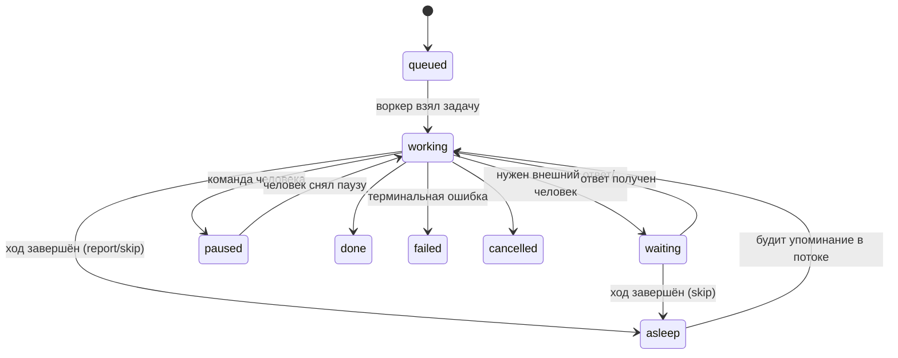

# 11. State Management

## Зачем это нужно?

Агент выполняет долгую задачу (например, развёртывание приложения), и сервер перезагружается. Задача теряется, пользователь ждёт, но ничего не происходит. Без управления состоянием вы не сможете:
- Продолжить выполнение после сбоя
- Гарантировать идемпотентность (повторный вызов не создаёт дубликатов)
- Обрабатывать ошибки с retry
- Устанавливать дедлайны для долгих задач

State Management — это то, что делает долгоживущие агенты надёжными. Без него задачи на минуты и часы быстро разваливаются.

### Реальный кейс

**Ситуация:** Агент развёртывает приложение. Процесс занимает 10 минут. На 8-й минуте сервер перезагружается.

**Проблема:** Задача теряется. Пользователь не знает, что произошло. При повторном запуске агент начинает с начала, создавая дубликаты.

**Решение:** Сохранение состояния в БД, идемпотентность операций, retry с backoff и дедлайны. Теперь агент продолжит с места остановки, а повторные вызовы не создадут дубликаты.

> **Junior employee model.** Идемпотентность и checkpoint'ы для агента — это автоматизация привычки «не нажимать кнопку второй раз, не убедившись, что первое нажатие не сработало». Retry с backoff = «подождать и аккуратно повторить, а не долбить как робот». У человека этот тормоз встроен (психологически больно повторять разрушающее действие), у агента его нет — поэтому ставим в код. См. [Предисловие → Ментальная модель](../00-preface/README.md#ментальная-модель-агент-это-новый-сотрудник) и [Гл. 17: Security и Governance](../17-security-and-governance/README.md).

## Теория простыми словами

### Что такое State Management?

State Management — это сохранение состояния агента между перезапусками. Это позволяет:
- Продолжить выполнение после сбоя
- Отслеживать прогресс задачи
- Гарантировать идемпотентность

### Что такое идемпотентность?

Идемпотентность — это свойство операции: повторный вызов даёт тот же результат, что и первый. Например, "создать файл" не идемпотентно (создаст дубликат), а "создать файл, если его нет" — идемпотентно.

### Связь с Planning

State Management тесно связан с [Planning](../10-planning-and-workflows/README.md), но фокусируется на надёжности выполнения, а не на декомпозиции задач. Planning создаёт план, State Management гарантирует его надёжное выполнение.

## Как это работает (пошагово)

### Шаг 0: Состояние agent run и артефакты вне контекста

В примерах ниже мы храним состояние "задачи" (`Task`). В прод-агенте полезен отдельный контракт **agent run**: цель, ограничения (HITL-политика), бюджет и план. Упрощённо:

```json
{
  "goal": "Развернуть сервис X в staging",
  "constraints": {
    "human_in_the_loop": { "required_for_risk_levels": ["write_local", "external_action"] }
  },
  "budget": { "max_steps": 20, "max_wall_time_ms": 300000, "max_llm_tokens": 200000 },
  "plan": ["Проверить текущий статус", "Собрать конфиг", "Применить изменения", "Проверить снова"]
}
```

Важно: это **не** часть контекста LLM. Состояние персистентно в БД, отдельно от истории сообщений, и попадает в контекст только явно — как обычные сообщения.

**Артефакты — вне контекста.** Дампы, логи, длинные выводы команд хранятся в файле или БД, а в историю идёт только путь/ID и короткая выдержка:

```go
type Artifact struct {
    ID      string // "art_123"
    Path    string // /var/agent/artifacts/art_123.log
    Summary string // "nginx error log, 48 KB; выдержка — первые 20 строк"
    Bytes   int64
}
```

Легитимный предел, который стоит ставить, — бюджет на размер **одного tool-результата** (в проде ~128 KB): превышение → обрезка или вынос в артефакт. А вот «фильтрация релевантного состояния» скорингом внутри контекста — антипаттерн: какую часть истории оставить, решает конденсация ([Глава 13](../13-context-engineering/README.md)), а не ручной скоринг фактов.

### Шаг 1: Структура задачи с состоянием

Создайте структуру для хранения состояния задачи:

```go
type TaskState string

const (
    TaskPending   TaskState = "pending"
    TaskRunning   TaskState = "running"
    TaskCompleted TaskState = "completed"
    TaskFailed    TaskState = "failed"
)

type Task struct {
    ID        string    `json:"id"`
    UserInput string    `json:"user_input"`
    State     TaskState `json:"state"`
    Result    string    `json:"result,omitempty"`
    Error     string    `json:"error,omitempty"`
    CreatedAt time.Time `json:"created_at"`
    UpdatedAt time.Time `json:"updated_at"`
}
```

### Шаг 2: Идемпотентность операций

Проверяйте, не выполнялась ли задача уже:

```go
func executeTask(ctx context.Context, store *TaskStore, id string) error {
    // Загружаем задачу из хранилища
    task, exists := store.Get(id)
    if !exists {
        return fmt.Errorf("task not found: %s", id)
    }
    
    // Проверяем идемпотентность
    if task.State == TaskCompleted {
        return nil // Уже выполнено, ничего не делаем
    }
    
    // Устанавливаем состояние "running"
    task.State = TaskRunning
    store.Save(task)
    
    // Выполняем задачу...
    result, err := doWork(task.UserInput)
    
    if err != nil {
        task.State = TaskFailed
        task.Error = err.Error()
    } else {
        task.State = TaskCompleted
        task.Result = result
    }
    
    store.Save(task)
    
    return err
}
```

### Шаг 3: Retry с экспоненциальным backoff

Транзиентные ошибки (сеть, лимиты API) ретраит сам LLM-клиент — экспоненциальным backoff с jitter; классификация ошибок и реализация показаны в [Главе 04](../04-autonomy-and-loops/README.md). Здесь достаточно контракта:

```go
// executeWithRetry повторяет fn при транзиентной ошибке.
// Терминальные ошибки (лимит итераций, дедлайн) возвращаются сразу — их не ретраят.
func executeWithRetry(ctx context.Context, fn func() error, maxRetries int) error
```

Планирование и ретраи не отменяют границ: дедлайн на весь run и лимит итераций — терминальные, их превышение останавливает ход с сообщением человеку (см. FSM ниже).

### Шаг 4: Дедлайны

Установите timeout для всего agent run и для каждого шага:

```go
func runAgentWithDeadline(ctx context.Context, agent *Agent, userInput string) (string, error) {
    // Дедлайн для всего agent run (5 минут)
    ctx, cancel := context.WithDeadline(ctx, time.Now().Add(5*time.Minute))
    defer cancel()
    
    // ... agent loop ...
    
    for i := 0; i < maxIterations; i++ {
        // Проверяем дедлайн перед каждой итерацией
        select {
        case <-ctx.Done():
            return "", fmt.Errorf("deadline exceeded")
        default:
        }
        
        // ... выполнение ...
    }
}
```

### Шаг 5: Сохранение состояния

Сохраняйте состояние задачи после каждого значимого изменения. В учебных примерах ниже — в памяти процесса; в проде — SQLite или любая другая БД (см. раздел [Store](#store-database-backed-хранение) ниже):

```go
type TaskStore struct {
    mu    sync.RWMutex
    tasks map[string]*Task
}

func (s *TaskStore) Save(task *Task) {
    s.mu.Lock()
    defer s.mu.Unlock()
    task.UpdatedAt = time.Now()
    s.tasks[task.ID] = task
}

func (s *TaskStore) Get(id string) (*Task, bool) {
    s.mu.RLock()
    defer s.mu.RUnlock()
    task, exists := s.tasks[id]
    return task, exists
}
```

### Память: линейная история + condense

Отдельного слоя «working memory» в агенте нет — это пережиток старых фреймворков. Память агента — это **линейная история сообщений**: текущая задача, план, прочитанные файлы и последние действия уже находятся в ней. При переполнении контекста работает конденсация: старые сообщения сжимаются в краткое резюме, последние остаются как есть.

Персистентность — это сохранение самой истории (чекпоинты, см. ниже): после рестарта агент загружает историю и продолжает, не перечитывая файлы и не теряя план. Как устроены condense и долговременная память — [Главы 12](../12-agent-memory/README.md) и [13](../13-context-engineering/README.md).

### Шаг 6: Возобновление выполнения

Продолжайте выполнение задачи после сбоя:

```go
func resumeTask(ctx context.Context, store *TaskStore, taskID string) error {
    task, exists := store.Get(taskID)
    if !exists {
        return fmt.Errorf("task not found: %s", taskID)
    }
    
    // Если задача уже завершена, ничего не делаем
    if task.State == TaskCompleted {
        return nil
    }
    
    // Если задача упала, можно повторить
    if task.State == TaskFailed {
        task.State = TaskPending
        store.Save(task)
    }
    
    // Продолжаем выполнение
    return executeTask(taskID)
}
```

## Где это встраивать в нашем коде

### Точка интеграции 1: Agent Loop

> **Примечание:** лаба lab04 переведена на нейтральный клиент; канонический материал — в этой главе.

В [`labs/lab04-autonomy/main.go`](https://github.com/kshvakov/ai-agent-course/blob/main/translations/ru/labs/lab04-autonomy/main.go) добавьте сохранение состояния:

```go
store := &TaskStore{tasks: map[string]*Task{}}

// В начале agent run:
task := &Task{
    ID:        generateTaskID(),
    UserInput: userInput,
    State:     TaskRunning,
    CreatedAt: time.Now(),
}
store.Save(task)

// После завершения:
task.State = TaskCompleted
task.Result = finalAnswer
store.Save(task)
```

### Точка интеграции 2: Tool Execution

> **Примечание:** лаба lab02 переведена на нейтральный клиент; канонический материал — в этой главе.

В [`labs/lab02-tools/main.go`](https://github.com/kshvakov/ai-agent-course/blob/main/translations/ru/labs/lab02-tools/main.go) добавьте retry для инструментов:

```go
func executeToolWithRetry(ctx context.Context, toolCall ToolCall) (string, error) {
    var result string
    err := executeWithRetry(ctx, func() error {
        var err error
        result, err = executeTool(toolCall)
        return err
    }, 3)
    return result, err
}
```

## Мини-пример кода

> **Примечание:** лаба lab04 переведена на нейтральный клиент; канонический материал — в этой главе.

Полный пример с workflow и state management на базе [`labs/lab04-autonomy/main.go`](https://github.com/kshvakov/ai-agent-course/blob/main/translations/ru/labs/lab04-autonomy/main.go). Клиент LLM — нейтральный (`llm.Client`): retry транзиентных ошибок уже внутри клиента, здесь мы управляем только состоянием и границами:

```go
package main

import (
    "context"
    "fmt"
    "sync"
    "time"
)

type TaskState string

const (
    TaskPending   TaskState = "pending"
    TaskRunning   TaskState = "running"
    TaskCompleted TaskState = "completed"
    TaskFailed    TaskState = "failed"
)

type Task struct {
    ID        string    `json:"id"`
    UserInput string    `json:"user_input"`
    State     TaskState `json:"state"`
    Result    string    `json:"result,omitempty"`
    Error     string    `json:"error,omitempty"`
    CreatedAt time.Time `json:"created_at"`
    UpdatedAt time.Time `json:"updated_at"`
}

type TaskStore struct {
    mu    sync.RWMutex
    tasks map[string]*Task
}

func (s *TaskStore) Save(task *Task) {
    s.mu.Lock()
    defer s.mu.Unlock()
    task.UpdatedAt = time.Now()
    s.tasks[task.ID] = task
}

func (s *TaskStore) Get(id string) (*Task, bool) {
    s.mu.RLock()
    defer s.mu.RUnlock()
    task, exists := s.tasks[id]
    return task, exists
}

var tools = map[string]func() string{
    "check_disk": func() string { return "Disk usage: 95%, large folder: /var/log" },
    "clean_logs": func() string { return "Logs cleaned, freed 20 GB" },
}

func main() {
    // Дедлайн на весь agent run — терминальная граница
    ctx, cancel := context.WithDeadline(context.Background(), time.Now().Add(5*time.Minute))
    defer cancel()

    userInput := "У меня кончилось место. Разберись."

    store := &TaskStore{tasks: map[string]*Task{}}
    task := &Task{
        ID:        fmt.Sprintf("task-%d", time.Now().UnixNano()),
        UserInput: userInput,
        State:     TaskRunning,
        CreatedAt: time.Now(),
    }
    store.Save(task)

    agent := NewAgent(llm.ClientFromEnv())

    const maxIterations = 5
    for i := 0; i < maxIterations; i++ {
        select {
        case <-ctx.Done():
            task.State, task.Error = TaskFailed, "deadline exceeded"
            store.Save(task)
            return
        default:
        }

        // Одна итерация: вызов LLM + выполнение tool calls
        reply, err := agent.Step(ctx, userInput)
        if err != nil {
            task.State, task.Error = TaskFailed, err.Error()
            store.Save(task)
            return
        }

        if reply.Done { // модель ответила текстом — задача завершена
            task.State, task.Result = TaskCompleted, reply.Text
            store.Save(task)
            fmt.Println("AI:", reply.Text)
            return
        }
    }

    // Лимит итераций — тоже терминальная ошибка
    task.State, task.Error = TaskFailed, "iteration limit exceeded"
    store.Save(task)
}
```

Обратите внимание: дедлайн и лимит итераций завершают задачу со статусом `failed` и сообщением человеку — никакой логики «повезёт на шестой попытке».

## Store: Database-backed хранение

В примерах выше состояние живёт в памяти процесса. Для учебных целей это работает, но в продакшене так нельзя.

### Почему память процесса — не продакшен

1. **Перезагрузка = потеря.** Состояние умирает вместе с процессом.
2. **Нет конкурентного доступа.** Два инстанса агента не могут безопасно работать с одними задачами.
3. **Нет запросов.** Чтобы найти все незавершённые задачи, нужно перебрать всё.

Базы данных решают все три проблемы. PostgreSQL — надёжный выбор для продакшена. SQLite — хороший вариант для локальной разработки и одиночного инстанса.

### StateStore: интерфейс хранилища

Отделяем интерфейс от реализации. Это позволяет подменять хранилище в тестах и менять его без переписывания логики агента.

```go
// StateStore — контракт хранения состояния агента.
// Реализация может использовать PostgreSQL, SQLite или in-memory хранилище.
type StateStore interface {
    Save(ctx context.Context, task *Task) error
    Get(ctx context.Context, id string) (*Task, error)
    ListByState(ctx context.Context, state TaskState) ([]*Task, error)
}
```

### Реализация на PostgreSQL

```go
type PgStateStore struct {
    db *sql.DB
}

func NewPgStateStore(dsn string) (*PgStateStore, error) {
    db, err := sql.Open("pgx", dsn)
    if err != nil {
        return nil, fmt.Errorf("connect to postgres: %w", err)
    }
    return &PgStateStore{db: db}, nil
}

func (s *PgStateStore) Save(ctx context.Context, task *Task) error {
    // UPSERT: вставляем новую задачу или обновляем существующую
    query := `
        INSERT INTO agent_tasks (id, user_input, state, result, error, created_at, updated_at)
        VALUES ($1, $2, $3, $4, $5, $6, now())
        ON CONFLICT (id) DO UPDATE SET
            state      = EXCLUDED.state,
            result     = EXCLUDED.result,
            error      = EXCLUDED.error,
            updated_at = now()`

    _, err := s.db.ExecContext(ctx, query,
        task.ID, task.UserInput, task.State,
        task.Result, task.Error, task.CreatedAt,
    )
    return err
}

func (s *PgStateStore) Get(ctx context.Context, id string) (*Task, error) {
    task := &Task{}
    err := s.db.QueryRowContext(ctx,
        `SELECT id, user_input, state, result, error, created_at, updated_at
         FROM agent_tasks WHERE id = $1`, id,
    ).Scan(
        &task.ID, &task.UserInput, &task.State,
        &task.Result, &task.Error,
        &task.CreatedAt, &task.UpdatedAt,
    )
    if errors.Is(err, sql.ErrNoRows) {
        return nil, nil
    }
    return task, err
}

func (s *PgStateStore) ListByState(ctx context.Context, state TaskState) ([]*Task, error) {
    rows, err := s.db.QueryContext(ctx,
        `SELECT id, user_input, state, result, error, created_at, updated_at
         FROM agent_tasks WHERE state = $1 ORDER BY created_at`, state,
    )
    if err != nil {
        return nil, err
    }
    defer rows.Close()

    var tasks []*Task
    for rows.Next() {
        t := &Task{}
        if err := rows.Scan(
            &t.ID, &t.UserInput, &t.State,
            &t.Result, &t.Error,
            &t.CreatedAt, &t.UpdatedAt,
        ); err != nil {
            return nil, err
        }
        tasks = append(tasks, t)
    }
    return tasks, rows.Err()
}
```

### Транзакции для атомарных обновлений

Когда агент выполняет шаг, нужно обновить состояние атомарно. Если шаг упал — состояние не должно измениться.

```go
func (s *PgStateStore) ExecuteStep(ctx context.Context, taskID string, stepFn func(*Task) error) error {
    tx, err := s.db.BeginTx(ctx, nil)
    if err != nil {
        return fmt.Errorf("begin tx: %w", err)
    }
    defer tx.Rollback()

    // SELECT ... FOR UPDATE блокирует запись на время выполнения шага.
    // Другой агент не сможет изменить эту задачу параллельно.
    task := &Task{}
    err = tx.QueryRowContext(ctx,
        `SELECT id, user_input, state, result, error, created_at, updated_at
         FROM agent_tasks WHERE id = $1 FOR UPDATE`, taskID,
    ).Scan(
        &task.ID, &task.UserInput, &task.State,
        &task.Result, &task.Error,
        &task.CreatedAt, &task.UpdatedAt,
    )
    if err != nil {
        return fmt.Errorf("lock task: %w", err)
    }

    // Выполняем бизнес-логику шага
    if err := stepFn(task); err != nil {
        return fmt.Errorf("step failed: %w", err)
    }

    // Сохраняем обновлённое состояние внутри транзакции
    _, err = tx.ExecContext(ctx,
        `UPDATE agent_tasks SET state=$1, result=$2, error=$3, updated_at=now() WHERE id=$4`,
        task.State, task.Result, task.Error, task.ID,
    )
    if err != nil {
        return fmt.Errorf("save state: %w", err)
    }

    return tx.Commit()
}
```

Шаг либо выполнится полностью, либо откатится. Промежуточного «половинного» состояния не будет.

## MCP для состояния

Model Context Protocol (MCP) позволяет выставить состояние агента наружу как стандартизированные ресурсы: один агент записывает прогресс, другой читает по URI и продолжает работу — без собственного API для каждого хранилища. Это имеет смысл в [мульти-агентных системах](../07-multi-agent/README.md), где несколько агентов делят одно состояние; для одиночного агента достаточно `StateStore` из этой главы. Подробно о MCP — в [Главе 18: Протоколы Инструментов и Tool Servers](../18-tool-protocols-and-servers/README.md).

## Артефакты вне контекста (вместо «динамического выбора состояния»)

Агент накапливает артефакты: логи, результаты команд, промежуточные данные. Со временем их объём превышает контекстное окно LLM. Отправить всё — модель потеряет фокус; не отправлять ничего — не сможет принять решение.

**Антипаттерн — «Dynamic Context»:** вручную скорить известные факты и артефакты («приоритет 1: артефакты текущего шага, приоритет 2: последние факты») и собирать из них срез контекста на каждом шаге. Это скрытая логика в обход модели: её нельзя протестировать, она конфликтует с конденсацией и молча ломается при смене контекстного окна.

**Рабочий подход:**

- Большие артефакты хранятся **вне** истории — в файле или БД; в контекст идёт путь/ID + короткая выдержка (см. `Artifact` в «Шаге 0»).
- Бюджет ставится на размер **одного tool-результата** (~128 KB в проде): превышение → обрезка или вынос в артефакт.
- Что остаётся в истории при переполнении контекста — решает конденсация, а не ручной скоринг ([Глава 13](../13-context-engineering/README.md)).

Об управлении размером контекста и стоимостью — [Глава 20: Cost & Latency Engineering](../20-cost-latency-engineering/README.md).

## Продвинутые стратегии Checkpoint

Базовая реализация Checkpoint (структура, сохранение/загрузка, интеграция с agent loop) описана в [Главе 09: Анатомия Агента](../09-agent-architecture/README.md#checkpoint-и-resume-сохранение-и-восстановление). Здесь мы рассматриваем продвинутые стратегии для продакшена.

### Когда сохранять: гранулярность Checkpoint

Checkpoint — это снимок состояния, к которому можно вернуться. Частота сохранений — компромисс между надёжностью и производительностью:

| Стратегия | Когда сохраняем | Плюс | Минус |
|-----------|----------------|------|-------|
| `every_step` | После каждого tool call | Минимальная потеря прогресса | Много записей в БД |
| `every_iteration` | После каждой итерации цикла | Баланс надёжности и I/O | Теряем промежуточные шаги |
| `on_state_change` | Только при смене состояния | Минимум I/O | Теряем прогресс внутри состояния |

### CheckpointManager

```go
type CheckpointStrategy string

const (
    CheckpointEveryStep      CheckpointStrategy = "every_step"
    CheckpointEveryIteration CheckpointStrategy = "every_iteration"
    CheckpointOnStateChange  CheckpointStrategy = "on_state_change"
)

type CheckpointManager struct {
    store    StateStore
    strategy CheckpointStrategy
    maxAge   time.Duration // Максимальный возраст Checkpoint
    maxCount int           // Сколько Checkpoint хранить на задачу
}

// MaybeSave сохраняет Checkpoint, если текущий триггер совпадает со стратегией.
func (cm *CheckpointManager) MaybeSave(
    ctx context.Context,
    task *Task,
    trigger CheckpointStrategy,
) error {
    if trigger != cm.strategy {
        return nil // Не наш триггер — пропускаем
    }
    return cm.store.Save(ctx, task)
}
```

### Валидация перед возобновлением

Нельзя слепо возобновлять задачу из Checkpoint. Checkpoint может устареть, а состояние — оказаться некорректным.

```go
// ValidateAndResume загружает Checkpoint и проверяет его пригодность.
func (cm *CheckpointManager) ValidateAndResume(ctx context.Context, taskID string) (*Task, error) {
    task, err := cm.store.Get(ctx, taskID)
    if err != nil {
        return nil, fmt.Errorf("load checkpoint: %w", err)
    }
    if task == nil {
        return nil, fmt.Errorf("checkpoint not found: %s", taskID)
    }

    // Проверка 1: Checkpoint не устарел
    age := time.Since(task.UpdatedAt)
    if age > cm.maxAge {
        return nil, fmt.Errorf("checkpoint expired: age %v exceeds max %v", age, cm.maxAge)
    }

    // Проверка 2: состояние допускает возобновление
    switch task.State {
    case TaskCompleted:
        return task, nil // Уже завершено, повторное выполнение не нужно
    case TaskRunning, TaskFailed:
        return task, nil // Можно возобновить
    default:
        return nil, fmt.Errorf("cannot resume from state: %s", task.State)
    }
}
```

### Ротация Checkpoint

Checkpoint накапливаются. Без очистки они занимают место и усложняют восстановление. Ротация оставляет только последние N Checkpoint и удаляет устаревшие.

```go
// Cleanup удаляет устаревшие Checkpoint, оставляя maxCount последних.
func (cm *CheckpointManager) Cleanup(ctx context.Context, taskID string) (int64, error) {
    result, err := cm.store.(*PgStateStore).db.ExecContext(ctx,
        `DELETE FROM agent_checkpoints
         WHERE task_id = $1
           AND created_at < $2
           AND id NOT IN (
               SELECT id FROM agent_checkpoints
               WHERE task_id = $1
               ORDER BY created_at DESC
               LIMIT $3
           )`,
        taskID, time.Now().Add(-cm.maxAge), cm.maxCount,
    )
    if err != nil {
        return 0, fmt.Errorf("cleanup checkpoints: %w", err)
    }
    return result.RowsAffected()
}
```

Хорошая практика — запускать ротацию после каждого успешного сохранения или по расписанию.

## FSM автономного хода

Прод-боты, которые живут в чате или трекере часами, не крутят agent loop бесконечно. Задача (issue, тикет, сообщение) проходит конечный автомат состояний:

| Состояние | Что происходит |
|-----------|----------------|
| `queued` | Задача поставлена, ждёт воркера |
| `working` | Идёт agent loop: модель, инструменты, шаги плана |
| `waiting` | Ход приостановлен: ждём внешний ответ или человека |
| `paused` | Липкая пауза по команде человека; переживает рестарт |
| `asleep` | Ход завершён (отчёт отправлен или пропущен), задача «слушает» поток |
| `done` / `failed` / `cancelled` | Терминальные состояния — из них не выходят |



Ключевые правила:

- **«Свобода внутри хода, границы снаружи».** Внутри хода (`working`) агент свободен: сам строит план, вызывает инструменты, пересматривает шаги. Снаружи — жёсткие границы: **дедлайн на ход (~1 час)** и **лимит итераций**. Их превышение — терминальная ошибка: ход завершается со статусом `failed` и сообщением человеку, а не «ещё одна попытка».
- **`waiting` ≠ `paused`.** `waiting` — агент сам ждёт ответа (HTTP-колбэк, подтверждение человека) и продолжит автоматически. `paused` — стоп-команда человека; выйти из паузы может только человек.
- **`asleep` — задача слушает поток.** Ход завершён, отчёт отправлен (или помечен skip), но задача продолжает следить за чатом: новая реплика, где задачу **упомянули**, будит её — начинается новый ход `working`. Без упоминания задача спит и не тратит токены.
- **Ack-после-персиста.** Входящее событие подтверждается доставщику **только после** успешного сохранения состояния и истории в БД. Если процесс упал до персиста — событие не подтверждено и доедет повторно; поэтому операции должны быть идемпотентны (см. выше). Недоставленный ответ доезжает следующим ходом — задача не теряет его в `waiting`/`asleep`.
- Состояние FSM хранится в том же `StateStore`, что и задачи, и переживает рестарты процесса.

## Типовые ошибки

### Ошибка 1: Нет идемпотентности

**Симптом:** Повторный вызов создаёт дубликаты (например, создаёт два файла вместо одного).

**Причина:** Операции не проверяют, не выполнялись ли они уже.

**Решение:**
```go
// ПЛОХО
func createFile(filename string) error {
    os.WriteFile(filename, []byte("data"), 0644)
    return nil
}

// ХОРОШО
func createFileIfNotExists(filename string) error {
    if _, err := os.Stat(filename); err == nil {
        return nil // Уже существует
    }
    return os.WriteFile(filename, []byte("data"), 0644)
}
```

### Ошибка 2: Нет retry при ошибках

**Симптом:** Агент падает при первой же временной ошибке (network error, timeout).

**Причина:** Нет повторных попыток при ошибках.

**Решение:**
```go
// ПЛОХО
result, err := executeTool(toolCall)
if err != nil {
    return "", err // Сразу возвращаем ошибку
}

// ХОРОШО
err := executeWithRetry(func() error {
    result, err := executeTool(toolCall)
    return err
}, 3)
```

### Ошибка 3: Нет дедлайнов

**Симптом:** Агент зависает навсегда, пользователь ждёт.

**Причина:** Нет timeout для операций.

**Решение:**
```go
// ПЛОХО
resp, _ := agent.Step(ctx, input)
// Может зависнуть навсегда

// ХОРОШО
ctx, cancel := context.WithDeadline(ctx, time.Now().Add(5*time.Minute))
defer cancel()
resp, err := agent.Step(ctx, input)
```

### Ошибка 4: Состояние не сохраняется

**Симптом:** После перезапуска агент начинает с начала, теряя прогресс.

**Причина:** Состояние хранится только в памяти.

**Решение:**
```go
// ПЛОХО
var taskState = "running" // Только в памяти

// ХОРОШО
task.State = TaskRunning
store.Save(task) // Сохраняем в БД
```

### Ошибка 5: Потеря истории между сессиями

**Симптом:** Агент перечитывает файлы, которые уже читал в прошлой сессии. План задачи потерян. Прогресс не сохранён.

**Причина:** История сообщений живёт только в оперативной памяти. При перезапуске — теряется.

**Решение:** Персистите саму историю — линейную историю сообщений вместе с конденсатом, а не выдуманный слой «working memory»:

```go
// ХОРОШО: история + конденсат сохраняются и восстанавливаются
func handleSession(ctx context.Context, sessionID string) {
    history := loadHistory(sessionID) // из БД
    defer saveHistory(sessionID, history)
    agent.Run(ctx, history)
}
```

## Мини-упражнения

### Упражнение 1: Реализуйте retry с backoff

Реализуйте функцию выполнения с retry:

```go
func executeWithRetry(fn func() error, maxRetries int) error {
    // Ваш код здесь
    // Повторяйте вызов с экспоненциальным backoff
}
```

**Ожидаемый результат:**
- Функция повторяет вызов при ошибке
- Используется экспоненциальный backoff (1s, 2s, 4s...)
- Функция возвращает ошибку после исчерпания retries

### Упражнение 2: Реализуйте идемпотентность

Создайте функцию, которая проверяет, не выполнялась ли задача уже:

```go
func executeTaskIfNotDone(taskID string) error {
    // Ваш код здесь
    // Проверяйте состояние задачи перед выполнением
}
```

**Ожидаемый результат:**
- Если задача уже выполнена, функция возвращает nil без выполнения
- Если задача не выполнена, функция выполняет её и сохраняет состояние

## Критерии сдачи / Чек-лист

**Сдано (готовность к прод):**
- [x] Реализована идемпотентность операций (повторный вызов не создаёт дубликатов)
- [x] Реализованы retries с экспоненциальным backoff
- [x] Установлены дедлайны для agent run и отдельных операций
- [x] Состояние задачи сохраняется между перезапусками
- [x] Можно продолжить выполнение задачи после сбоя
- [x] Понимаете FSM автономного хода: working/waiting/paused/asleep, ack-после-персиста

**Не сдано:**
- [ ] Нет идемпотентности
- [ ] Нет retry при ошибках
- [ ] Нет дедлайнов
- [ ] Состояние не сохраняется
- [ ] Потеря истории между сессиями (нет чекпоинтов истории)

## Связь с другими главами

- **[Глава 04: Автономность и Циклы](../04-autonomy-and-loops/README.md)** — Базовый цикл агента
- **[Глава 10: Planning и Workflow-паттерны](../10-planning-and-workflows/README.md)** — State Management гарантирует надёжное выполнение планов
- **[Глава 19: Observability и Tracing](../19-observability-and-tracing/README.md)** — Логирование состояния задач
- **[Глава 20: Cost & Latency Engineering](../20-cost-latency-engineering/README.md)** — Контроль стоимости долгих задач

## Что дальше?

После понимания state management переходите к:
- **[12. Системы Памяти Агента](../12-agent-memory/README.md)** — Узнайте, как агенты запоминают и извлекают информацию


